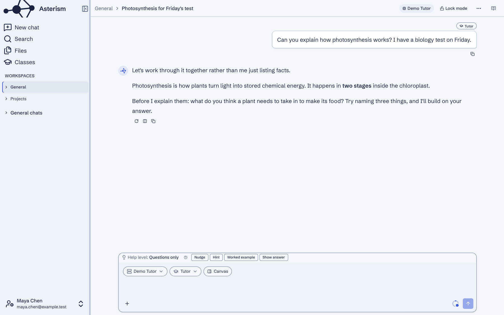

# Asterism

[](https://github.com/dbracewell/Asterism/actions/workflows/ci.yml)

Asterism is a self-hosted AI assistant for learning. A school, a class or a team
runs it on their own server, connects the language models they choose, and gets
a chat workspace built to help people learn rather than just hand them answers.



## What it does

- **Chat with the models you choose.** Connect OpenAI or any OpenAI-compatible
  server, pick a model per chat, compare two or three side by side, and branch a
  conversation without losing anything. Replies keep streaming if you close the tab.
- **Work from your own material.** Upload notes, PDFs, documents and images to one
  library and group them in projects. Answers cite the passages they used, and you
  can ask Asterism to check an answer's claims against your files.
- **Learn, not just get answers.** Learning modes change how the assistant helps:
  Tutor guides with questions and gives stronger hints only when asked, Explain-back checks your
  explanation, Review my work comments on your attempt, Spot the error hides a
  mistake for you to find, Draft feedback assesses writing against a rubric, and
  Research assistant helps with sources and outlines but writes no prose.
- **Study.** Turn a project's files into flashcards with spaced-repetition review,
  practice quizzes with feedback, summaries and exam study plans, and follow your
  progress.
- **Run a class.** Educators invite students, publish a course that each student
  gets their own copy of, limit which learning modes it allows, and see which topics the
  class finds hard, from class totals that students opt into.
- **Shape your assistant.** Write instructions for your main agent, add sub-agents
  with their own models and tools, save skills, prompt templates and rubrics, and
  share a whole setup as a team pack. A canvas holds long documents and code, and
  image generation creates pictures in chat.
- **Run it for a group.** One container with one storage volume. Admins manage
  accounts and groups, decide which models and tools each group may use, set token
  budgets, see usage and cost, and back up and restore while it runs.

Planned work, such as sandboxed code execution, is tracked in [`todo.md`](todo.md).

## Quick start with Docker

You need Docker with Compose and an API key for OpenAI or an OpenAI-compatible
server.

```bash
git clone https://github.com/dbracewell/Asterism.git
cd Asterism
docker run --rm -it --user "$(id -u):$(id -g)" -v "$PWD:/out" ghcr.io/dbracewell/asterism:<version> setup
```

The setup command asks for the address people will open (press Enter for
`http://localhost:3000` to try it on your own machine) and any reverse proxy. It
generates the three secrets and writes `.env`. In a checkout with Node.js,
`pnpm configure` does the same. It prints the admin passphrase you need next and
never replaces an existing `.env`. Then start it:

```bash
docker compose pull
docker compose up -d
docker compose ps    # wait until it says "healthy"
```

This runs the published image, `ghcr.io/dbracewell/asterism`, for amd64 and arm64
(under 1 GB to download). On first start Asterism also downloads the model it
uses to search files. To build from source instead, see
[Building from source](docs/deployment.md#building-from-source).

Open <http://localhost:3000> and create the administrator account with the admin
passphrase the setup command printed, then follow the setup in the app.

To run Asterism for real users, behind HTTPS with backups, follow the
[deployment guide](docs/deployment.md).

## Local development

You need Node.js 22.13+, pnpm 11+, Python 3.13+ (with SQLite 3.45+), uv and
mprocs 0.9.6+.

```bash
pnpm install
pnpm --filter @asterism/backend sync
cp .env.example .env    # set the three secrets and an absolute STORAGE_ROOT
mkdir -p <your STORAGE_ROOT>
pnpm --filter @asterism/frontend migrate:db
pnpm --filter @asterism/backend init:db
pnpm dev
```

Open <http://localhost:3000>. The [development guide](docs/development.md) covers
the configuration check, running each app on its own, resetting local data and
the checks CI runs.

## Documentation

| If you want to…                                                | Read                                                                                    |
| -------------------------------------------------------------- | --------------------------------------------------------------------------------------- |
| Learn to use Asterism, as a student, educator or administrator | [User guide](docs/guide/README.md)                                                      |
| Run Asterism for real users                                    | [Deployment guide](docs/deployment.md)                                                  |
| Check an image, or report a vulnerability                      | [Verify the image](docs/deployment.md#verify-the-image), [security policy](SECURITY.md) |
| Set up a development environment and run the checks            | [Development guide](docs/development.md)                                                |
| Understand how the system is built                             | [Architecture guides](docs/architecture/README.md)                                      |
| Know why it is built that way                                  | [Architecture decision records](docs/adr/)                                              |
| See what is being worked on                                    | [`todo.md`](todo.md) and [epics](docs/epics/)                                           |

## License

Asterism is licensed under the [Apache License, Version 2.0](LICENSE).
Copyright 2026 David Bracewell.
