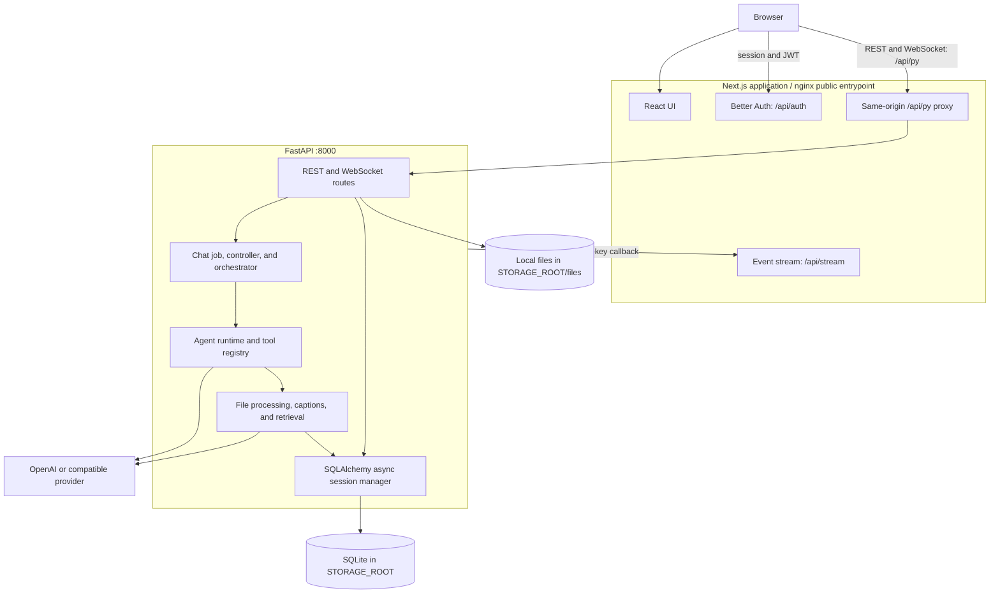

# Asterism Architecture Documentation

This directory documents the architecture implemented in the Asterism monorepo.
Asterism is a self-hosted AI chat application with a Next.js frontend, FastAPI
backend, one main configuration per user and project-selected sub-agents, reconnectable streamed
responses, full-text chat search, and user-owned file attachments.

## Document index

| Document                                                                            | Scope                                                                                           |
| ----------------------------------------------------------------------------------- | ----------------------------------------------------------------------------------------------- |
| [System overview](overview.md)                                                      | Topology, workspace layout, request, streaming, and chat-job lifecycle                          |
| [Authentication and security](auth-and-security.md)                                 | Better Auth, JWT/JWKS verification, tenancy, and internal callbacks                             |
| [Chat and WebSocket](chat-and-websocket.md)                                         | Bidirectional chat protocol, reconnectable jobs, queues, cancellation, and controller lifecycle |
| [Agent runtime](agent-runtime.md)                                                   | Bounded LLM loop, event stream, delegation, and traces                                          |
| [Tool authorization](tool-authorization.md)                                         | Allowlist and interactive approval policies, child-agent boundaries                             |
| [LLM providers](llm-providers.md)                                                   | OpenAI and OpenAI-compatible provider configuration and capabilities                            |
| [Data and storage](data-and-storage.md)                                             | SQLite schema, FTS search, message tree, local file storage, and attachments                    |
| [Knowledge retrieval](knowledge-retrieval.md)                                       | File-owned processing, scoped LanceDB retrieval, and image captioning                           |
| [File knowledge processing](file-knowledge-processing.md)                           | Upload-to-artifact pipeline, embeddings, captions, jobs, and lifecycle guarantees               |
| [ADR-0016: Memory resource contracts](../adr/adr-0016-memory-resource-contracts.md) | Process-lifetime state inventory, ownership, bounds, and remediation plan                       |

Additional guides:

- [Frontend layout, themes, and product surface](frontend-and-themes.md): current
  theme ownership, scrolling constraints, unfinished settings and known trust gaps.
- [2026-10-17 codebase review](../reviews/2026-10-17-codebase-review.md) and
  [quality roadmap](../plans/post-refactor-quality-roadmap.md): architecture/UI
  findings, verification evidence and pending EPIC-31–EPIC-35.

- [Execution context and module boundaries](execution-context.md): trace project/chat
  readers into Agent, RuntimeFileReader, and RetrievalService.
- [Project and chat workspaces](project-workspaces.md): settings, membership UI,
  attachment scopes, model picker, and selection/error states.
- [Context provenance and memory isolation](context-isolation.md): replay ceilings,
  content-free audit, historical information limits, and future memory keys.
- [Development initialization and reset](development-reset.md): relational, source,
  vector cleanup, model-bundle retention, and isolated verification.
- [ADR-0017](../adr/0017-project-file-and-chat-boundaries.md): current accepted
  project/file/chat/configuration/execution decisions.

## Current deployment topology

## Design boundaries

- **Same-origin browser traffic:** the browser uses `/api/py` for FastAPI HTTP,
  WebSocket, and OpenAPI traffic. Next.js supplies the local-development proxy;
  nginx supplies the equivalent route in the combined container.
- **Authentication boundary:** Better Auth owns sessions and signing keys. FastAPI
  validates bearer and WebSocket JWTs against the frontend's loopback JWKS endpoint.
- **Capability boundary:** configured ordinary capabilities, admin policy, explicit
  model support, and live context derive effective tool schemas. Main-agent calls
  can require interactive approval within this boundary; delegated tools use the
  child's allowlist. Internal search/delegation are context managed, without user
  toggles. Approval cannot expand capabilities or file scope.
- **Persistence boundary:** SQLAlchemy manages the relational store; uploaded bytes
  pass through the `FileStore` protocol, whose current implementation is
  `LocalFileStore`.
- **Knowledge boundary:** each source file owns its processed generations;
  project/chat references resolve into the live execution file scope. Runtime
  retrieval rechecks authorization and artifact freshness before release. LanceDB accepts only owner- and allowed-file-filtered searches.
- **Provider boundary:** the runtime uses the OpenAI SDK. Supported configurations
  are canonical OpenAI and a generic OpenAI-compatible HTTP(S) endpoint. Captioning
  is disabled by default; when enabled it uses either the admin-selected discovered
  vision model or a pinned, manifest-verified local bundle.

## Code entry points

- Backend app: [`asterism.main:app`](../../apps/backend/asterism/main.py)
- Backend lifespan: [`asterism.core.lifespan:lifespan`](../../apps/backend/asterism/core/lifespan.py)
- Chat jobs and transport: [`ChatJobManager`](../../apps/backend/asterism/domains/chat/jobs.py) and [`ChatController`](../../apps/backend/asterism/domains/chat/controller.py)
- Agent loop: [`Agent`](../../apps/backend/asterism/domains/agent/agent.py)
- Knowledge runtime: [`runtime.py`](../../apps/backend/asterism/domains/extraction/runtime.py)
- Tool registry: [`tool_registry`](../../apps/backend/asterism/domains/tools/registry.py)
- Frontend chat hook: [`useChatWebSocket`](../../apps/frontend/src/features/chat/hooks/use-chat-websocket.tsx)
