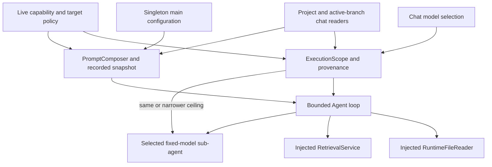

# Agent runtime and execution lifecycle

Each user has one model-free main-agent configuration. Chats use that configuration
and independently persist a selected model. Sub-agent definitions each bind exactly
one model; projects explicitly select eligible owned definitions, and the main-agent
configuration holds a separate General chat set that General chats delegate to
([ADR-0059](../adr/0059-general-chat-delegation.md)). Persona/profile defaults are a separate product invariant and do
not select or replace the main-agent configuration.

## Configuration and model identity

`GET/PUT /settings/user/main-agent` reads/updates instructions, ordinary capabilities,
loop limits, and supported generation defaults. The main row cannot be independently
created, deleted, or converted to a sub-agent. User provisioning and the singleton
main row share a transaction; database constraints enforce role/model consistency.

`/agents/sub-agents` lists/creates separately owned definitions, and
`/agents/sub-agents/{agent_id}` updates/deletes them. A definition requires a fixed
model binding. Disabled models keep their identity and display unavailability.
Provider/model deletion cannot silently rebind a definition; restrictive foreign
keys require explicit removal or rebinding first.

`GET /chat/models` supplies the authenticated catalog. Model changes use
`PUT /chat/{chat_id}/model` with `expected_model_revision`, and draft model changes
use `PUT /chat/drafts/{draft_id}/model`. A user default model only prefills the
picker. Updates and send acceptance check revisions and reject unavailable models;
changes are blocked during active work. Historical assistant messages retain the
actual model/provider used even after the chat selection changes.

## Runtime composition

[Execution context](execution-context.md) traces the domain boundary into Agent and
RetrievalService. The chat composition root resolves the recorded configuration,
model, active branch, project instructions, file ceiling, target ceiling, and
internal tool policy. Agent receives those values plus injected live file and
retrieval providers. It does not query project/file memberships itself.

## Composable prompts

[PromptComposer](../../apps/backend/asterism/domains/agent/prompts.py) composes unique
layers in this order:

| Layer      | Authority and source                                                                   |
| ---------- | -------------------------------------------------------------------------------------- |
| `platform` | Mandatory platform rules and capability restrictions                                   |
| `agent`    | Versioned main or delegated role/instructions                                          |
| `profile`  | Accepted persona USER.md constraints; separate from memory                             |
| `mode`     | Pinned server-owned learning-mode instructions; main-agent only                        |
| `project`  | Project task instructions and context revision, when applicable                        |
| `skills`   | Explicit ordered, pinned skill instructions; main-agent only                           |
| `runtime`  | Server-authorized tool names and eligible target metadata; bounded to 8,000 characters |

Agent role and explicit profile constraints remain authoritative; project text
refines the task within them. User requests, files, retrieved excerpts, and forwarded
conversation are untrusted task data. Prompt order and instructions cannot grant
capabilities, delegation, or file access; executable authorization enforces them.

Estimation, main execution, delegation, and replay use the shared composition path.
Private `PromptSnapshot` stores replay inputs; public `PromptProvenance` records
composer revision plus source IDs/revisions/digests without instruction text.
Project edits affect new turns/regeneration; resume uses its existing snapshot
with current access rechecks. The profile layer uses the accepted persona snapshot
and records `user_profile_id` plus its source revision. Default changes and edits
affect new turns; regeneration explicitly captures current settings. Delegates
inherit the same recorded persona. Private immutable `chat_executions` records
preserve historical prompts, while public metadata contains identity and digests.
Skills retain the source turn's pinned snapshots during regeneration as well as
resume; changes require explicit accepted selection/refresh. Live owner, assignment
and admin-policy checks run before generation and provider output. Delegates do
not inherit parent activations. See the [skills contract](skills.md).
See [ADR-0021](../adr/0021-personas-and-execution-binding.md).
The `mode` layer uses the turn's pinned learning-mode snapshot; resume replays it,
and regeneration captures the chat's current selection. It outranks project and
skill text but not the persona. Delegates do not receive it. See
[ADR-0028](../adr/0028-learning-mode-layer.md). Modes with tiered hints append
the turn's branch hint level to the layer; see
[ADR-0029](../adr/0029-branch-local-hint-levels.md).

## Bounded loop and streaming

```mermaid
stateDiagram-v2
    [*] --> Bind: Validate model and execution identity
    Bind --> Stream: Compose inputs and authorized tools
    Stream --> Check: Accumulate text and tool calls
    Check --> Approve: Tool calls requested
    Approve --> Invoke: Reject unauthorized calls; execute approved calls
    Invoke --> Stream: Append results while steps remain
    Check --> Finish: Stop reason or step limit
    Finish --> [*]: Persist assistant execution and usage
```

The loop is bounded by configuration `max_steps` (default 5). On the final step,
tool schemas are stripped so the model can produce a final answer. Models receive
tools only with explicit `supports_tools=True`. Vision bytes similarly require
`supports_vision=True`; unknown capability values do not grant access.

The OpenAI-compatible LLM adapter accumulates streamed tool-call fragments, emits
content/thinking deltas, and applies bounded transient retries. Tagged textual
tool calls from compatible endpoints still enter normal authorization. Approved
tools may execute concurrently; approval never grants capabilities outside the
current effective allowlist. See [tool authorization](tool-authorization.md).

Agent events include `START`, `DELTA`, `TOOL_CALL`, `COMPLETE`, `ERROR`, and
`SUB_AGENT`. The chat layer maps them to socket packets and persists actual model,
provider, configuration, prompt provenance, token usage, and context provenance.
Provider-reported usage is authoritative; UI context estimates are advisory.

## Selected delegation: projects and the General set

A chat's delegation scope comes from where it is, read live: a project chat uses
its project's selections, any other chat uses the main agent's General chat set.
`DelegationScope.project_id` is `None` for the General set, and
`context_revision` is then the set's own revision. Both sources follow the same
rules below; moving a chat between them refuses delegation until a new turn.

`GET/PUT /settings/user/main-agent/general-sub-agents` reads or replaces the
ordered General set under `expected_revision`. A new user's set is empty, saving
the same list keeps the revision, and deleting a definition removes it and bumps
the revision. Capability entries say which source granted a target
(`project_selection` or `general_selection`), and sub-agent traces store
`delegation_scope`.

New projects select no targets. `/projects/{project_id}/sub-agent-candidates`
lists owned candidates, and `/projects/{project_id}/sub-agents` reads/updates the
selected set under `expected_context_revision`. No-op membership changes preserve
the revision. Selected definitions must still be owned, model-available,
and eligible when advertised, invoked, and used during execution.

The runtime catalog includes only eligible selected targets, excluding the caller.
The child inherits the same file ceiling and can only narrow internal tool scope.
Its ordinary capabilities come from its own configuration intersected with active
admin policy; they need not duplicate the parent's ordinary capabilities.

`sub_agent` checks the call stack for cycles and bounds recursion with
`MAX_SUB_AGENT_DEPTH` (default 3). It forwards bounded caller notes, file metadata,
and recent parent history as untrusted data, not authoritative system instructions.
The default history window is 10 messages and 4,000 estimated tokens; the combined
forwarded block is token-bounded. No sibling-chat history is fetched.

The child uses `AllowlistApprovalPolicy`, so its authorized tools execute without
nested interactive prompts. Live checks cancel/reject work after deselection,
project or General set revision/identity changes, configuration/model revocation,
or cancellation;
an in-flight silent child is polled rather than allowed to complete unchecked.
See [context isolation](context-isolation.md) for source ceilings and history limits.

Each forwarded child event is wrapped in a `SubAgentEventEnvelope` and sent as a
`sub_agent` socket packet. Besides `execution_id`, `sub_agent_id`,
`sub_agent_name`, `depth` and the child `event`, it carries:

- `parent_execution_id`: the delegating sub-agent's execution, or null when the
  main agent delegated. A child agent receives its own execution id as
  `delegation_execution_id`, and the tool registry passes it to that child's own
  tool calls as `ToolContext.caller_execution_id`.
- `model_id` and `model_name`: the fixed binding that ran, taken from the child's
  execution scope. The name is null until the child resolves its model, so a
  model-lookup failure leaves it null.

These are display fields for the delegation graph only. They grant nothing, and
authorization stays with the live checks above.

The orchestrator's `DelegationCollector` (`domains/chat/delegations.py`) folds a
step's envelopes into one `DelegationRecord` per execution. A record holds
identity, parent, model name, depth, status, start/end time in milliseconds, the
child's tool calls and results (from its per-step `COMPLETE` events), and its
output or error. The records are drained onto the assistant message that step
persists (`Message.delegations`), so each record belongs to the step that ran it.

- A run that never sent a terminal event is stored as `error`.
- On cancel, in-flight records are stored as `cancelled`. The partial assistant
  message is kept even when no text had streamed.
- Thinking, prompts and forwarded parent context are never stored.
- Records live in the owner's chat and are deleted with it. The audit trail stays
  in `sub_agent_traces` (digests only).

### Run usage and cost (US-54.1)

Each main-agent model call persists as one assistant message with its
provider-reported `input_tokens`/`output_tokens`. Each `DelegationRecord` adds
`steps` (one `UsageStep` per child `COMPLETE` event) and the child model's
`model_id`, `provider_type` and `pricing`, taken from the resolved model.

Admins may set optional `pricing` per model (`ModelPricing`: US dollars per
million input and output tokens, both or neither; edited only through
`PUT /app/providers/{id}/models/{model_id}`, kept by provider saves and catalog
refreshes). It is snapshotted at execution time: into `ChatModelChoice.pricing`
on the main execution when the turn is accepted, and into delegation records
when the child resolves its model. Usage views read only these recorded values, so
later price edits never rewrite past runs.

The chat footer of a turn's final step sums the turn's steps
(`features/chat/lib/run-usage.ts`). Models without prices show tokens only, and
a cost that leaves out unpriced steps is marked partial. Steps on a ChatGPT plan
(`provider_type = chatgpt`) show "ChatGPT plan" instead of dollars. Opening the
summary breaks totals down per agent and per model call.

### Capability manifest (US-54.2)

Each agent run records a `CapabilityManifest` (`agent/capabilities.py`). It
lists the run's tools, skills, sub-agents and files. Each entry names the grants
that allowed it: agent assignment, admin policy, model tool support, project
selection, chat attachment, chat skill selection, or files in scope. Tools also
record whether the user is asked before each call. `chat/capabilities.py`
builds it from the results of the same authorization that started the run:
`resolve_effective_tools`, the accepted skills, the scope's file provenance and
the eligible delegation targets. It only adds grant reasons and display names.

- **Main agent:** captured in `build_execution_provenance` when the turn is
  accepted and stored as `MessageExecution.capabilities`. Resume reuses it;
  regeneration records a new one. Tools on the chat's `allowed_tools` run
  without asking, and the rest ask first.
- **Sub-agents:** captured after the child resolves its tools, before its first
  event. The manifest rides on the next forwarded `SubAgentEventEnvelope`, and
  `DelegationCollector` stores it on the `DelegationRecord`. Sub-agents never
  receive skills, and their own assigned tools run without asking. If capture
  fails, the delegation continues and its record has no manifest.
- **Single-step agents:** an agent limited to one step never gets tools, so its
  manifest lists none.

The manifest is a record only. It grants nothing, and live authorization still
rechecks every call. The chat footer's "Capabilities" dialog shows the recorded
manifests and never recomputes them from current settings.
`features/chat/lib/capability-manifest.ts` supplies the dialog's data. MCP
servers are not implemented yet, so manifests have no MCP entries.

### Context inspector (US-54.3)

Each persisted assistant step records a `ContextManifest`
(`agent/context_manifest.py`) of what the model was given. It holds references
and reasons only, never content:

- **Layers:** kind, source id, revision, digest and length of each prompt layer
  (platform, agent, persona, learning mode, project, skills, runtime), taken
  from the run's prompt snapshot.
- **Compaction:** the stored summary that replaced the start of the branch, if
  any: record id, anchor message, replaced message count and summary length.
- **Template:** the provenance of the template that built the user turn, if any.
- **Files:** each attached file on the branch and whether it was included as
  text, as an image, or not at all, with the reason.
- **Chunks:** the file, chunk id, generation and score of each passage that
  `search_knowledge` returned in that step, and whether its excerpt was cut.
- **Omissions:** runtime details cut at `RUNTIME_MAX_CHARS`
  (`PromptSnapshot.runtime_truncated`), a search that returned nothing and why,
  and matches dropped once the result byte budget ran out
  (`RetrievalResponse.omitted_for_budget`; `RetrievalHit.truncated` marks a
  clipped excerpt).

The orchestrator builds the manifest from what it actually sent:
`_assemble_agent_messages` reports file inclusion, and `chat/context_manifest.py`
adds each step's chunks. Sub-agents record their layers and any cuts to the
forwarded parent context: older chat messages left out, or the block shortened
or dropped to fit its token budget. The manifest rides on the first forwarded
envelope, and `DelegationCollector` adds the child's chunks as its steps
complete.

Layer text stays in the immutable execution record. Only the chat owner can read
it, through `GET /chat/{chat_id}/messages/{message_id}/context/layers`, which
also returns the text of the step's compaction summary, if any. Any other
user, and any user turn, gets a 404. Sub-agent layer text is not stored, so the
inspector shows only which layers a sub-agent used.

The chat footer's "Context" dialog fetches the layer text only when opened.
Retrieved excerpts come from the step's persisted tool results and render as
untrusted plain text. File names come from the scope-checked file-info query.

### Context compaction (US-69.1)

Before each main-agent run, after prompt assembly, the orchestrator estimates
the request (system prompt, history, tool schemas, image allowance, reserved
output). If it exceeds `compaction.threshold` (default 0.8) of the run model's
context window, or of `compaction.fallback_context_window` when the window is
unknown, it compacts first (`chat/compaction.py`). See
[ADR-0060](../adr/0060-context-compaction.md).

- A `chat_compactions` record summarizes the branch from the root through an
  anchor message. It applies to any branch containing the anchor, so siblings,
  forks and regenerations from before the anchor never see it. Assembly uses
  the deepest applicable record: a labelled user-role summary message, then the
  messages after the anchor.
- Anchors sit before a user turn. The last `compaction.tail_turns` user turns
  (default 3) stay verbatim; if the request still exceeds the threshold, only
  the current turn is kept.
- The summarizer is the run's model unless the admin sets `compaction.model_id`.
  Large transcripts are folded in chunks. Usage is stored on the record.
- The summary is untrusted and grants nothing. Prompt layers come from the
  snapshot as before. Messages are never deleted.
- If compaction fails, or the request still exceeds the full window, the run
  emits an error and sends no model request; the turn stays pending.
- Sub-agent runs are not compacted.

### Fork from a step (US-54.5)

A delegation node's "Fork from here" re-runs a finished run from that
delegation, with that sub-agent's instructions changed for this run only. See
[ADR-0038](../adr/0038-fork-from-a-delegation-step.md).

- `GET /chat/{chat_id}/messages/{message_id}/fork/instructions` (owner only)
  returns the starting text: the source run's own fork override for that
  sub-agent, otherwise the definition's current instructions. For a nested
  delegation it also names the top-level delegation that runs again.
- `POST /chat/{chat_id}/messages/{message_id}/fork` (`chat/forks.py`) adds a
  pending sibling of the source step and makes it active. The new step keeps the
  source step's model output, the other calls' results, and their delegation
  records (marked `reused`). It gets a copy of the source run's execution
  record with `MessageExecution.fork` (public digests) and the private override
  text on `chat_executions.instruction_overrides`. The client then sends
  `resume`.
- Running the step takes the resume path: recorded inputs with live rechecks.
  `Agent.run(replay=...)` re-runs only the forked top-level `sub_agent` call,
  reuses the recorded results, then continues with the steps left in the main
  agent's budget. The override reaches every delegation of that sub-agent
  through `ExecutionScope.instruction_overrides`. `sub_agent` refuses it if the
  definition's revision changed since the fork.
- Delegation records carry `tool_call_id`, `reused` and
  `instructions_overridden`. Usage totals leave reused records out.
- Saving the instructions to the definition is a separate action:
  `PUT /agents/sub-agents/{agent_id}/instructions` with the expected revision.

### Run diff (US-54.6)

Two runs on different branches can be compared: comparison columns ("Diff
answers" under a comparison), and a turn whose branch was regenerated, edited
or forked ("Diff branches" in its meta line, against the branches beside its
first fork point).

`GET /chat/{chat_id}/messages/{message_id}/run` (owner only, `chat/runs.py`)
returns the recorded run a message belongs to, on that message's own branch: the
user turn, then its steps back from the message and onward along its active
chain. `features/chat/lib/run-diff.ts` compares two runs from their records
only: a word-level diff of the final answers (line-level, then whole-text, for
long answers), agents and their models, tool calls by name, usage totals and
capability-manifest entries. Answers render as plain untrusted text.

## Resume, regeneration, and audit

Each invocation has an execution UUID. Delegated events also include target ID,
name, and depth, so repeated/concurrent calls remain distinguishable. Child results
feed the parent response while delegated progress renders separately.

A private pending execution survives reconnect/restart as persisted data. Resume
reuses its configuration, model, prompt, file/target ceilings, and execution identity;
it does not continue an interrupted provider connection. A revoked or changed model
fails explicitly. Regeneration validates current selection and captures a new
snapshot without changing earlier turns' model labels.

Delegated traces persist content-free task/context/result digests, message roles,
status, timing, token/step counts, and prompt/context provenance. They exclude raw
task text, parent notes, message bodies, tool results, and generated answers. Normal
owned chat history and authorized retrieval responses remain content-bearing.

No active long-term memory store or automatic cross-chat summary retrieval is
implemented. Namespace/key types define a future isolation boundary; they do not
authorize reads. See [memory limits](context-isolation.md) and
[chat transport](chat-and-websocket.md).
