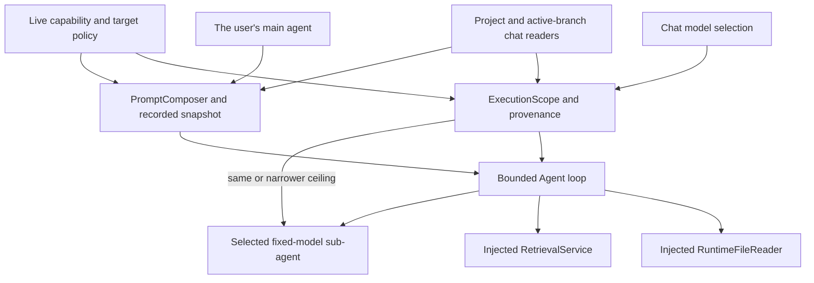

# Agent runtime

This guide explains the agent loop: how a configured agent and a chosen model
turn into a bounded run that streams text, calls tools and delegates to
sub-agents, and what each run records. Read it before changing the loop,
delegation, compaction or the records the chat footer shows.

Each user has one model-free main-agent configuration. Chats use that configuration
and independently persist a selected model. Sub-agent definitions each bind exactly
one model; projects explicitly select eligible owned definitions, and the main-agent
configuration holds a separate General chat set that General chats delegate to
([ADR-0059](../adr/0059-general-chat-delegation.md)). The user's About you text is
separate and does not select or replace the main-agent configuration.

## Configuration and model identity

`GET/PUT /settings/user/main-agent` reads/updates instructions, ordinary capabilities,
loop limits, and supported generation defaults. The main row cannot be independently
created, deleted, or converted to a sub-agent. User provisioning and the singleton
main row share a transaction; database constraints enforce role/model consistency.

`/agents/sub-agents` lists/creates separately owned definitions, and
`/agents/sub-agents/{agent_id}` updates/deletes them. A definition requires a fixed
model binding. Disabled models keep their identity and display unavailability.
Provider/model deletion cannot silently rebind a definition; restrictive foreign
keys require explicit removal or rebinding first.

`GET /chat/models` supplies the authenticated catalog. Model changes use
`PUT /chat/{chat_id}/model` with `expected_model_revision`, and draft model changes
use `PUT /chat/drafts/{draft_id}/model`. A user default model only prefills the
picker. Updates and send acceptance check revisions and reject unavailable models;
changes are blocked during active work. Historical assistant messages retain the
actual model/provider used even after the chat selection changes.

## Runtime composition

[Execution context](execution-context.md) traces the domain boundary into Agent and
RetrievalService. The chat composition root resolves the recorded configuration,
model, active branch, project instructions, execution file scope, delegation set, and
internal tool policy. Agent receives those values plus injected live file and
retrieval providers. It does not query project/file memberships itself.

## Prompts and what a run records

The [execution context guide](execution-context.md#what-a-turn-is-made-of) lists
the prompt layers and where each comes from. Here it matters how they are kept.

Each run stores a private `PromptSnapshot` with the layers' text, so a replay can
send exactly what was sent before, and a public `PromptProvenance` with only the
composer revision and each source's ID, revision and digest. Both live in the
immutable `chat_executions` record. Chat responses carry the provenance, never the
text.

- **Project, agent and mode edits** affect new turns and regenerations. Resume
  uses the snapshot, with live access checks.
- **About you, skills and the learning mode** are pinned on the user's message
  ([execution context](execution-context.md#about-you-on-a-turn)). Regenerate keeps
  the pinned skills but reads the current About you text and mode. Live owner,
  assignment and admin-policy checks run before generation.
- **Memories** ([ADR-0078](../adr/0078-long-term-memory.md)) are chosen and pinned
  on the user's message when memory is on. The recorded run keeps only their ids
  and revisions; each run adds the memory layer from the pins, minus any deleted
  since, after rechecking availability. Regenerate chooses again.
- **Sub-agents** inherit the recorded About you and memory layers but not the mode or the
  parent's skills ([skills](skills.md), [learning modes](learning-modes.md)).

## Bounded loop and streaming

```mermaid
stateDiagram-v2
    [*] --> Bind: Validate model and execution identity
    Bind --> Stream: Compose inputs and authorized tools
    Stream --> Check: Accumulate text and tool calls
    Check --> Approve: Tool calls requested
    Approve --> Invoke: Reject unauthorized calls; execute approved calls
    Invoke --> Stream: Append results while steps remain
    Check --> Finish: Stop reason or step limit
    Finish --> [*]: Persist assistant execution and usage
```

The loop is bounded by configuration `max_steps` (default 5). On the final step,
tool schemas are stripped so the model can produce a final answer. Models receive
tools only with explicit `supports_tools=True`. Vision bytes similarly require
`supports_vision=True`; unknown capability values do not grant access.

The OpenAI-compatible LLM adapter accumulates streamed tool-call fragments, emits
content/thinking deltas, and applies bounded transient retries. Tagged textual
tool calls from compatible endpoints still enter normal authorization. Approved
tools may execute concurrently; approval never grants capabilities outside the
current effective allowlist. See [tool authorization](tool-authorization.md).

Live authorization (`authorization_check`: skills, sub-agent target)
runs at the start of the run and of each loop step, when the provider stream
starts, and on each completed step before it is recorded or its tools run. It
does not run per text or thinking delta, since each check reads the database;
a revocation mid-stream stops the turn at that step's completion.

Agent events include `START`, `DELTA`, `TOOL_CALL`, `COMPLETE`, `ERROR`, and
`SUB_AGENT`. The chat layer maps them to socket packets and persists actual model,
provider, configuration, prompt provenance, token usage, and context provenance.
Provider-reported usage is authoritative; UI context estimates are advisory.

## Delegation: projects and the General chat set

A chat's delegation scope comes from where it is, read live: a project chat uses
its project's selections, any other chat uses the main agent's General chat set.
`DelegationScope.project_id` is `None` for the General chat set, and
`context_revision` is then the set's own revision. Both sources follow the same
rules below; moving a chat between them refuses delegation until a new turn.

`GET/PUT /settings/user/main-agent/general-sub-agents` reads or replaces the
ordered General chat set under `expected_revision`. A new user's set is empty, saving
the same list keeps the revision, and deleting a definition removes it and bumps
the revision. Capability entries say which source granted a target
(`project_selection` or `general_selection`), and sub-agent traces store
`delegation_scope`.

New projects select no targets. `/projects/{project_id}/sub-agent-candidates`
lists owned candidates, and `/projects/{project_id}/sub-agents` reads/updates the
selected set under `expected_context_revision`. No-op membership changes preserve
the revision. Selected definitions must still be owned, model-available,
and eligible when advertised, invoked, and used during execution.

The runtime catalog includes only eligible selected targets, excluding the caller.
The child inherits the same execution file scope and can only narrow internal tool scope.
Its ordinary capabilities come from its own configuration intersected with active
admin policy; they need not duplicate the parent's ordinary capabilities.

`sub_agent` checks the call stack for cycles and bounds recursion with the
`max_sub_agent_depth` setting (default 3). It forwards bounded caller notes, file metadata,
and recent parent history as untrusted data, not authoritative system instructions.
The default history window is 10 messages and 4,000 estimated tokens; the combined
forwarded block is token-bounded. No sibling-chat history is fetched.

The child uses `AllowlistApprovalPolicy`, so its authorized tools execute without
nested interactive prompts. Live checks cancel/reject work after deselection,
project or General chat set revision/identity changes, configuration/model revocation,
or cancellation;
an in-flight silent child is polled rather than allowed to complete unchecked.
Child text deltas are rechecked at most once per poll interval; every other child
event is checked before it is forwarded.
See [context isolation](context-isolation.md) for source ceilings and history limits.

Each forwarded child event is wrapped in a `SubAgentEventEnvelope` and sent as a
`sub_agent` socket packet. Besides `execution_id`, `sub_agent_id`,
`sub_agent_name`, `depth` and the child `event`, it carries:

- `parent_execution_id`: the delegating sub-agent's execution, or null when the
  main agent delegated. A child agent receives its own execution id as
  `delegation_execution_id`, and the tool registry passes it to that child's own
  tool calls as `ToolContext.caller_execution_id`.
- `model_id` and `model_name`: the fixed binding that ran, taken from the child's
  execution scope. The name is null until the child resolves its model, so a
  model-lookup failure leaves it null.

These are display fields for the delegation graph only. They grant nothing, and
authorization stays with the live checks above.

The orchestrator's `DelegationCollector` (`domains/chat/delegations.py`) folds a
step's envelopes into one `DelegationRecord` per execution. A record holds
identity, parent, model name, depth, status, start/end time in milliseconds, the
child's tool calls and results (from its per-step `COMPLETE` events), and its
output or error. The records are drained onto the assistant message that step
persists (`Message.delegations`), so each record belongs to the step that ran it.

- A run that never sent a terminal event is stored as `error`.
- On cancel, in-flight records are stored as `cancelled`. The partial assistant
  message is kept even when no text had streamed.
- Thinking, prompts and forwarded parent context are never stored.
- Records live in the owner's chat and are deleted with it. The audit trail stays
  in `sub_agent_traces` (digests only).

### Run usage and cost

Each main-agent model call is stored as one assistant message with the
`input_tokens` and `output_tokens` the provider reported. Each `DelegationRecord`
adds `steps` (one `UsageStep` per child `COMPLETE` event) and the child model's
`model_id`, `provider_type` and `pricing`.

Prices are copied onto the run when it uses a model: into `ChatModelChoice.pricing`
for the main execution when the turn is accepted, and into the delegation record
when the child resolves its model. So later price edits never change what a past
run cost. The admin sets prices per model
([LLM providers](llm-providers.md#model-pricing)).

The chat footer of a turn's last step adds up its steps
(`features/chat/lib/run-usage.ts`). Models without prices show tokens only, a cost
that leaves out unpriced steps is marked partial, and steps on a ChatGPT plan show
"ChatGPT plan" instead of dollars. Opening the summary breaks the totals down per
agent and per model call.

Separately, every model call, including titles, captions, study tools and images,
is written to the usage ledger, which drives usage views and group budgets
([ADR-0073](../adr/0073-usage-ledger-and-budgets.md)).

### Capability manifest

Each agent run records a `CapabilityManifest` (`agent/capabilities.py`). It
lists the run's tools, skills, sub-agents and files. Each entry names the grants
that allowed it: agent assignment, admin policy, model tool support, project
selection, chat attachment, chat skill selection, or files in scope. Tools also
record whether the user is asked before each call. `chat/capabilities.py`
builds it from the results of the same authorization that started the run:
`resolve_effective_tools`, the accepted skills, the scope's file provenance and
the eligible delegation targets. It only adds grant reasons and display names.

- **Main agent:** captured in `build_execution_provenance` when the turn is
  accepted and stored as `MessageExecution.capabilities`. Resume reuses it;
  regeneration records a new one. Tools on the chat's `allowed_tools` run
  without asking, and the rest ask first.
- **Sub-agents:** captured after the child resolves its tools, before its first
  event. The manifest rides on the next forwarded `SubAgentEventEnvelope`, and
  `DelegationCollector` stores it on the `DelegationRecord`. Sub-agents never
  receive skills, and their own assigned tools run without asking. If capture
  fails, the delegation continues and its record has no manifest.
- **Single-step agents:** an agent limited to one step never gets tools, so its
  manifest lists none.

The manifest is a record only. It grants nothing, and live authorization still
rechecks every call. The chat footer's "Capabilities" dialog shows the recorded
manifests and never recomputes them from current settings.
`features/chat/lib/capability-manifest.ts` supplies the dialog's data. MCP
servers are not implemented yet, so manifests have no MCP entries.

### Context inspector

Each persisted assistant step records a `ContextManifest`
(`agent/context_manifest.py`) of what the model was given. It holds references
and reasons only, never content:

- **Layers:** kind, source id, revision, digest and length of each prompt layer
  (platform, agent, About you, learning mode, task, project, skills, runtime), taken
  from the run's prompt snapshot.
- **Compaction:** the stored summary that replaced the start of the branch, if
  any: record id, anchor message, replaced message count and summary length.
- **Template:** the provenance of the template that built the user turn, if any.
- **Files:** each attached file on the branch and whether it was included as
  text, as an image, or not at all, with the reason.
- **Chunks:** the file, chunk id, generation and score of each passage that
  `search_knowledge` returned in that step, and whether its excerpt was cut.
- **Omissions:** runtime details cut at `RUNTIME_MAX_CHARS`
  (`PromptSnapshot.runtime_truncated`), a search that returned nothing and why,
  and matches dropped once the result byte budget ran out
  (`RetrievalResponse.omitted_for_budget`; `RetrievalHit.truncated` marks a
  clipped excerpt).

The orchestrator builds the manifest from what it actually sent:
`_assemble_agent_messages` reports file inclusion, and `chat/context_manifest.py`
adds each step's chunks. Sub-agents record their layers and any cuts to the
forwarded parent context: older chat messages left out, or the block shortened
or dropped to fit its token budget. The manifest rides on the first forwarded
envelope, and `DelegationCollector` adds the child's chunks as its steps
complete.

Layer text stays in the immutable execution record. Only the chat owner can read
it, through `GET /chat/{chat_id}/messages/{message_id}/context/layers`, which
also returns the text of the step's compaction summary, if any. Any other
user, and any user turn, gets a 404. Sub-agent layer text is not stored, so the
inspector shows only which layers a sub-agent used.

The chat footer's "Context" dialog fetches the layer text only when opened.
Retrieved excerpts come from the step's persisted tool results and render as
untrusted plain text. File names come from the scope-checked file-info query.

### Context compaction

Before each main-agent run, after prompt assembly, the orchestrator estimates
the request (system prompt, history, tool schemas, image allowance, reserved
output). If it exceeds `compaction.threshold` (default 0.8) of the run model's
context window, or of `compaction.fallback_context_window` when the window is
unknown, it compacts first (`chat/compaction.py`). See
[ADR-0060](../adr/0060-context-compaction.md).

- A `chat_compactions` record summarizes the branch from the root through an
  anchor message. It applies to any branch containing the anchor, so siblings,
  forks and regenerations from before the anchor never see it. Assembly uses
  the deepest applicable record: a labelled user-role summary message, then the
  messages after the anchor.
- Anchors sit before a user turn. The last `compaction.tail_turns` user turns
  (default 3) stay verbatim; if the request still exceeds the threshold, only
  the current turn is kept.
- The summarizer is the run's model unless the admin sets `compaction.model_id`.
  Large transcripts are folded in chunks. Usage is stored on the record.
- The summary is untrusted and grants nothing. Prompt layers come from the
  snapshot as before. Messages are never deleted.
- If compaction fails, or the request still exceeds the full window, the run
  emits an error and sends no model request; the turn stays pending.
- Sub-agent runs are not compacted.
- "Compact now" is the `compact` socket command. It summarizes all but
  the verbatim tail regardless of usage, inside the chat's work slot. Progress is
  reported as `compaction` packets; the transcript draws a divider after each
  anchor from the chat's `compactions`.
- Admins edit the policy in Admin Settings → Context compaction
  (`GET/PUT /settings/app/compaction`); a dedicated summarizer must be an active
  model of an admin-managed provider.

### Fork from a step

A delegation node's "Fork from here" re-runs a finished run from that
delegation, with that sub-agent's instructions changed for this run only. See
[ADR-0038](../adr/0038-fork-from-a-delegation-step.md).

- `GET /chat/{chat_id}/messages/{message_id}/fork/instructions` (owner only)
  returns the starting text: the source run's own fork override for that
  sub-agent, otherwise the definition's current instructions. For a nested
  delegation it also names the top-level delegation that runs again.
- `POST /chat/{chat_id}/messages/{message_id}/fork` (`chat/forks.py`) adds a
  pending sibling of the source step and makes it active. The new step keeps the
  source step's model output, the other calls' results, and their delegation
  records (marked `reused`). It gets a copy of the source run's execution
  record with `MessageExecution.fork` (public digests) and the private override
  text on `chat_executions.instruction_overrides`. The client then sends
  `resume`.
- Running the step takes the resume path: recorded inputs with live rechecks.
  `Agent.run(replay=...)` re-runs only the forked top-level `sub_agent` call,
  reuses the recorded results, then continues with the steps left in the main
  agent's budget. The override reaches every delegation of that sub-agent
  through `ExecutionScope.instruction_overrides`. `sub_agent` refuses it if the
  definition's revision changed since the fork.
- Delegation records carry `tool_call_id`, `reused` and
  `instructions_overridden`. Usage totals leave reused records out.
- Saving the instructions to the definition is a separate action:
  `PUT /agents/sub-agents/{agent_id}/instructions` with the expected revision.

### Run diff

Two runs on different branches can be compared: comparison columns ("Diff
answers" under a comparison), and a turn whose branch was regenerated, edited
or forked ("Diff branches" in its meta line, against the branches beside its
first fork point).

`GET /chat/{chat_id}/messages/{message_id}/run` (owner only, `chat/runs.py`)
returns the recorded run a message belongs to, on that message's own branch: the
user turn, then its steps back from the message and onward along its active
chain. `features/chat/lib/run-diff.ts` compares two runs from their records
only: a word-level diff of the final answers (line-level, then whole-text, for
long answers), agents and their models, tool calls by name, usage totals and
capability-manifest entries. Answers render as plain untrusted text.

## Grounded answers

Three features help a user judge an answer. None of them edits it, and those that
read files use only the answer's recorded file scope, through `RetrievalService`.

- **Claim citations.** The model may mark a claim with an `asterism-cite:` token
  pointing at a passage its run retrieved. The server resolves each token against
  that run's results and the chat's current files; anything else renders as an
  unavailable citation ([ADR-0040](../adr/0040-claim-level-citations.md)).
  A citation or source chip opens the file's page with `?passage=<chunk_id>`;
  the page reads the whole passage and its place in the file from
  `GET /chat/{chat_id}/files/{file_id}/passages/{chunk_id}`, which rechecks the
  chat's live file scope. A link's passage id grants nothing, and a chunk gone
  since re-processing returns 404.
- **Verify.** `POST /chat/{chat_id}/messages/{message_id}/verify` lists up to 12
  claims in a finished answer and labels each `supported`, `contradicted` or
  `unsupported` from the user's files, within a 120-second budget, on a model the
  user chooses. It never edits the answer
  ([ADR-0041](../adr/0041-verify-pass.md)).
- **Disagreements.** For a comparison, or for a step whose sub-agents returned
  conflicting results, one model call lists where the answers disagree and points
  back to each one, without choosing a winner. It compares two or three comparison
  columns, or up to six delegation outputs
  ([ADR-0042](../adr/0042-disagreement-display.md)).

## Resume, regeneration, and audit

Each invocation has an execution UUID. Delegated events also include target ID,
name, and depth, so repeated/concurrent calls remain distinguishable. Child results
feed the parent response while delegated progress renders separately.

A private pending execution survives reconnect/restart as persisted data. Resume
reuses its configuration, model, prompt, file/target ceilings, and execution identity;
it does not continue an interrupted provider connection. A revoked or changed model
fails explicitly. Regeneration validates current selection and captures a new
snapshot without changing earlier turns' model labels.

A turn that ends in an error (an agent `ERROR` event, an empty model response, or
an unhandled exception) is finalized like a cancellation, so resume never re-runs
it. The orchestrator records a `failed` assistant step with any streamed
output and the error text under the step it was answering, then marks the request
`failed`. A failed fork step is recorded `failed` with its finished results. The
client gets a `complete` packet with the recorded messages and then the `error`
packet. A comparison column that fails shows `failed`, and later columns still run.
Failed steps with no output are left out of later model history.

Delegated traces persist content-free task/context/result digests, message roles,
status, timing, token/step counts, and prompt/context provenance. They exclude raw
task text, parent notes, message bodies, tool results, and generated answers. Normal
owned chat history and authorized retrieval responses remain content-bearing.

Long-term memories are read only through the turn's pins, never by search at
run time, and no automatic cross-chat summary retrieval is implemented.
The main agent in an ordinary conversation can call the internal `propose_memory`
tool when memory is available for the chat and the model supports tools; sub-agents
and drafting chats never get it. A call records a pending `memory_proposals` row
anchored to the run (at most one per run) and returns only its id; nothing reaches
`memories` until the person saves it, which rechecks ownership, the chat's project
and availability. Memory vectors are a cache of the rows: each start rebuilds any
missing or stale vector in the background and drops vectors without a memory, so a
restored backup or a memory saved while the embedding model was down catches up.
Namespace/key types define the isolation boundary; they do not authorize reads. See [memory limits](context-isolation.md) and
[chat transport](chat-and-websocket.md).
