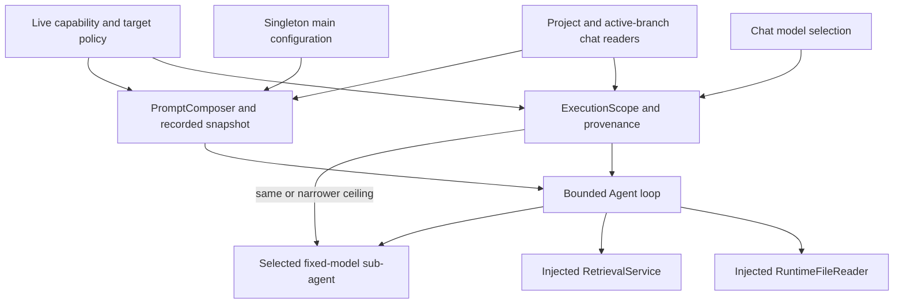

# Agent runtime and execution lifecycle

Each user has one model-free main-agent configuration. Chats use that configuration
and independently persist a selected model. Sub-agent definitions each bind exactly
one model; projects explicitly select eligible owned definitions. General chats
never delegate. Persona/profile defaults are a separate product invariant and do
not select or replace the main-agent configuration.

## Configuration and model identity

`GET/PUT /settings/user/main-agent` reads/updates instructions, ordinary capabilities,
loop limits, and supported generation defaults. The main row cannot be independently
created, deleted, or converted to a sub-agent. User provisioning and the singleton
main row share a transaction; database constraints enforce role/model consistency.

`/agents/sub-agents` lists/creates separately owned definitions, and
`/agents/sub-agents/{agent_id}` updates/deletes them. A definition requires a fixed
model binding. Disabled models keep their identity and display unavailability.
Provider/model deletion cannot silently rebind a definition; restrictive foreign
keys require explicit removal or rebinding first.

`GET /chat/models` supplies the authenticated catalog. Model changes use
`PUT /chat/{chat_id}/model` with `expected_model_revision`, and draft model changes
use `PUT /chat/drafts/{draft_id}/model`. A user default model only prefills the
picker. Updates and send acceptance check revisions and reject unavailable models;
changes are blocked during active work. Historical assistant messages retain the
actual model/provider used even after the chat selection changes.

## Runtime composition

[Execution context](execution-context.md) traces the domain boundary into Agent and
RetrievalService. The chat composition root resolves the recorded configuration,
model, active branch, project instructions, file ceiling, target ceiling, and
internal tool policy. Agent receives those values plus injected live file and
retrieval providers. It does not query project/file memberships itself.

## Composable prompts

[PromptComposer](../../apps/backend/asterism/domains/agent/prompts.py) composes unique
layers in this order:

| Layer      | Authority and source                                                                   |
| ---------- | -------------------------------------------------------------------------------------- |
| `platform` | Mandatory platform rules and capability restrictions                                   |
| `agent`    | Versioned main or delegated role/instructions                                          |
| `profile`  | Accepted persona USER.md constraints; separate from memory                             |
| `project`  | Project task instructions and context revision, when applicable                        |
| `skills`   | Explicit ordered, pinned skill instructions; main-agent only                           |
| `runtime`  | Server-authorized tool names and eligible target metadata; bounded to 8,000 characters |

Agent role and explicit profile constraints remain authoritative; project text
refines the task within them. User requests, files, retrieved excerpts, and forwarded
conversation are untrusted task data. Prompt order and instructions cannot grant
capabilities, delegation, or file access; executable authorization enforces them.

Estimation, main execution, delegation, and replay use the shared composition path.
Private `PromptSnapshot` stores replay inputs; public `PromptProvenance` records
composer revision plus source IDs/revisions/digests without instruction text.
Project edits affect new turns/regeneration; resume uses its existing snapshot
with current access rechecks. The profile layer uses the accepted persona snapshot
and records `user_profile_id` plus its source revision. Default changes and edits
affect new turns; regeneration explicitly captures current settings. Delegates
inherit the same recorded persona. Private immutable `chat_executions` records
preserve historical prompts, while public metadata contains identity and digests.
Skills retain the source turn's pinned snapshots during regeneration as well as
resume; changes require explicit accepted selection/refresh. Live owner, assignment
and admin-policy checks run before generation and provider output. Delegates do
not inherit parent activations. See the [skills contract](skills.md).
See [ADR-0021](../adr/0021-personas-and-execution-binding.md).

## Bounded loop and streaming

```mermaid
stateDiagram-v2
    [*] --> Bind: Validate model and execution identity
    Bind --> Stream: Compose inputs and authorized tools
    Stream --> Check: Accumulate text and tool calls
    Check --> Approve: Tool calls requested
    Approve --> Invoke: Reject unauthorized calls; execute approved calls
    Invoke --> Stream: Append results while steps remain
    Check --> Finish: Stop reason or step limit
    Finish --> [*]: Persist assistant execution and usage
```

The loop is bounded by configuration `max_steps` (default 5). On the final step,
tool schemas are stripped so the model can produce a final answer. Models receive
tools only with explicit `supports_tools=True`. Vision bytes similarly require
`supports_vision=True`; unknown capability values do not grant access.

The OpenAI-compatible LLM adapter accumulates streamed tool-call fragments, emits
content/thinking deltas, and applies bounded transient retries. Tagged textual
tool calls from compatible endpoints still enter normal authorization. Approved
tools may execute concurrently; approval never grants capabilities outside the
current effective allowlist. See [tool authorization](tool-authorization.md).

Agent events include `START`, `DELTA`, `TOOL_CALL`, `COMPLETE`, `ERROR`, and
`SUB_AGENT`. The chat layer maps them to socket packets and persists actual model,
provider, configuration, prompt provenance, token usage, and context provenance.
Provider-reported usage is authoritative; UI context estimates are advisory.

## Project-selected delegation

New projects select no targets. `/projects/{project_id}/sub-agent-candidates`
lists owned candidates, and `/projects/{project_id}/sub-agents` reads/updates the
selected set under `expected_context_revision`. No-op membership changes preserve
the revision. Selected definitions must still be owned, model-available,
and eligible when advertised, invoked, and used during execution.

The runtime catalog includes only eligible selected targets, excluding the caller.
The child inherits the same file ceiling and can only narrow internal tool scope.
Its ordinary capabilities come from its own configuration intersected with active
admin policy; they need not duplicate the parent's ordinary capabilities.

`sub_agent` checks the call stack for cycles and bounds recursion with
`MAX_SUB_AGENT_DEPTH` (default 3). It forwards bounded caller notes, file metadata,
and recent parent history as untrusted data, not authoritative system instructions.
The default history window is 10 messages and 4,000 estimated tokens; the combined
forwarded block is token-bounded. No sibling-chat history is fetched.

The child uses `AllowlistApprovalPolicy`, so its authorized tools execute without
nested interactive prompts. Live checks cancel/reject work after deselection,
project revision/identity changes, configuration/model revocation, or cancellation;
an in-flight silent child is polled rather than allowed to complete unchecked.
See [context isolation](context-isolation.md) for source ceilings and history limits.

Each forwarded child event is wrapped in a `SubAgentEventEnvelope` and sent as a
`sub_agent` socket packet. Besides `execution_id`, `sub_agent_id`,
`sub_agent_name`, `depth` and the child `event`, it carries:

- `parent_execution_id`: the delegating sub-agent's execution, or null when the
  main agent delegated. A child agent receives its own execution id as
  `delegation_execution_id`, and the tool registry passes it to that child's own
  tool calls as `ToolContext.caller_execution_id`.
- `model_id` and `model_name`: the fixed binding that ran, taken from the child's
  execution scope. The name is null until the child resolves its model, so a
  model-lookup failure leaves it null.

These are display fields for the delegation graph only. They grant nothing, and
authorization stays with the live checks above.

The orchestrator's `DelegationCollector` (`domains/chat/delegations.py`) folds a
step's envelopes into one `DelegationRecord` per execution. A record holds
identity, parent, model name, depth, status, start/end time in milliseconds, the
child's tool calls and results (from its per-step `COMPLETE` events), and its
output or error. The records are drained onto the assistant message that step
persists (`Message.delegations`), so each record belongs to the step that ran it.

- A run that never sent a terminal event is stored as `error`.
- On cancel, in-flight records are stored as `cancelled`. The partial assistant
  message is kept even when no text had streamed.
- Thinking, prompts and forwarded parent context are never stored.
- Records live in the owner's chat and are deleted with it. The audit trail stays
  in `sub_agent_traces` (digests only).

## Resume, regeneration, and audit

Each invocation has an execution UUID. Delegated events also include target ID,
name, and depth, so repeated/concurrent calls remain distinguishable. Child results
feed the parent response while delegated progress renders separately.

A private pending execution survives reconnect/restart as persisted data. Resume
reuses its configuration, model, prompt, file/target ceilings, and execution identity;
it does not continue an interrupted provider connection. A revoked or changed model
fails explicitly. Regeneration validates current selection and captures a new
snapshot without changing earlier turns' model labels.

Delegated traces persist content-free task/context/result digests, message roles,
status, timing, token/step counts, and prompt/context provenance. They exclude raw
task text, parent notes, message bodies, tool results, and generated answers. Normal
owned chat history and authorized retrieval responses remain content-bearing.

No active long-term memory store or automatic cross-chat summary retrieval is
implemented. Namespace/key types define a future isolation boundary; they do not
authorize reads. See [memory limits](context-isolation.md) and
[chat transport](chat-and-websocket.md).
