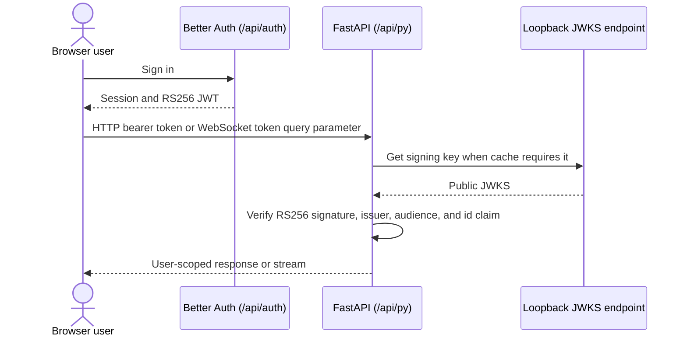

# Authentication and Security Architecture

Asterism uses Better Auth in Next.js for sessions and RS256 JWT issuance. FastAPI
does not share a signing secret or trust a browser-supplied identity: it retrieves
public signing keys from Better Auth's JWKS endpoint and validates each token.

## Authentication flow

`PUBLIC_URL` is the sole public identity setting. It supplies FastAPI's expected
JWT issuer and audience. The backend reaches JWKS through the fixed loopback
frontend address (`http://127.0.0.1:3000/api/auth/jwks`), so public DNS and TLS
termination are not part of this internal hop.

## Security controls

### JWT verification

[`verify_jwks_token`](../../apps/backend/asterism/core/security.py) uses
`jwt.PyJWKClient` with a one-hour JWKS/key cache. It accepts only RS256, validates
issuer and audience, and requires the `id` claim before constructing an
`AuthedUser`. REST dependencies obtain the bearer token through `HTTPBearer`; the
chat WebSocket validates its required `token` query parameter before accepting the
connection. Uvicorn transport diagnostics redact `token` and `access_token` query
values before formatting, including WebSocket acceptance logs. Chat read/delete
queries are owner-filtered and return the same 404 for foreign and missing identities.

### User and administrator boundaries

Backend services pass the authenticated user ID into queries for user-owned chats,
messages, projects, files, personas, main-agent configurations, sub-agent definitions, and settings. File routes additionally
resolve stored paths below that user's file root. Provider administration and other
administrator operations use the user's authenticated role; provider credentials are
write-only in API responses.

### Frontend theme and rendered-content boundaries

US-31.1 confines theme reads to validated catalog IDs and independently authorizes
editor actions against the server-side administrator session. The original review's
harmless traversal probe is covered by isolated filesystem and HTTP regressions.
The [theme trust boundary](#theme-trust-boundary) describes the current contract.
The shared renderer now disables raw HTML, blocks automatic content resources
and limits link schemes and KaTeX extensions. See the
[Markdown and file-content policy](markdown-content.md); persistent custom storage
is described in the [theme lifecycle](theme-storage.md).

### Internal callbacks

The backend event bus can POST to the Next.js `/api/stream` route for events such
as chat-title updates. This loopback callback carries
`x-asterism-system-key`; the route accepts it only when it equals the server-side
`SYSTEM_KEY`. The key is not a JWT signing key and must never be sent to the browser.
The stream route can also accept an authenticated frontend session, rate-limits
requests, and filters emitted events by user ID for SSE subscribers.

### Deployment safeguards

- The supported image exposes only port 3000. nginx routes `/api/py/` to FastAPI
  on loopback and keeps ports 8000 and 3001 private.
- nginx's access-log format omits query strings because chat WebSocket URLs contain
  JWTs.
- Runtime configuration rejects wildcard CORS origins and invalid public origins in
  full runtime profiles. Production requires HTTPS for non-loopback public origins.
- Secrets use the root configuration contract or canonical `/run/secrets` files;
  see the root [README](../../README.md#configuration).

## ChatGPT plan connections

Users may connect their own ChatGPT plan when the admin policy
`chatgpt_plan_enabled` is on (default off). Connections are per user, encrypted
at rest and never returned with tokens. The loopback OAuth callback
(`/api/py/chatgpt/callback` on `127.0.0.1`) is unauthenticated and authorized only
by a single-use, ten-minute `state`. Refreshes are serialized per user and
never fall back to another user's connection or provider. See
[ADR-0025](../adr/0025-chatgpt-plan-connection.md).

## Related guides

- [System overview](overview.md)
- [Chat and WebSocket](chat-and-websocket.md)
- [Tool authorization](tool-authorization.md)

### Theme trust boundary

Theme palettes are public presentation data: `/api/theme/list` lists validated
catalog IDs and `/api/theme?name=<id>` returns a validated palette object. These
reads support setup/sign-in as well as authenticated selection. Do not store
secrets in theme files. Missing/malformed IDs return 400; unknown IDs return 404.

The editor's `loadTheme` and `saveTheme` server actions independently obtain the
BetterAuth session and require the exact `admin` role before filesystem access.
Hiding the editor is not an authorization check. Layout helpers and catalog
functions are `server-only` modules, not remotely callable server actions.

The theme domain owns ID validation, strict runtime palette validation and
resolved path containment. IDs contain only lowercase ASCII letters, digits,
underscores and hyphens (1–80 characters, beginning with a letter or digit).
Extensions, paths and encoded traversal are not IDs. Reads reject symlinks;
existing writes must identify a validated catalog member, and new IDs are
server-generated UUIDs. Bundled IDs create overrides only in persistent storage. Names are bounded nonempty display
text; colors are an exact set of hex color fields. The deployment filesystem is
trusted and must not be writable by untrusted local processes.

Catalog reads validate files individually without a process-global cache. Custom
palettes and overrides live under `STORAGE_ROOT/themes`; bundled defaults are static
imports. Saves await a synced temporary file and atomic rename before returning
success, then revalidate the layout. Failures retain editable drafts with retry.
See [theme storage and lifecycle](theme-storage.md) for ownership, freshness,
backup/reset and container permissions.

Persona lifecycle APIs always use the authenticated owner's ID, including for
administrators. Foreign and missing identities return the same 404. Accepted
persona snapshots guide output but grant no capabilities. Execution rechecks live
owner/profile access before work and while releasing output, including delegated
results. Public history contains identity/revision/digests; USER.md remains in
owner-only persona settings and private server snapshots.
