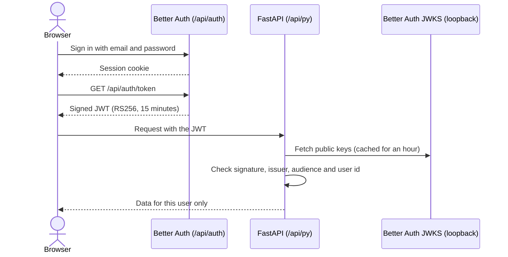

# Authentication and security

This guide explains how Asterism knows who a request is from, what that person
may do, how accounts are created, suspended and deleted, and what the edge of
the system does to protect them. Read it before changing anything that touches
sign-in, tokens, permissions or HTTP headers.

## Concepts

- **Better Auth owns identity.** Accounts, passwords, sessions, the admin role and
  the keys that sign tokens all live in Better Auth, inside the Next.js app, with
  their own database (`users.db`).
- **The backend trusts tokens, not browsers.** FastAPI never shares a secret with
  Better Auth. It checks each request's token against Better Auth's _public_ keys,
  so a forged or altered token fails.
- **The backend keeps a copy of each user.** Its `users` row holds the user's
  data in `database.db` and a display copy of their name and email. The copy is
  for showing people to each other; it is never used to decide who someone is
  ([ADR-0057](../adr/0057-user-identity-copy.md)).
- **Role and group are different things.** The _role_ (`admin` or `user`) is in
  the token and decides whether someone is an administrator. The _group_
  (`admin`, `educator`, `student` or a custom one) is in the backend and decides
  which models and tools they may use, and whether they may run classes
  ([ADR-0058](../adr/0058-user-groups.md)).
- **The system key** (`SYSTEM_KEY`) is a shared secret between the two server
  processes. It authorizes a few internal calls and never reaches the browser.

## How it works

### Signing in and getting a token

Signing in gives the browser a session cookie. The cookie is for Better Auth
only; to call the backend, the page exchanges it for a short-lived JWT at
`/api/auth/token`. The browser keeps that token in memory and reuses it until a
minute before it expires, so a page doesn't sign a new token for every request
([`backend-token.ts`](../../apps/frontend/src/lib/backend-token.ts)). A 401 from the
backend drops the cached token; a 403 keeps it, because the token is valid and
the person is only not allowed to do that one thing.

HTTP requests carry the token in the `Authorization: Bearer` header. The chat
WebSocket carries it as a `token` query parameter, because browsers cannot set
headers on a WebSocket. Query strings are kept out of every log for that reason:
nginx's log format leaves them out, and the backend's logging redacts `token=`
and `access_token=` values.

`PUBLIC_URL` is the only identity setting. It is the token's expected issuer and
audience, so a token issued for one instance is refused by another. The backend
fetches the public keys from Better Auth over loopback
(`http://127.0.0.1:3000/api/auth/jwks`), so this check never depends on public
DNS or TLS.

### From token to user

Every authenticated backend route depends on `get_current_user`
([`user/dependencies.py`](../../apps/backend/asterism/domains/user/dependencies.py)),
which does the following in order:

1. **Verify the token** (`verify_jwks_token` in
   [`core/security.py`](../../apps/backend/asterism/core/security.py)). Only RS256
   is accepted, and the token must name the right issuer, audience and a user id.
2. **Make sure the user exists.** A valid token for a user the backend hasn't seen
   creates their row and their main agent in one transaction. A user who was
   deleted has a tombstone row (`deleted_users`), and their token is refused
   rather than recreating them.
3. **Refuse a suspended account.** A suspended user's token stays valid until it
   expires, so the backend checks `users.suspended_at` on every request and on
   every chat WebSocket connect.
4. **Refresh the display copy** of name and email from the token, if they changed.
5. **Mirror the admin role into the group.** A user with the admin role is moved
   into the `admin` group, and a former admin drops to `student`. Nothing else
   can move someone into or out of `admin`.

Steps 2 to 5 read from in-memory caches when nothing has changed, so a typical
request costs a few dictionary lookups rather than database writes.

### Who may do what

**Users see only their own data.** Every service function takes the user's ID,
and every query on user-owned data (chats, messages, projects, files, About you,
agents, skills, settings) filters by it. Another user's chat returns the same 404
as a chat that doesn't exist, so IDs can't be probed. File paths are resolved
under that user's own directory.

**Administrators are decided by the token.** `get_current_admin` (`AdminUserDep`)
requires the `admin` role from the verified token. Hiding a page in the interface
is never the check; the route refuses the request itself, with 403 "Only an
administrator can do this" for a signed-in non-admin.

**Educators are decided by group, read live.** Educator routes read the user's
group on every request, so revoking educator access takes effect at once.
Administrators may also run classes.

**Groups only ever narrow access.** A group's model list and tool list are
either "every enabled one" or an explicit list. A model or tool is usable only
where admin policy, the group and the agent's own assignment all allow it. See
[tool authorization](tool-authorization.md) for how this combines with the other
checks.

**About you is always your own.** `/users/me/about` reads and writes the
authenticated user's text, administrators included; no route reads another
user's.

### Creating accounts

There is no open sign-up. In the app, accounts are created in two ways:

| Path                                    | Who                                  | Result                      |
| --------------------------------------- | ------------------------------------ | --------------------------- |
| First-run setup (`/setup`)              | Someone who knows `ADMIN_PASSPHRASE` | An administrator            |
| A class invite link (`/invite/{token}`) | Anyone holding an unused invite      | A user who joins that class |

Better Auth's user-create hook (`decideSignupRole` in
[`auth-core.ts`](../../apps/frontend/src/lib/auth-core.ts)) enforces this. It
accepts a sign-up only with the admin passphrase, from a signed-in administrator's
session, or for an invite redemption that carries the system key. The invite
server action adds that key itself, so the browser never sees it. There is no
screen for an administrator to create an account directly; they create invite
links instead.

Anything else, including a direct call to Better Auth's sign-up route, is
refused. Account creation from one address is limited to 10 attempts per 15
minutes, which slows passphrase guessing and invite probing
([`signup-limit.ts`](../../apps/frontend/src/features/auth/server/signup-limit.ts)).

The backend side of each account is created through `POST /users/`, which
accepts an admin token or the system key, or automatically on the user's first
request.

### Suspending, resetting and deleting accounts

Identity lives in Better Auth and data lives in the backend, so every change to
an account has to update both. Admin server actions in
[`account-lifecycle.ts`](../../apps/frontend/src/features/auth/server/account-lifecycle.ts)
do this, using the administrator's own session; Better Auth checks the admin
permission, and the backend checks it again. Better Auth's own HTTP routes for
banning, unbanning, removing users and requesting a password reset are disabled,
so no one can do half of a change from outside
([ADR-0070](../adr/0070-account-lifecycle.md)).

| Action                  | What happens                                                                                                                                                | Order                           |
| ----------------------- | ----------------------------------------------------------------------------------------------------------------------------------------------------------- | ------------------------------- |
| **Suspend**             | Sign-in is refused, sessions end, and the backend refuses the account's remaining tokens. Running chats and file jobs stop. Data is kept.                   | Backend first, then Better Auth |
| **Reactivate**          | The ban and the backend suspension are lifted.                                                                                                              | Better Auth first, then backend |
| **Reset link**          | The admin gets a one-time link, valid for an hour, to send the person themselves. Using it sets a new password and ends every session.                      | Better Auth only                |
| **Delete**              | The Better Auth account goes, then all backend data, with a tombstone so the ID can't come back. If the second step fails, the admin is told and can retry. | Better Auth first, then backend |
| **Deletion request**    | A user who isn't an admin asks to be deleted. The request appears in Admin → Users, where an admin deletes or dismisses it. It changes nothing by itself.   | Backend only                    |
| **Sign out everywhere** | A user ends all their own sessions.                                                                                                                         | Better Auth only                |

Admins cannot suspend or delete themselves, or the last active administrator.
This is checked from Better Auth's roles in the action and from the admin group
in the backend.

Reset links exist because Asterism sends no email. The admin copies the link and
delivers it however they like; there is no public "forgot password" request.

### Internal calls and the system key

Two internal paths use `SYSTEM_KEY`:

- **Events to the browser.** The backend posts events, such as a new chat title,
  to the Next.js route `/api/stream` with an `x-asterism-system-key` header. The
  route accepts the post only if the key matches, then delivers each event to that
  user's open tabs over server-sent events, never to anyone else's.
- **Provisioning.** `POST /users/` and invite sign-ups accept the system key in
  place of an admin token.

The system key is not a signing key and is unrelated to tokens. It is also the
key that encrypts stored provider API keys, which is why a restore checks that it
matches ([backup and restore](backup-and-restore.md)).

### The edge: nginx and the browser

The container is meant to sit behind the operator's own TLS proxy. These
protections are on by default ([ADR-0071](../adr/0071-edge-hardening.md)).

**A content security policy on every page.** The Next.js proxy
([`src/proxy.ts`](../../apps/frontend/src/proxy.ts)) makes a fresh nonce for each
page and sends a policy
([`content-security-policy.ts`](../../apps/frontend/src/lib/content-security-policy.ts))
that allows only the app's own scripts carrying that nonce. In short:

- no inline or third-party scripts;
- images, fonts and media only from the app itself (`blob:` and `data:` included);
- network connections only to the app's own origin and its WebSocket;
- no frames except the canvas preview, and the app can't be framed by others.

The canvas preview runs the agent's HTML in a sandboxed frame with an opaque
origin and no network access, under its own stricter policy
([ADR-0063](../adr/0063-canvas.md)).

**API responses are data.** nginx replaces the security headers of every
`/api/py/` and `/api/auth/` response with a policy that allows nothing to run,
load or be framed. Every response also sends `X-Content-Type-Options: nosniff`
and `Referrer-Policy: same-origin`.

**HTTPS settings follow `PUBLIC_URL`.** With an `https://` origin, nginx sends
HSTS for one year, and Better Auth's cookies are `Secure`, `HttpOnly` and
`SameSite=Lax`. In production, configuration refuses a non-HTTPS `PUBLIC_URL`
unless it is a loopback address.

**One upload limit.** `MAX_UPLOAD_FILE_SIZE_BYTES` (default and maximum 100 MiB)
is the largest upload request, whether one file or several. nginx, the Next.js
proxy and the backend all enforce the same value, so going around one layer
doesn't help.

**Rate limits per client address.** nginx limits each address, per minute:

| What                                                  | Rate | Burst |
| ----------------------------------------------------- | ---- | ----- |
| Better Auth writes (sign-in, sign-up, password reset) | 60   | 60    |
| Uploads                                               | 60   | 60    |
| Chat WebSocket connections                            | 120  | 60    |

The bursts let a class of about 30 people behind one school address sign in or
open chats together. Refused requests get a JSON 429 with `Retry-After: 60`.
Better Auth applies its own limit of 60 sign-ins per minute per address
([`auth-rate-limit.ts`](../../apps/frontend/src/lib/auth-rate-limit.ts)).

**Trusted proxies decide the client address.** nginx takes the client address
from `X-Forwarded-For` only when the connection comes from an address in
`TRUSTED_PROXIES`. Without it, every request seems to come from the TLS proxy,
and the limits above apply to everyone at once.

**Only port 3000 is published.** FastAPI (8000) and Next.js (3001) listen on
loopback inside the container.

### Theme files

Themes are public presentation data, readable before sign-in so the sign-in page
can use them. `/api/theme/list` lists theme IDs and `/api/theme?name=<id>`
returns one palette. IDs are restricted to lowercase letters, digits, `_` and
`-`, so a theme ID can never be a path. Saving a theme is a server action that
checks the admin role itself before it touches the disk. See
[theme storage](theme-storage.md) for how saves stay atomic.

### ChatGPT plan connections

When the admin turns the ChatGPT plan policy on, a user may connect their own
ChatGPT plan. Each connection belongs to one user and is encrypted at rest; its
tokens are never returned by the API. The OAuth callback
(`/api/py/chatgpt/callback`, on loopback) has no session and is authorized only
by a single-use `state` that expires after ten minutes. Token refreshes run one at
a time per user and never fall back to another user's connection
([ADR-0025](../adr/0025-chatgpt-plan-connection.md),
[LLM providers](llm-providers.md#chatgpt-plan-providers)).

## Rules

- No route trusts an identity it didn't verify from a token.
- Every query on user-owned data filters by the authenticated user's ID, and a
  foreign ID reads as not found.
- Administrator checks read the token's role. Educator checks read the group, live.
- Groups, prompts, skills, files and About you text can narrow what a user may do,
  never widen it.
- Account changes go through the admin server actions, which update Better Auth
  and the backend together.
- The system key never reaches the browser, and tokens never reach a log.

## Limits and failures

| Situation                                          | What the client sees                                                                                |
| -------------------------------------------------- | --------------------------------------------------------------------------------------------------- |
| Missing, expired or forged token                   | 401                                                                                                 |
| Another user's resource, or one that doesn't exist | 404                                                                                                 |
| Not an administrator on an admin route             | 403                                                                                                 |
| Suspended account                                  | Sign-in refused with "This account is suspended. Ask your administrator."; backend requests refused |
| Chat WebSocket refused                             | Closed with code 1008 and a reason (`Unauthorized`, `Chat not found`, `Forbidden`)                  |
| Too many requests from one address                 | 429 with `Retry-After: 60`                                                                          |

**Signing out everywhere is not instant for the backend.** Sessions end at once,
but a JWT already issued keeps working until it expires, up to 15 minutes later.
The settings page says so. Suspension does not have this gap, because the backend
checks it on every request.

## Where the code lives

1. [`src/lib/auth-core.ts`](../../apps/frontend/src/lib/auth-core.ts): the Better
   Auth configuration, sign-up rules and disabled routes.
2. [`core/security.py`](../../apps/backend/asterism/core/security.py): token
   verification against the public keys.
3. [`user/dependencies.py`](../../apps/backend/asterism/domains/user/dependencies.py):
   `get_current_user` and `get_current_admin`.
4. [`account-lifecycle.ts`](../../apps/frontend/src/features/auth/server/account-lifecycle.ts):
   suspend, reactivate, reset and delete.
5. [`src/proxy.ts`](../../apps/frontend/src/proxy.ts) and
   [`content-security-policy.ts`](../../apps/frontend/src/lib/content-security-policy.ts):
   the page security policy.
6. [`docker/nginx.conf`](../../docker/nginx.conf): rate limits, API headers and
   the log format.

## Related

- [ADR-0057](../adr/0057-user-identity-copy.md): the backend copy of name and email
- [ADR-0058](../adr/0058-user-groups.md): groups and their access lists
- [ADR-0070](../adr/0070-account-lifecycle.md): suspension, reset links and deletion
- [ADR-0071](../adr/0071-edge-hardening.md): security headers, upload limit and rate limits
- [Tool authorization](tool-authorization.md): how capabilities are decided
- [Operations](operations.md): logs and request IDs
