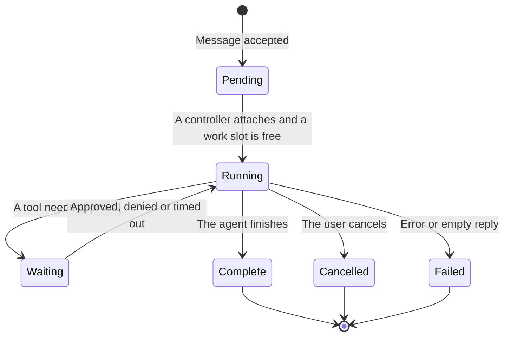

# Chat and WebSocket

This guide explains how a chat message travels: how it is accepted, how its reply
is streamed, and what happens when the user closes the tab, cancels or
regenerates. Read it before changing the chat routes, the socket protocol or the
chat job.

## Concepts

- **Accepting and answering are separate.** The browser sends a message over REST,
  and the backend stores it. The reply is produced afterwards, by a chat job, and
  streamed over a WebSocket. A message is never sent over the socket.
- **A chat job** runs the work for one chat: the reply, the chat's title, or a
  compaction. It lives in the backend's memory and belongs to the chat, not to any
  connection, so a reply keeps going when the tab closes.
- **A controller** is the server side of one open chat socket. Several tabs on the
  same chat each have a controller, and each receives the whole stream.
- **A pending turn** is an accepted user message that has no finished reply yet.
  It is stored in the database, so it survives a restart and can be resumed.
- **A request ID** (`request_id`) is a UUID the browser picks for each send. Sending
  again with the same ID returns the original result instead of a second message.

## How it works

### Sending a message

```mermaid
sequenceDiagram
    participant Browser
    participant REST as REST (sending)
    participant DB as SQLite
    participant Socket as Controller
    participant Job as Chat job
    participant Agent

    Browser->>REST: POST message: request_id, model revision, text, files
    REST->>DB: One transaction: message, file references, receipt
    REST-->>Browser: The accepted chat and message
    Browser->>Socket: Open /chat/stream/{chat_id}?token=…
    Socket->>Job: Attach; start the pending turn if idle
    Job->>DB: Record what this run may use, before calling the model
    Job->>Agent: Run with that recorded context
    Agent-->>Job: Text, tool calls, sub-agent events, usage
    Job-->>Socket: Packets
    Socket-->>Browser: Streamed reply
    Browser->>Socket: Approve a tool, or cancel
```

**Acceptance.** `POST /chat/` starts a new chat with its first message, and
`POST /chat/{chat_id}/message` adds one to an existing chat. The backend checks
that the user owns the chat, that the model is still available and unchanged
(`expected_model_revision`), that the parent message is on the chat, and that the
files belong to the user. It then commits the message, its file references and a
_receipt_ for the `request_id` in one transaction
([`sending.py`](../../apps/backend/asterism/domains/chat/sending.py)).

**Retrying a send.** If the browser isn't sure a send arrived (say the
connection dropped), it repeats the same request with the same `request_id`. A
matching receipt returns the message that was already accepted. A different
payload under the same ID is refused, so a retry can never turn into a different
message.

**Drafts.** Files are attached before sending through a _draft_: the composer
creates one, uploads or picks files into it, and names it on send. Acceptance
checks that the draft holds exactly the files shown in the composer, then consumes
it. Draft references expire after 24 hours and give no access to the files by
themselves. Discarding a draft never deletes a file from the library.

**Budgets.** If the user's group has a token budget and it is used up, the send is
refused with a 409 (`reason: "usage_limit"`) that says when the budget resets.
Regenerate and fork are refused the same way. Replies already running finish
([usage budgets](../adr/0073-usage-ledger-and-budgets.md)).

### Streaming the reply

When a controller attaches to a chat with a pending turn and no running job, it
starts the turn. The job records, before it calls the model, everything the run
may use: the model, the agent's configuration, the composed prompt, and the files
and sub-agents it may reach. [Execution context](execution-context.md) explains
that record; [agent runtime](agent-runtime.md) explains the loop that follows.

Each piece of output becomes a packet on the socket: text as it is written, tool
calls and their results, progress from sub-agents. The final `complete` packet
carries the stored messages, so the browser replaces its streamed copy with the
saved version.

Text streams as numbered increments ([ADR-0084](../adr/0084-incremental-streaming.md)).
The agent hands the orchestrator the whole text so far; the orchestrator keeps
what it last sent on each stream (each step of the reply, and each running
sub-agent) and sends only the new text as an `append`, or the whole text as a
`replace` when the text didn't just grow, such as an exercise run trimming its
held-back marker.

### Several tabs, closed tabs and reconnecting

Each chat's stream keeps a queue of up to 256 packets for every attached
controller, dropping the oldest if a tab falls behind, so every tab gets the full
stream. When no tab is attached, the stream buffers packets under the same limit
and replays them to the next tab that connects.

Closing a tab stops that controller's tasks and nothing else; the reply keeps
running. Reopening the chat attaches a new controller, which receives the
buffered packets and the rest of the stream.

A tab that attaches while text is streaming first gets a `replace` packet with
the text so far for each open stream. A tab that finds a gap in a stream's
numbers (a packet dropped from its queue) sends `resync` and gets the same
packets.

### Cancelling, regenerating and failing



- **Cancel** stops the reply at once and stores it as cancelled, keeping whatever
  text was already written.
- **Regenerate** creates a new reply to the same message, as a sibling branch. It
  records its context afresh, so it sees current settings and files. Earlier
  replies keep the model and context they were made with.
- **Resume** continues a pending turn with the context it recorded. It can lose
  access that was revoked meanwhile, but never gains new files or sub-agents.
  An interrupted call to the model is not continued; the step runs again.
- **A failure** (an error from the agent, an empty reply, an unexpected exception)
  is stored like a cancellation, as a `failed` reply with any text written so far
  and the error. Resume never reruns it. The browser gets `complete` with the
  stored messages, then `error`.

If something the turn depends on has gone, such as a disabled model or a revoked
file, the run stops with an explicit error. It never substitutes another model or
a wider context.

### Comparing models

A send may include `compare`: two or three targets, each a model and optionally a
different prompt and a label of up to 40 characters. Acceptance creates one
sibling user message per target, sharing a `comparison_id`. The first becomes the
active branch. The job then answers each column in turn, each with its own
history and its fixed model, and their packets carry `comparison: {id, column_id}`.
New sends wait until every column is answered; cancelling cancels the columns
still waiting ([ADR-0027](../adr/0027-side-by-side-comparison-branches.md)).

### Compacting a long chat

When a turn's request would exceed most of the model's context window, the job
first summarizes the start of the branch, then runs the turn
([agent runtime](agent-runtime.md#context-compaction)). The user can also ask for
it with the `compact` command ("Compact now"). Compaction takes the chat's work
slot like a turn, so it never overlaps one, and it reports progress in
`compaction` packets that are never part of an answer.

### Files and models

Attached files reach the model under the same checks as file search: the file must
still belong to the user and still be in the chat's scope. Text and converted
documents are included as bounded text. Images are included as image parts only
when the model is marked as supporting vision (`supports_vision = true`); for any
other model, and for missing, failed, unsupported or oversized files, the model
gets a short note instead, naming the file and the reason. Seeing a file in the
library or staging it in a draft never grants access by itself.

The context-usage meter in the composer is an estimate built from the same prompt
composition. The token counts the provider reports after each call are the
authoritative figures.

### The AI-use log

`POST /chat/ai-use-log` returns, for up to 50 of the user's chats, what each turn
on the active branch used: its prompt, time, learning mode, About you revision,
template, rubric, skills and files, and its reply's model, tools, cited files and
verification counts. It never returns answer text. The browser renders the log as
Markdown or prints it to PDF ([ADR-0046](../adr/0046-ai-use-log.md)).

## Rules

- A message is accepted only over REST, in one transaction with its receipt.
- A chat job belongs to the chat. Only an explicit cancel, chat deletion or
  shutdown stops it; a closed connection does not.
- Resume uses the context the turn recorded. Regenerate records new context. Both
  recheck access when they run.
- No run silently changes its model or widens its files.
- Tool approvals and cancels skip the controller's command queue, so they reach a
  run that is waiting on them.

## Limits and failures

**Admission.** The backend admits a fixed number of chat jobs and connections
([ADR-0020](../adr/0020-chat-capacity-admission.md)):

| Limit                                                                     | Default | Setting                         |
| ------------------------------------------------------------------------- | ------- | ------------------------------- |
| Work slots running at once (replies, titles, compactions, approval waits) | 32      | `MAX_ACTIVE_CHAT_JOBS`          |
| Work slots per user                                                       | 4       | `MAX_ACTIVE_CHAT_JOBS_PER_USER` |
| Open chat connections                                                     | 128     | `MAX_CHAT_CONTROLLERS`          |
| Open chat connections per user                                            | 16      | `MAX_CHAT_CONTROLLERS_PER_USER` |

There is no waiting queue. A connection over the limit gets an error packet and is
closed with code 1013. Work over the limit gets an error packet and the socket
stays open, so the user can retry or cancel. Both packets have
`error_code: "chat_capacity"` and `retryable: true`. The message is already
stored, so retrying resumes it rather than sending it again.

**Timeouts and bounds.**

- A tool approval waits 60 seconds, then counts as denied.
- The controller sends a `status` packet every 0.5 seconds and answers `ping`
  with `pong`.
- Each controller's queue holds 256 packets.

**Refused connections.** A socket refused before it is accepted closes with code
1008 and a reason: `Unauthorized` for a bad token or a suspended account,
`Chat not found` for a missing chat or someone else's, `Forbidden` for a refused
agent lookup, and `This chat has no assigned main agent`.

## Reference

### Routes

| Route                                                    | Purpose                                                                                                                                  |
| -------------------------------------------------------- | ---------------------------------------------------------------------------------------------------------------------------------------- |
| `POST /chat/`                                            | Create a chat with its first message: `request_id`, `model_id`, `user_prompt`, optional `project_id`, `draft_id`, file IDs and `compare` |
| `POST /chat/{chat_id}/message`                           | Add a message: `request_id`, `expected_model_revision`, `user_prompt`, optional parent ID, `draft_id`, file IDs and `compare`            |
| `POST /chat/drafts`                                      | Create a draft for a new or existing chat                                                                                                |
| `POST /chat/drafts/{draft_id}/uploads`                   | Upload files into the library and add them to the draft                                                                                  |
| `POST`, `DELETE /chat/drafts/{draft_id}/files`           | Add or remove library files by `file_ids`                                                                                                |
| `DELETE /chat/drafts/{draft_id}`                         | Discard a draft, keeping the library files                                                                                               |
| `PUT /chat/{chat_id}/model`                              | Change the model for the next turn, with `expected_model_revision`                                                                       |
| `PUT /chat/drafts/{draft_id}/model`                      | Change a draft's model, with `expected_model_id`                                                                                         |
| `POST /chat/{chat_id}/message/{message_id}/compare`      | Turn an answered message into column 0 of a comparison and queue one or two more targets                                                 |
| `GET /chat/{chat_id}/comparisons/{comparison_id}`        | A comparison's columns, replies, models, status and usage                                                                                |
| `PUT /chat/{chat_id}/comparisons/{comparison_id}/active` | Continue the chat from one column                                                                                                        |
| `WS /chat/stream/{chat_id}?token=…`                      | The chat's socket                                                                                                                        |

All paths are under `/api/py`.

### Commands from the browser

| Command         | Fields                | Effect                                              |
| --------------- | --------------------- | --------------------------------------------------- |
| `resume`        |                       | Start the pending turn, if nothing is running       |
| `regenerate`    | `parent_message_id`   | Write a new reply; ignored while work is running    |
| `tool_approval` | `tool_id`, `approved` | Answer an approval; `approved` must be a boolean    |
| `cancel`        |                       | Stop the running work                               |
| `compact`       |                       | Compact the chat now; refused while work is running |
| `ping`          |                       | Ask for a `pong`                                    |
| `resync`        |                       | Ask for the open streams' text so far (`replace`)   |

### Packets from the server

| Packet                    | When                                                                                                                                                             |
| ------------------------- | ---------------------------------------------------------------------------------------------------------------------------------------------------------------- |
| `start`                   | A run begins; carries the recorded execution details when available                                                                                              |
| `delta`                   | New answer text or reasoning: `stream`, `seq`, `mode` (`append` or `replace`), `content`, `thinking`                                                             |
| `tool_call`               | The model asked for tools                                                                                                                                        |
| `tool_permission_request` | A tool call waits for approval: its ID, name and arguments                                                                                                       |
| `tool_update`             | An approval was answered; the prompt can close                                                                                                                   |
| `tool_progress`           | A long tool's progress, such as image generation steps: `tool_call_id`, `name`, `stage`, `step`, `total`                                                         |
| `sub_agent`               | An event from a sub-agent, wrapped with its execution ID, name, model and depth ([agent runtime](agent-runtime.md#delegation-projects-and-the-general-chat-set)) |
| `compaction`              | `started`, then `completed` with the new summary record, or `failed` with a reason                                                                               |
| `status`                  | `is_processing`: whether work is running, every 0.5 seconds                                                                                                      |
| `regenerate`              | A regeneration was accepted, sent to every open tab; `parent_id` names the message being answered again                                                          |
| `complete`                | The run ended; carries the stored messages                                                                                                                       |
| `error`                   | Something failed: `content`, `code`, and for special cases `error_code` (`chat_capacity`, `usage_limit`), `retryable` and `resets_at`                            |
| `pong`                    | The reply to `ping`                                                                                                                                              |

## Where the code lives

1. [`chat/sending.py`](../../apps/backend/asterism/domains/chat/sending.py):
   accepting a message, receipts and drafts.
2. [`chat/router.py`](../../apps/backend/asterism/domains/chat/router.py): the
   routes and the socket's checks before it is accepted.
3. [`chat/controller.py`](../../apps/backend/asterism/domains/chat/controller.py):
   one connection's command and packet loops.
4. [`chat/jobs.py`](../../apps/backend/asterism/domains/chat/jobs.py) and
   [`chat/capacity.py`](../../apps/backend/asterism/domains/chat/capacity.py): chat
   jobs, work slots and admission.
5. [`chat/message_queue.py`](../../apps/backend/asterism/domains/chat/message_queue.py):
   the per-chat stream and its buffers.
6. [`chat/orchestrator.py`](../../apps/backend/asterism/domains/chat/orchestrator.py):
   runs a turn and turns agent events into packets.
7. [`use-chat-websocket.tsx`](../../apps/frontend/src/features/chat/hooks/use-chat-websocket.tsx):
   the browser side.

## Related

- [Execution context](execution-context.md): what a run may use
- [Agent runtime](agent-runtime.md): the loop, delegation and compaction
- [Tool authorization](tool-authorization.md): approvals
- [ADR-0020](../adr/0020-chat-capacity-admission.md): admission limits
- [ADR-0016](../adr/adr-0016-memory-resource-contracts.md#operations): memory bounds
  and cleanup
