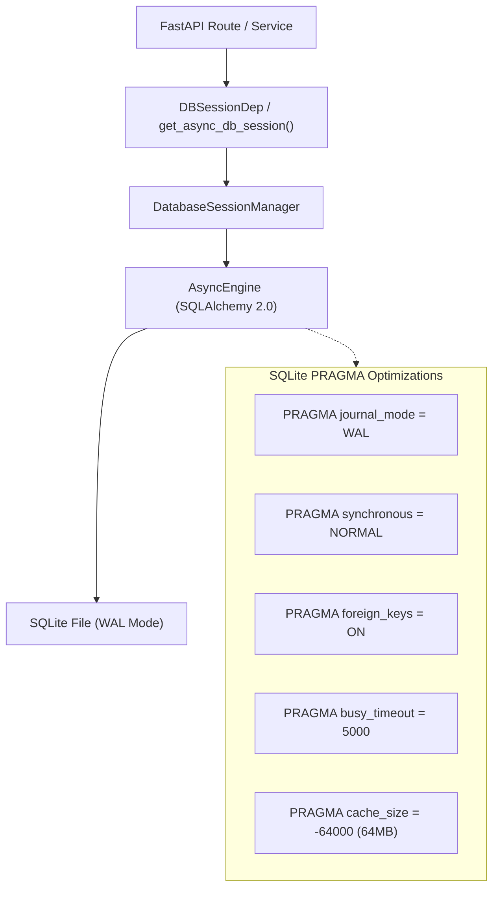
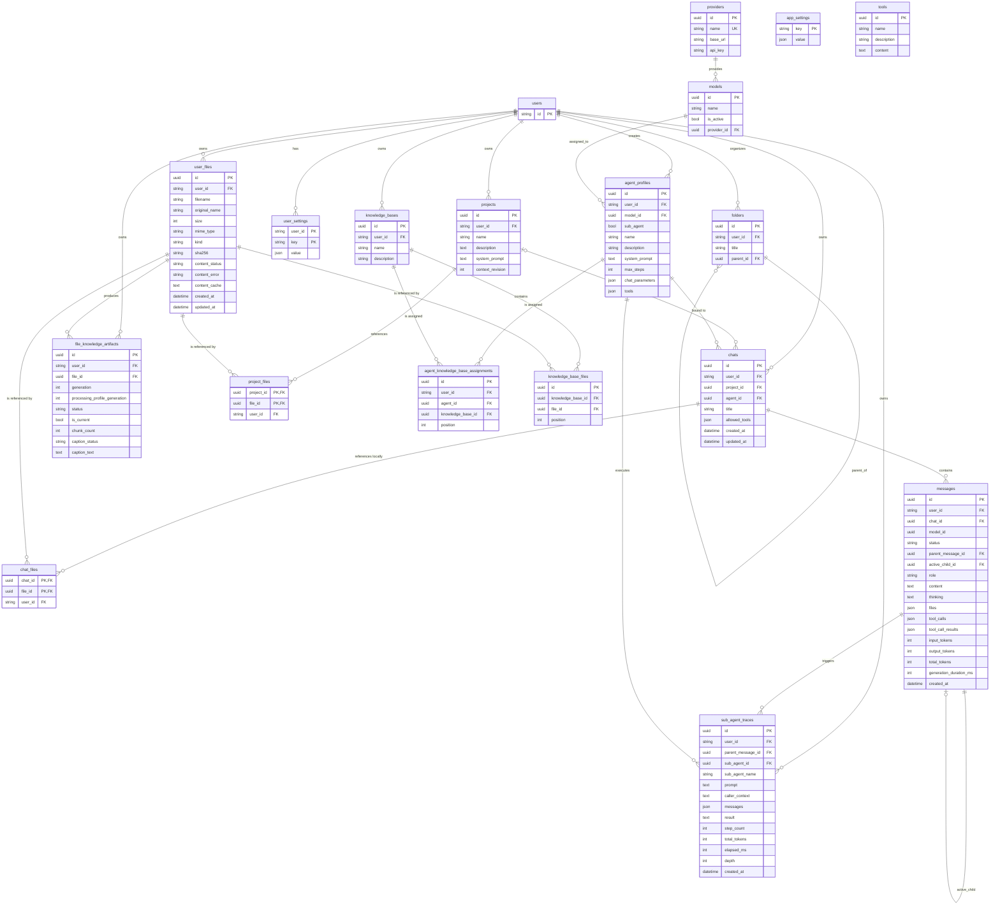
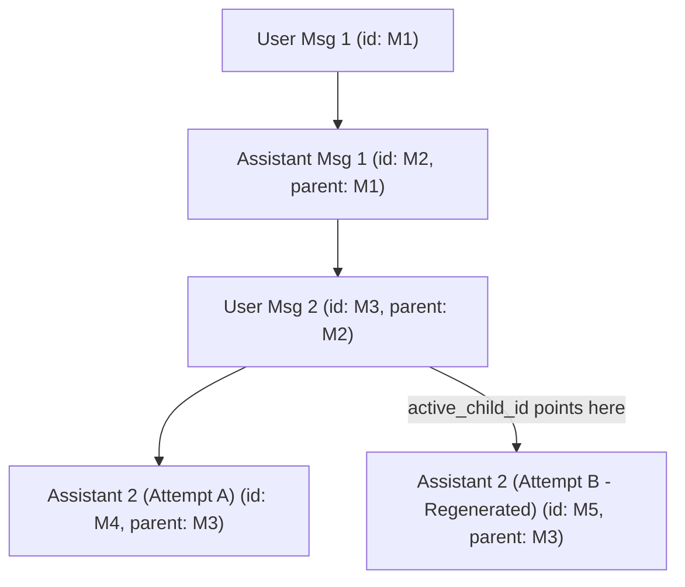

# Data Model & Storage Architecture

Asterism's persistence layer is engineered for high-concurrency local development and production deployments while maintaining clean abstraction boundaries for future database engine swaps.

---

## Storage Engine Architecture

The backend database system is managed by [`DatabaseSessionManager`](../apps/backend/asterism/db/database.py) using SQLAlchemy 2.0 Asyncio.

### High-Concurrency SQLite Configuration

Asterism applies production-grade PRAGMA settings upon establishing every raw connection:

1. **Write-Ahead Logging (`WAL`)**: Allows concurrent readers without blocking writers, and writers without blocking readers.
2. **Synchronous Normal (`NORMAL`)**: Drastically reduces filesystem sync operations without risking database corruption in WAL mode.
3. **Foreign Keys Enforcement (`foreign_keys = ON`)**: Ensures cascade deletions (`ondelete="CASCADE"`) work reliably at the SQLite engine level.
4. **Busy Timeout (`busy_timeout = 5000`)**: Waits up to 5 seconds during lock contention rather than immediately failing with `database is locked`.
5. **Memory Cache (`cache_size = -64000`)**: Allocates 64MB of in-memory page cache for lightning-fast queries.

---

## Entity Relationship Diagram (ERD)

---

## Search indexes

SQLite FTS5 virtual tables, `chat_search` and `project_search`, provide
owner-scoped keyword search over chat titles/persisted message text and project
names/descriptions. Project prompts, attachments and extracted file content are not
indexed. Fresh initialization installs indexes and insert/update/delete triggers.
The adapter accepts up to ten quoted word terms joined with `AND`; user input is
never passed through as FTS syntax. The search service rechecks owner predicates,
filters General/project chat scope before database pagination, sorts mixed results
by updated time/kind/UUID, and enriches only the selected page with current project
identity and snippets. Project search replaces folder search and ancestor traversal.

## Chat binding, context, and message tree

Each chat stores an `agent_id` foreign key to the main profile selected at creation.
The service rejects sub-agent bindings and uses the user's valid default only when
the client did not select one. Existing chats retain their binding, and a main
agent cannot be deleted or converted to a sub-agent while a chat references it.

Messages retain provider-reported `input_tokens`, `output_tokens`, `total_tokens`,
and `generation_duration_ms`. The UI's preflight context meter is not persisted
usage: it is an estimate assembled from the active thread, system prompt, tool
schemas, text attachments, and accepted images.

## The Message Tree Model

Asterism models conversation history as a **directed acyclic tree** rather than a flat linear list.

### Tree Capabilities

- **Regeneration without Data Loss**: When the user requests regeneration, the original assistant response is kept in the database with its tool calls and reasoning. The parent message's `active_child_id` is simply pointed to the newly generated child message.
- **Cancellation without Data Loss**: Explicit cancellation marks the active user message cancelled. If output had already streamed, a cancelled assistant child retains that partial content and thinking.
- **Branch Traversal**: Clients can inspect siblings (`has_siblings`, `sibling_count`, `current_sibling_index`) and switch branches without destroying alternate histories.

---

## JSONB Columns & Serialization

Asterism provides type-safe JSON serialization directly into SQLite columns using [`JSONB_COLUMN`](../apps/backend/asterism/db/columns.py):

- Supports SQLite 3.45+ native `JSONB` binary formats where supported, falling back cleanly to text JSON.
- Built-in integration with **Pydantic `TypeAdapter`**, ensuring stored JSON is validated and deserialized directly into strong domain types (such as `list[ToolCall]`, `list[ToolResult]`, and `ChatCompletionParams`).

---

## User file storage and model input

Uploaded bytes pass through the `FileStore` protocol; `LocalFileStore` currently
places them below `{storage_root}/files/{user_id}`. The `user_files` table records
ownership, sanitized and original names, MIME/kind classification, SHA-256, and a
bounded processing cache. `messages.files` stores typed snapshots/references rather
than a relational foreign key, so deleting a file removes its bytes and row without
rewriting history; affected historical attachments render as unavailable.

The authenticated, user-scoped API provides `POST /files`, paginated `GET /files`,
`GET /files/{filename}`, and `DELETE /files/{filename}`. Uploads sanitize names,
reject configured executable extensions and oversized input, and never expose
another user's bytes or metadata. An intact existing object with the same user,
sanitized filename, and SHA-256 is reused. Different bytes receive filename collision
suffixes; deduplication never crosses users or filenames.

On first attachment, `MarkItDownFileProcessor` reads text directly where possible
or converts supported documents in a worker thread. Processing is bounded by input
size, timeout, and converted-character limits; its status and safe error message are
stored on the file. Chat builds document/text cache into text parts. Image bytes are
included only for models whose `supports_vision` capability is explicitly `true` and
only below the configured vision limit; unknown capability is intentionally treated
as non-vision. See [LLM providers](llm-providers.md#file-input-capability-gating).

## File-owned knowledge artifacts

`file_knowledge_artifacts` holds the versioned derived state for an immutable
`user_files` revision: extraction cache, chunk/embedding readiness, canonical
caption metadata, safe error state, and whether the generation is current. The
database permits one current generation per file. A pending replacement cannot
displace a ready generation; it becomes current only after processing and its
vector writes complete.

`knowledge_base_files` is deliberately a small ordered membership table. It has
no processing state, vectors, or caption fields, so one library file can appear
in multiple private bases without repeat work. Agent assignments point to bases,
and retrieval resolves those memberships to allowed file IDs before issuing its
LanceDB query. File deletion explicitly cancels work and removes memberships and
artifacts before source bytes; membership deletion removes only the relationship.
See [Knowledge retrieval](knowledge-retrieval.md) for runtime and operator
behavior.

## Related Documentation

- [System Overview](overview.md)
- [Chat & Real-Time WebSocket](chat-and-websocket.md)
- [Agent Runtime & Execution Loop](agent-runtime.md)

## Project/chat source references (US-25.1)

Chats bind to zero or one owned project, with General represented by null. ProjectFile
and ChatFile are unique owner-consistent references to independent source rows; they do
not own bytes or extraction generations. Message JSON attachment snapshots include
immutable file IDs and metadata, so source deletion cannot make an old filename refer
to a later upload. Composite keys constrain message and branch-edge ownership.

The active branch is traversed once through shared chat-domain logic. Its local file
IDs must also appear in current ChatFile memberships and owned source rows; project
memberships supply the other allowed set. Sibling/inactive-branch/unselected library
files are excluded. The chat file scope API exposes source provenance and project
revision/instructions; scoped source downloads and attachment assembly use that reader.
Full prompt/tool/retrieval integration remains in EPIC-26/29.

Original bytes remain in user-scoped, file-ID-sharded FileStore storage. Organization is
relational; source consumers resolve opaque keys and listings query the database.
Deleting a source removes memberships while retaining message snapshots for unavailable
history. Project deletion sets chat project_id to null and preserves local references.
Guarded moves and explicit lifecycle coordination are implemented in US-25.2.

## Draft references and durable message acceptance

US-25.3 adds ChatDraft (owner, optional target chat, fixed 24-hour expiry and selected-ID
snapshot), ChatDraftFile (unique owner-consistent source membership) and ChatSendReceipt
(owner/request UUID, payload fingerprint and owner-consistent chat/message acknowledgement).
The draft snapshot is data, not an authorization grant: consumption validates all live
source owners and memberships again. It retains unavailable IDs after physical deletion,
so an incomplete draft cannot silently send a partial set. Draft discard/lazy expiry
cleans references, never source bytes/generations. Message/chat deletion cascades receipts;
target-chat deletion cascades its unsent drafts.

Source ingest commits before draft staging; cancellation/expiry between them can leave a
library source without granting any chat access. Message acceptance commits user history,
branch linkage, local references, receipt and draft consumption together. Request replay
returns that accepted message's current status/availability and cannot rebind revoked files
or switch branches. New-chat creation serializes owner writes for duplicate-request races;
follow-up acceptance/removal share the process-local idle-change gate with moves. The DB
write lock and explicit parent check detect concurrent branch changes before mutation.

Socket generation resumes persisted pending messages after reloading current history and
scope. Cancellation is terminal but preserves references; regeneration uses the current
persisted branch/memberships. Response-only file availability prevents historical snapshots
from authorizing removed/deleted files. Project membership is independent of local removal.
Extraction bytes/state remain owned by Files/Extraction. No migration or old API fallback
is added; full execution context/prompt/retrieval work remains EPIC-26/29.
