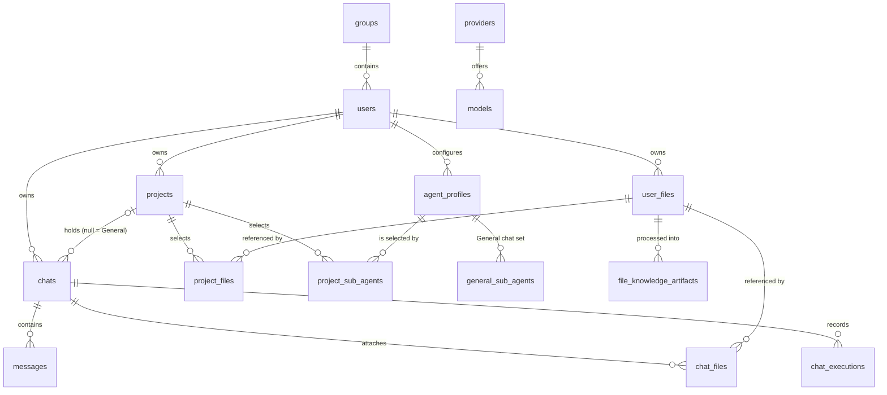
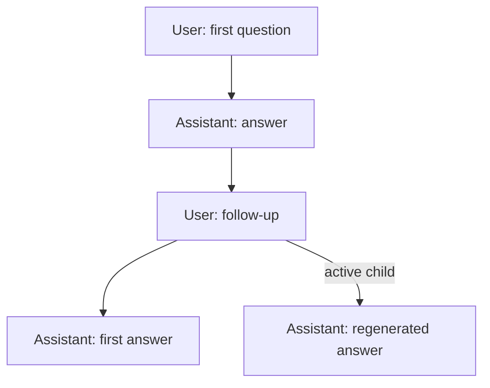

# Data and storage

This guide explains where Asterism keeps its data, how the schema is organized
and versioned, how chats and files are stored, and what happens to data when
something is deleted. Read it before adding a table or column, changing what a
message stores, or touching deletion.

## Concepts

- **Two databases.** Better Auth's `users.db` holds accounts, sessions and
  signing keys. The backend's `database.db` holds everything users create. They
  share only the user ID.
- **Everything is owned.** Nearly every backend row belongs to one user, and
  every query on it filters by that user's ID.
- **Records versus references.** Some data is a _reference_ that grants access,
  such as a project's file membership, enforced with foreign keys. Some is a
  _record_ of what happened, such as the files attached to a past message, stored
  as an immutable JSON snapshot that never grants access by itself. Deleting a file
  removes its references; records stay and show the file as unavailable.
- **Storage behind interfaces.** SQLAlchemy for relational data, `VectorStore` for
  search vectors, `FileStore` for file bytes, so each could be replaced later
  ([ADR-0019](../adr/0019-single-process-runtime-and-storage-seams.md)).

## Where data lives

Everything is under one directory, `STORAGE_ROOT` (`/storage` in the container):

| Path                 | Holds                                                              | Backed up            |
| -------------------- | ------------------------------------------------------------------ | -------------------- |
| `users.db`           | Better Auth: accounts, sessions, signing keys                      | Yes                  |
| `database.db`        | All backend data                                                   | Yes                  |
| `files/`             | Uploaded and generated files, by user                              | Yes                  |
| `knowledge/lancedb/` | Search vectors for processed files                                 | Yes                  |
| `themes/`            | Custom and edited themes ([theme storage](theme-storage.md))       | Yes                  |
| `models/`            | Downloaded model bundles: embeddings, captioning, image generation | No; downloaded again |
| `exports/`           | Users' "Download my data" archives, kept 7 days                    | No                   |
| `.last-backup.json`  | When the last backup ran, for the Status page                      | No                   |

[Backup and restore](backup-and-restore.md) explains how the backed-up parts are
copied consistently while the app runs.

## The relational database

`DatabaseSessionManager`
([`db/database.py`](../../apps/backend/asterism/db/database.py)) runs SQLAlchemy 2
in async mode on SQLite 3.45 or later. Routes get a session through `DBSessionDep`,
and services through `get_async_db_session()`.

Every connection sets these SQLite options:

| Setting                | Why                                                |
| ---------------------- | -------------------------------------------------- |
| `journal_mode = WAL`   | Readers and a writer don't block each other        |
| `synchronous = NORMAL` | Fewer disk syncs, still safe under WAL             |
| `foreign_keys = ON`    | Cascading deletes actually happen                  |
| `busy_timeout = 5000`  | Wait up to 5 seconds for a lock instead of failing |
| `cache_size = -64000`  | About 64 MB of page cache                          |

**JSON columns.** Structured values (tool calls, citations, snapshots) are stored
in JSON columns made with `jsonb_type()`
([`db/columns.py`](../../apps/backend/asterism/db/columns.py)). The column type
`PydanticJSONB` validates values with a Pydantic model or `TypeAdapter` on the way
in and out, so code reads typed objects, not dictionaries. On SQLite it stores
binary JSON with `jsonb()` and reads it back with `json()`, which is why SQLite 3.45
is the minimum. A PostgreSQL variant exists, but migrations and full-text search
assume SQLite.

## The schema by domain

The schema has 55 tables. Each domain owns its tables and the queries over them.

| Domain             | Tables                                                                                                                                                 | Holds                                                                                                                |
| ------------------ | ------------------------------------------------------------------------------------------------------------------------------------------------------ | -------------------------------------------------------------------------------------------------------------------- |
| `user`             | `users`, `deleted_users`, `account_deletion_requests`                                                                                                  | Backend user rows with About you and the display copy of name and email; tombstones; deletion requests               |
| `groups`           | `groups`                                                                                                                                               | Groups, their model and tool lists, their token budgets                                                              |
| `agent`            | `agent_profiles`, `general_sub_agents`, `sub_agent_traces`                                                                                             | The main agent and sub-agents; the General chat set; content-free delegation audit                                   |
| `chat`             | `chats`, `messages`, `chat_files`, `chat_executions`, `chat_drafts`, `chat_draft_files`, `chat_send_receipts`, `chat_compactions`                      | Chats and the message tree; attachments; immutable execution records; drafts and send receipts; compaction summaries |
| `projects`         | `projects`, `project_files`, `project_sub_agents`                                                                                                      | Projects and their file and sub-agent selections                                                                     |
| `files`            | `user_files`                                                                                                                                           | The file library: names, type, hash, processing cache, origin                                                        |
| `knowledge`        | `file_knowledge_artifacts`, `file_knowledge_extractions`                                                                                               | Processing results per file ([file knowledge processing](file-knowledge-processing.md))                              |
| `skills`           | `skills`, `agent_skills`                                                                                                                               | Skill documents and their assignments                                                                                |
| `prompt_templates` | `prompt_templates`                                                                                                                                     | Prompt templates and rubrics, told apart by `kind`                                                                   |
| `study`            | `study_decks`, `study_cards`, `study_review_logs`, `study_quizzes`, `study_quiz_questions`, `study_quiz_attempts`, `study_quiz_answers`, `study_notes` | Flashcards and reviews, quizzes and attempts, notes ([study tools](study-tools.md))                                  |
| `reflections`      | `reflections`                                                                                                                                          | End-of-session reflections                                                                                           |
| `canvas`           | `canvas_items`, `canvas_versions`                                                                                                                      | Canvas documents and every version of each                                                                           |
| `classes`          | `classes`, `class_members`, `class_invites`, `educator_requests`                                                                                       | Classes, rosters, invite links, requests for educator access                                                         |
| `courses`          | `course_versions`, `course_files`, `course_copies`, `course_copy_items`                                                                                | Published courses and each student's copy                                                                            |
| `image_generation` | `image_generations`                                                                                                                                    | Every image request and its outcome                                                                                  |
| `chatgpt`          | `chatgpt_connections`, `chatgpt_authorizations`, `chatgpt_host`                                                                                        | Personal ChatGPT plan connections, encrypted                                                                         |
| `packs`            | `pack_imports`, `pack_import_items`                                                                                                                    | Team pack imports and what each created                                                                              |
| `settings`         | `app_settings`, `user_settings`, `providers`, `models`                                                                                                 | Instance and user settings, providers and models                                                                     |
| `usage`            | `usage_records`                                                                                                                                        | The usage ledger                                                                                                     |
| `data_export`      | `data_exports`                                                                                                                                         | "Download my data" archive state                                                                                     |

Two FTS5 virtual tables, `chat_search` and `project_search`, back search
([below](#search)).

The core of the schema, the part every turn touches, looks like this:

`agent_profiles` holds both the user's single main agent, which has no model, and
their sub-agents, each bound to one model. Database constraints keep those roles
consistent, and restrictive foreign keys stop a model from being deleted while a
sub-agent is bound to it.

## Schema versioning

The backend schema is versioned with Alembic
([ADR-0069](../adr/0069-versioned-schema-migrations.md)). The revision in
`alembic_version` is the schema version. Migrations live in
[`db/migrations/versions/`](../../apps/backend/asterism/db/migrations/versions/), and
[`db/migrate.py`](../../apps/backend/asterism/db/migrate.py) runs them.

- **Baseline.** The first revision creates the schema as it stood on 2026-11-17,
  as frozen SQL: every table and index, the built-in groups, the FTS5 tables and
  their triggers, and the triggers that keep records immutable. `create_all` is
  not a way to initialize a database; tests may use it for throwaway schemas.
- **Upgrading.** `init:db` and container startup run `upgrade head` in one SQLite
  transaction, so a failed migration rolls back completely, DDL included. They use
  a separate engine without the application's PRAGMAs, so foreign keys are off
  while tables are rebuilt.
- **Refusing a mismatch.** `init:db` and the API server refuse a database whose
  revision the code doesn't know (newer, or from another branch), and a non-empty
  database with no revision. The API server also refuses a database that is behind.
  Each refusal names both revisions and changes nothing. There are no downgrades:
  the way back from an upgrade is restoring a backup.
- **Keeping models and migrations in step.** `tests/test_migrations.py` builds one
  database by migrations and one from the models, and requires the same tables,
  columns, constraints, indexes, triggers, FTS tables and seed groups, plus an empty
  autogenerate diff. A model change without a migration fails CI.
- **Better Auth** migrates `users.db` itself, with its pinned CLI, outside Alembic.

The [backend README](../../apps/backend/README.md#database-initialization-and-migrations)
explains how to write a migration and its upgrade test. `pnpm reset:db` deletes
local data and is for development only ([initialization and reset](development-reset.md)).

## Chats and messages

### The message tree

A chat's history is a tree, not a list, so editing or regenerating never loses
anything:

- **Regenerating** adds a sibling reply and points the parent's `active_child_id`
  at it. The old reply stays, with its tool calls and reasoning.
- **Editing** a message adds a sibling user message, starting a new branch.
- **Cancelling** marks the turn cancelled and keeps any text already written.
- **Switching branches** reads siblings (`sibling_count`,
  `current_sibling_index`) without deleting anything. Regenerating re-runs from
  the answer's parent, so in a turn that used tools the versions can sit on a
  tool-call step with no footer. The answer's switcher then controls the
  nearest step in the turn that has siblings
  ([`turn-branch.ts`](../../apps/frontend/src/features/chat/lib/turn-branch.ts)).

The _active branch_ is the path from the root following each message's active
child. It decides what the user sees, what the model is sent, and which
attachments are in scope.

Each chat stores its main agent (`agent_id`, always the user's own), its selected
model with a revision, its project (or null for General), its learning mode and
its `purpose` (an ordinary conversation, or a hidden special-purpose chat such as
skill drafting).

### What a message stores

Besides its role, content and tree links, a message keeps records of its turn.
These are JSON snapshots, never foreign keys: they describe what happened and
grant nothing. Reads recheck any file or source they mention against the chat's
current scope and mark it `available` or not.

| Field                                                                     | Holds                                                                                                                            |
| ------------------------------------------------------------------------- | -------------------------------------------------------------------------------------------------------------------------------- |
| `files`                                                                   | Snapshots of the files attached to a user message, by immutable file ID                                                          |
| `inline_files`                                                            | `asterism-file:` references the server resolved in the content ([ADR-0039](../adr/0039-inline-file-references-in-markdown.md))   |
| `citations`                                                               | `asterism-cite:` claim citations, with an excerpt of each passage ([ADR-0040](../adr/0040-claim-level-citations.md))             |
| `delegations`                                                             | One record per sub-agent call made in this step ([agent runtime](agent-runtime.md#delegation-projects-and-the-general-chat-set)) |
| `verification`                                                            | The latest verify pass, one label per claim ([ADR-0041](../adr/0041-verify-pass.md))                                             |
| `disagreements`                                                           | The latest disagreement pass ([ADR-0042](../adr/0042-disagreement-display.md))                                                   |
| `exercise_record`                                                         | Spot the error's hidden error, attempts and reveal ([learning modes](learning-modes.md#spot-the-error-a-hidden-graded-mistake))  |
| `draft_comments`                                                          | Inline comments from a Draft feedback reply; only their resolved state changes later                                             |
| `accepted_about`, `accepted_rubric`, skill and mode snapshots             | What the user message was sent with, pinned ([execution context](execution-context.md#about-you-on-a-turn))                      |
| `input_tokens`, `output_tokens`, `total_tokens`, `generation_duration_ms` | What the provider reported for this step                                                                                         |

Pinned inputs are immutable: SQLite triggers refuse updates to them and to
`chat_executions` records. Composite foreign keys keep a message's execution in the
same chat and owner.

### Sending records

Three tables make sending safe to retry ([chat and WebSocket](chat-and-websocket.md#sending-a-message)):

- **`chat_drafts` and `chat_draft_files`**: a draft and the library files staged
  in it. A draft lasts 24 hours and grants no access. Discarding it removes the
  references, never the files.
- **`chat_send_receipts`**: one row per accepted `request_id`, with a fingerprint
  of the payload, so a retry returns the original message.

Accepting a message writes the message, its branch link, its attachments, its
receipt and the draft's consumption in one transaction. Creating a new chat
serializes per user, so two identical requests racing can't create two chats.

## Files

### Storing bytes

`FileStore` ([`files/store.py`](../../apps/backend/asterism/domains/files/store.py)) is
the only way to read or write file bytes. `LocalFileStore` writes each file to
`files/{encoded user id}/{shard}/{shard}/{file id}/source{extension}`. Callers pass
opaque storage keys and never build paths themselves. Reads are async
(`read_bytes`, with an optional byte limit, and `exists`). Only `local_path()` returns
a real path, for the few consumers that need a file on disk: streamed downloads,
the document converter and page counting. An object-store adapter would make a
temporary copy there.

### The library

`user_files` records each file's owner, safe and original names, type, SHA-256 hash
and a bounded cache of its converted text. The API is `POST /files/`, `GET /files/`
(paginated), `GET /files/{filename}` and `DELETE /files/{filename}`, all scoped to
the user.

- **Uploads** sanitize names, refuse executable extensions and anything over the
  upload limit, and are limited per address at nginx.
- **Duplicates.** Uploading identical bytes under the same name reuses the
  existing file. Different bytes under a taken name get a numbered suffix.
  Deduplication never crosses users or names.
- **Generated files.** Files a tool creates, such as generated images, have
  `origin = "agent"` and record which chat, execution, agent and tool produced them.
  They are registered by tool code through
  [`files/produced.py`](../../apps/backend/asterism/domains/files/produced.py), never
  through an HTTP route, and are limited per run by `MAX_PRODUCED_FILES_PER_RUN` and
  `MAX_PRODUCED_BYTES_PER_RUN`. A generated file is in a chat's scope only while a
  message from the run that produced it is on the active branch. Deleting the chat
  leaves the file in the library.

What happens after upload, from conversion to searchable vectors, is in
[file knowledge processing](file-knowledge-processing.md).

### References

A file reaches a turn only through a reference: `project_files` (the project's
files) or `chat_files` (attachments in a chat). Both are unique, owner-consistent
rows pointing at the library file. Neither copies the bytes or the processing
results, so a file shared by ten projects is stored and processed once.

## Search

Two SQLite FTS5 tables give keyword search: `chat_search` over chat titles and
message text, and `project_search` over project names and descriptions. Project
instructions, attachments and file content are not indexed. Triggers keep the
indexes current; their definitions live in
[`chat/search_index.py`](../../apps/backend/asterism/domains/chat/search_index.py),
and changing them needs a migration.

**Queries are built safely.** The service takes at most ten case-folded words; the
adapter quotes each and joins them with `AND`, so user input is never read as FTS
syntax. `ChatSearchIndex` returns composable SQL selects of matching IDs rather
than running queries itself.

**Ownership comes before pagination.**
[`chat/search.py`](../../apps/backend/asterism/domains/chat/search.py) joins those
selects with the owner-scoped base selects from `chat/queries.py` and
`projects/queries.py`, applies the General or project filter, and only then counts
and pages. Results sort by last update, newest first, then by kind and ID.

**Snippets are fetched only for the page.** After paging, the service loads the
selected chats and projects, and fetches a snippet only for chats whose title
doesn't already match every word. One query returns, per chat, the earliest message
containing any of the words. All words must match the chat as a whole, but they may
be spread over several messages.

This bounds what the application holds in memory and how many queries it sends,
not the database's own work: counting, matching and sorting can still scan many
rows. Measurements are in the
[2026-10-24 search verification](../reviews/us-34.1-verification-2026-10-24.md).

## The usage ledger

`usage_records` holds one append-only row per completed model call or image
request: the user, the source (chat, sub-agent, title, study tool and so on), the
model, the chat, tokens, images, the model's prices at that moment, and whether it
ran on a ChatGPT plan. Rows have no foreign key to models or chats, so deleting
either never changes past usage. [Usage and budgets](usage-and-budgets.md) explains
how the ledger is written and read.

## The data lifecycle

| When this is deleted             | This happens                                                                                                                                                                       |
| -------------------------------- | ---------------------------------------------------------------------------------------------------------------------------------------------------------------------------------- |
| A file is removed from a project | Only the `project_files` row goes. The file stays in the library.                                                                                                                  |
| A file is deleted                | Its processing jobs are cancelled. Every reference, its processing results and vectors, then its bytes are removed. Past messages keep their snapshots and show it as unavailable. |
| A chat is deleted                | Its messages, attachments, drafts, receipts, executions, compactions and canvas go by cascade. Library files stay, including files the chat generated.                             |
| A project is deleted             | Its running work is cancelled, its chats move to General keeping their attachments, and its selections go. Library files stay.                                                     |
| A user is deleted                | See below.                                                                                                                                                                         |

**Deleting a user** is permanent
([`user/service.py`](../../apps/backend/asterism/domains/user/service.py),
`delete_user`; [ADR-0070](../adr/0070-account-lifecycle.md)):

1. Their running chats and file jobs are stopped.
2. One transaction deletes the `users` row, which cascades to everything they own,
   including classes they teach, and writes a tombstone in `deleted_users` so the
   ID can never be recreated.
3. Work that started meanwhile is stopped again.
4. Their file folder, their vectors and their export archives are removed. These
   steps log failures rather than stopping, because the database already says the
   user is gone.

Better Auth's account is removed before any of this, by the admin action that
calls it.

**Downloading my data.** Settings → General → Your data builds one zip archive of
everything the user owns ([ADR-0076](../adr/0076-download-my-data.md)): account
details, settings, About you, each chat as Markdown and JSON with all branches and
canvas versions, skills, library files, and records from an allowlist of tables
(projects, study material, reflections, templates, image requests, usage, class
memberships and requests). It leaves out credentials, bookkeeping such as receipts
and drafts, processing results and vectors, which can be rebuilt from the files,
and agent traces. A new table is not exported until it is added to the allowlist in
`data_export/records.py`.

Builds run one at a time for the whole instance, in the background, and each user
has at most one archive. The archive is written to `exports/` as `.partial`, renamed
when complete and kept for 7 days. A failed or cancelled build deletes its
`.partial` file. It is downloaded through a link valid for five
minutes, signed with `SYSTEM_KEY`, so the browser can stream it straight to disk.

## Rules

- Every query on user data filters by owner, in the owning domain's `queries.py`,
  before pagination.
- References grant access; snapshots record history and grant nothing.
- Pinned inputs and execution records never change after they are written.
- Every schema change ships as a migration with an upgrade test.
- Bytes go through `FileStore`, vectors through `VectorStore`; nothing else builds a
  storage path.
- Deleting a user leaves a tombstone, and their ID is never reused.

## Where the code lives

1. [`db/database.py`](../../apps/backend/asterism/db/database.py): the session
   manager and SQLite settings.
2. [`db/columns.py`](../../apps/backend/asterism/db/columns.py): typed JSON columns.
3. [`db/migrations/`](../../apps/backend/asterism/db/migrations/) and
   [`db/migrate.py`](../../apps/backend/asterism/db/migrate.py): migrations.
4. [`chat/models.py`](../../apps/backend/asterism/domains/chat/models.py): chats,
   messages and execution records.
5. [`files/store.py`](../../apps/backend/asterism/domains/files/store.py) and
   [`files/service.py`](../../apps/backend/asterism/domains/files/service.py): file
   storage and the library.
6. [`chat/search.py`](../../apps/backend/asterism/domains/chat/search.py) and
   [`chat/search_index.py`](../../apps/backend/asterism/domains/chat/search_index.py):
   search.

## Related

- [File knowledge processing](file-knowledge-processing.md) and
  [knowledge retrieval](knowledge-retrieval.md)
- [Backup and restore](backup-and-restore.md)
- [Usage and budgets](usage-and-budgets.md)
- [ADR-0069](../adr/0069-versioned-schema-migrations.md): migrations
