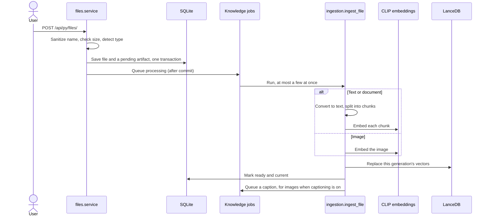

# File knowledge processing

This guide explains what happens after a user uploads a file: how its text is
extracted, split and embedded, how images are embedded and captioned, how the
results are versioned and replaced, and how failures are retried. Read it before
changing the upload path, the processing pipeline or the processing policy.
[Knowledge retrieval](knowledge-retrieval.md) covers the other half: searching
those results during a turn.

## Concepts

- **Processing belongs to the file.** Each library file is processed once,
  whatever projects or chats it is used in. A project or chat only references the
  file; adding it to ten projects doesn't process it ten times.
- **A knowledge artifact** is the complete processing result for one file under
  one version of the processing policy: its status, its chunk count, and whether
  it has anything searchable (`file_knowledge_artifacts`).
- **A derived output** (an _extraction_) is one product of processing: the text
  extraction, the embeddings or the caption. Each has its own status, provider,
  model and error (`file_knowledge_extractions`, one row per artifact and kind).
- **A generation** is one version of a file's artifact. Reprocessing makes a new
  generation instead of changing a working one, and the new one replaces the old
  only when it has fully succeeded. The generation retrieval uses is the
  **current** one.
- **A chunk** is a bounded excerpt of text, or the stand-in text for an image,
  stored with its vector in LanceDB.
- **The processing policy** (`knowledge.processing`) is the one instance-wide
  choice of how files are processed, including the captioning choice. Users can't
  choose a different one per file.

## How it works

### From upload to searchable



1. **The upload** (`upload_files` in
   [`files/service.py`](../../apps/backend/asterism/domains/files/service.py))
   saves the bytes through `FileStore`, creates the `user_files` row and a
   pending artifact with its text and embedding outputs, and commits them
   together. Processing is queued only after the commit, so a job never sees a
   file that isn't saved.
2. **A job runs** in the knowledge job manager
   ([`knowledge/runtime.py`](../../apps/backend/asterism/domains/knowledge/runtime.py)),
   which runs at most `MAX_CONCURRENT_KNOWLEDGE_JOBS` (default 4) jobs at once and
   never the same artifact twice. Jobs wait, as pending rows, until the embedding
   model is downloaded and verified.
3. **Text and documents** are converted to text by `MarkItDownFileProcessor`
   ([`files/processor.py`](../../apps/backend/asterism/domains/files/processor.py)),
   split into overlapping chunks and embedded.
4. **Images** are embedded directly as one vector, with `Image file: <name>` as the
   chunk's stand-in text.
5. **Vectors are written,** replacing any partial rows from an earlier attempt at
   the same generation, and only then does the generation become current.

The file manager shows each output's status and offers retry and cancel.

### Converting documents

`MarkItDownFileProcessor` reads plain text directly and converts other supported
documents (PDF, Word and so on) in a worker thread. Each step is bounded:

| Limit                  | Setting                                                       | Default                               |
| ---------------------- | ------------------------------------------------------------- | ------------------------------------- |
| Largest file processed | `MAX_PROCESS_FILE_SIZE_BYTES`                                 | 100 MiB, never above the upload limit |
| Conversion time        | `FILE_CONVERSION_TIMEOUT_S`                                   | 60 seconds                            |
| Converted text kept    | `MAX_CONVERTED_CHARS`                                         | 100,000 characters                    |
| Chunk size and overlap | `KNOWLEDGE_CHUNK_SIZE_CHARS`, `KNOWLEDGE_CHUNK_OVERLAP_CHARS` | 1,000 and 150 characters              |
| Chunks per file        | `MAX_KNOWLEDGE_CHUNKS_PER_DOCUMENT`                           | 200                                   |

The converted text is cached on the file row. The file's recorded SHA-256 is the
authority on its bytes: every read checks it, and a mismatch drops the cache, so a
file changed on disk outside Asterism can never feed stale text to a model.

### Embeddings

Embeddings come from a local CLIP model
([`knowledge/embedding.py`](../../apps/backend/asterism/domains/knowledge/embedding.py)),
so file content never leaves the server to be embedded. The model is pinned: a
specific revision of `Xenova/clip-vit-base-patch32`, its quantized ONNX file
identified by size and SHA-256. It produces normalized 512-dimensional vectors for
both text and images, which is what lets a text query find an image.

On first start, Asterism downloads the model's allowlisted files (about 150 MB) to
a temporary directory, verifies them, and moves them into
`STORAGE_ROOT/models/knowledge-clip`. The server starts serving without waiting;
uploads made meanwhile stay pending and are processed once the model is ready. A
failed download is retried at the next start. `SKIP_KNOWLEDGE_MODEL_PROVISIONING`
turns this off, for tests.

The model runs on the CPU and loads only local files, with no model-supplied code.
Embedding and vector-store calls run in worker threads behind their own limits,
`MAX_CONCURRENT_KNOWLEDGE_EMBEDDINGS` and `MAX_CONCURRENT_KNOWLEDGE_VECTOR_OPERATIONS`
(2 each). Allow about 1.25 GiB of memory per embedding worker
([measurements](../reviews/2026-09-22-knowledge-model-benchmarks.md)).

Each vector row records its provenance, so it can always be traced and removed:

```text
id = SHA-256(file_id : generation : chunk_ordinal)
user_id, file_id, generation, chunk_ordinal, content, vector
```

### Image captions

Captions make images findable by what they show, not just by visual similarity.
Captioning is off by default. The admin chooses one of three settings in Admin
Settings → Image captioning:

- **Off.**
- **A provider model.** The image is sent to one admin-chosen model that the
  provider or catalog reports as supporting vision; a manually asserted capability
  isn't enough. This is the one place an external provider receives users' images,
  and there is no fallback to another provider.
- **Local.** A pinned SmolVLM2 export (int8) runs on the server's CPU with ONNX
  Runtime, without PyTorch ([ADR-0077](../adr/0077-torch-free-default-image.md)).
  The admin downloads it from the same page
  (`POST /settings/app/caption-model/download`); when local captioning is on and
  the bundle is missing or out of date, startup downloads it too. The download
  fetches the pinned file list (about 265 MB), checks every file against the
  SHA-256 pinned in the code, then replaces the model folder, removing any older
  bundle. Caption jobs never download anything:
  while the bundle is missing or doesn't verify, local captions wait as pending
  and resume once it verifies. Allow about 2 GiB of memory headroom; captions run
  one at a time by default (`MAX_CONCURRENT_LOCAL_CAPTIONS`) and stop at 128
  tokens or `FILE_CONVERSION_TIMEOUT_S`.

A caption is queued once an image's artifact is ready. `captioning.caption`
([`knowledge/captioning.py`](../../apps/backend/asterism/domains/knowledge/captioning.py))
checks that the file is an image under `MAX_VISION_IMAGE_BYTES`, asks the chosen
captioner for a short description, embeds it as one more chunk, and stores the text
as the artifact's captioning output. The artifact is then searchable through its
caption. Captions are indexed straight away; there is no approval step. Users can't
edit a caption, but regenerating the file in Files reprocesses both the embedding
and the caption.

An admin can't remove a provider or model while captioning uses it. They first
switch captioning to local or off.

### Changing the processing policy

The admin edits the policy, and `knowledge/processing.py` owns the only path that
changes it. When the policy's fingerprint changes, its revision goes up and every
eligible file gets a new pending generation. Until a file's new generation
succeeds, its previous ready generation stays current and searchable, so a policy
change never makes files disappear from search.

### Keeping generations bounded

Every policy change creates a generation for every file, each with its own vectors.
`prune_superseded_generations`
([`knowledge/retention.py`](../../apps/backend/asterism/domains/knowledge/retention.py))
runs whenever a generation finishes, and keeps:

- the current generation, always;
- any generation still being processed;
- the newest `KNOWLEDGE_GENERATION_RETENTION` superseded generations (default 1).

Vectors are deleted before the row that describes them. A row whose vectors are
gone is retried at the next prune; vectors without a row would be orphans nothing
could find.

### Which generation the API shows

File listings and `GET /files/{filename}/knowledge` show the **current** generation
when there is one, so the interface and search agree on what a file is using. A
file never processed has no current generation, so the one being built is shown.
Retry and cancel act on the **newest** generation instead, because they act on work
in progress: they retry a failed replacement or stop one, without touching the
generation that is serving the file.

### Status, retries and restarts

Artifacts and their outputs share one set of states: `pending`, `running`, `ready`,
`failed` and `canceled`. An output's state is its own: a generation is `ready` once
its embeddings are written, even while its caption is still `running`.

At startup, `recover_interrupted` sets interrupted `running` artifacts back to
`pending` and marks interrupted captions `failed` with the code `interrupted`. Once
the embedding model is ready, `resume_ingestion_jobs` queues pending artifacts
again, and, unless captioning is off, captions that were pending or interrupted.
Other caption failures wait for the user to retry. Because jobs are keyed by
artifact, resuming twice never queues the same work twice.

### Deleting

Removing a file from a project removes only the reference. Deleting the file
cancels its jobs, removes every reference and artifact, deletes its vectors once the
database change has committed, and finally deletes its bytes. A job still running
when this happens finds no rows when it next writes, and can't bring anything back.

### The file page and similar files

The file page (`/files/{filename}`) shows the extracted text, the caption, the
projects that use the file and similar files. `GET /files/{filename}/similar`
averages the file's current vectors into one, searches the user's other ready
files, and groups the results by file.

## Boundaries

The `files` and `knowledge` domains depend on each other in one direction only.
`files` uses the published service in
[`knowledge/artifacts.py`](../../apps/backend/asterism/domains/knowledge/artifacts.py)
to create, report, reset, cancel and remove artifacts and to rank similar files.
`knowledge` never imports `files`. It reads sources through the small contract in
[`knowledge/sources.py`](../../apps/backend/asterism/domains/knowledge/sources.py):
a file's identity, type, converted text and, for images, bytes. `files` implements
it, and the application installs it at startup. A test enforces both directions.

The knowledge admin routes live in
[`knowledge/router.py`](../../apps/backend/asterism/domains/knowledge/router.py)
under `/settings/app/…`. The settings domain asks whether a provider is in use for
captioning through an interface it owns, which the knowledge domain implements, so
neither imports the other.

## Rules

- A file is processed once, however many places reference it.
- A new generation becomes current only after its vectors are written. A failed
  replacement leaves the previous one working.
- Embedding happens on the server; only captioning with a provider model sends
  images out, and only to the one model the admin chose.
- Models are pinned by revision and hash, and never run model-supplied code.
- Logs never contain image bytes or caption text.
- Deleting a file removes everything derived from it.

## Where the code lives

1. [`files/service.py`](../../apps/backend/asterism/domains/files/service.py):
   upload, regenerate, cancel, delete and similar files.
2. [`knowledge/artifacts.py`](../../apps/backend/asterism/domains/knowledge/artifacts.py):
   the published artifact service.
3. [`knowledge/runtime.py`](../../apps/backend/asterism/domains/knowledge/runtime.py):
   the job manager, startup recovery and model download.
4. [`knowledge/ingestion.py`](../../apps/backend/asterism/domains/knowledge/ingestion.py):
   chunking, embedding and promotion.
5. [`knowledge/captioning.py`](../../apps/backend/asterism/domains/knowledge/captioning.py):
   captions, local and provider.
6. [`knowledge/vector_store.py`](../../apps/backend/asterism/domains/knowledge/vector_store.py):
   the LanceDB adapter.

## Related

- [Knowledge retrieval](knowledge-retrieval.md): searching processed files during a turn
- [Data and storage](data-and-storage.md#files): the library and file storage
- [Model benchmarks](../reviews/2026-09-22-knowledge-model-benchmarks.md)
- [ADR-0012](../adr/0012-user-files-vision-and-document-routing.md): file routing
  and vision
