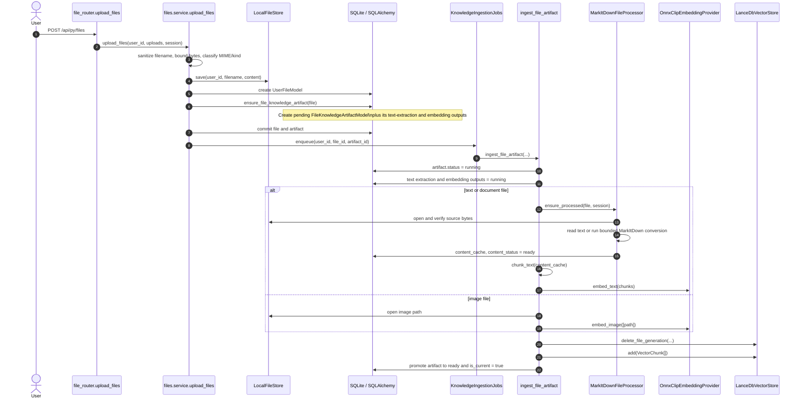

# File Upload, Embedding, and Caption Pipeline

This guide describes the implemented path from a user upload to searchable
knowledge. It is intentionally file-owned: a `UserFileModel` has derived
`FileKnowledgeArtifactModel` generations, while project/chat memberships only
reference a file and never initiate duplicate work.

## Terminology

| Term                              | Meaning in Asterism                                                                                                                                                                                                                                                               | Implemented representation                                                             |
| --------------------------------- | --------------------------------------------------------------------------------------------------------------------------------------------------------------------------------------------------------------------------------------------------------------------------------- | -------------------------------------------------------------------------------------- |
| **Source file**                   | The immutable, user-owned upload from which knowledge is derived. It owns the original bytes and identity, not the derived text, vectors, or caption.                                                                                                                             | `UserFileModel` plus bytes in `LocalFileStore`                                         |
| **Knowledge artifact**            | The complete, versioned set of derived knowledge for one source-file revision under one processing profile: its generation, its lifecycle, the denormalized searchable aggregate, and one derived output per kind. This is the canonical meaning of _artifact_ in this guide. | `FileKnowledgeArtifactModel` / `file_knowledge_artifacts`                                             |
| **Derived output (extraction)**   | One derived output of a source file — its text extraction, its embeddings, or its caption. Each has its own status, provider, model, safe errors, and kind-specific payload, so adding an output does not reshape the artifact. | `FileKnowledgeExtractionModel` / `file_knowledge_extractions`, one row per `(artifact_id, kind)` |
| **Artifact generation**           | A monotonic version of a file's knowledge artifact. Reprocessing creates a new generation instead of modifying a usable one in place.                                                                                                                                             | `FileKnowledgeArtifactModel.generation` and `VectorChunk.artifact_generation`                 |
| **Current artifact**              | The one ready artifact generation selected for a source file. A replacement becomes current only after its vectors are written successfully.                                                                                                                                      | `FileKnowledgeArtifactModel.is_current`, protected by a partial unique index                  |
| **Reported artifact**             | The artifact generation an API reports for a file: the current generation when one exists (the generation retrieval serves), otherwise the newest generation (the one still being built).                                                                                                                                  | `knowledge.queries.select_file_artifacts` plus the files domain's `file_knowledge_summaries` |
| **Generation retention**          | The window of superseded artifact generations kept per file. The current generation plus `KNOWLEDGE_GENERATION_RETENTION` superseded generations are kept; the rest are pruned with their vectors.                                                                                                                          | `KNOWLEDGE_GENERATION_RETENTION` plus `knowledge.retention.prune_superseded_generations` |
| **Processing policy**             | The single platform-wide extraction, chunking, embedding, and caption policy. Users cannot select a different model or policy per file.                                                                                                                                           | Versioned `knowledge.processing` value in `ApplicationSettingsModel`                   |
| **Profile generation / identity** | The profile's revision number and deterministic fingerprint, copied into each artifact to show which policy produced it. A changed identity queues a replacement artifact for each eligible library file.                                                                         | `processing_profile_generation`, `processing_profile_identity`                         |
| **Content cache**                 | Bounded converted text used as the input to chunking. It is source-file conversion state, distinct from the artifact's indexed vector rows.                                                                                                                                       | `UserFileModel.content_cache`, produced by `MarkItDownFileProcessor`                   |
| **Chunk**                         | One bounded text excerpt, or the display content associated with a visual image embedding. A chunk has stable provenance within an artifact generation.                                                                                                                           | `VectorChunk` and a LanceDB `knowledge_chunks` row                                     |
| **Embedding / vector**            | A normalized numeric representation of a chunk, caption, or image used for similarity search. Vectors are not relational artifact fields; their provenance links them to an artifact generation.                                                                                  | `OnnxClipEmbeddingProvider`, `LanceDbVectorStore`                                      |
| **Searchable aggregate**          | Whether a generation has searchable text. Text chunks make it searchable, and so does a caption. It is denormalized on the artifact row so the retrieval hot path stays a single-row read.                                                                                            | `FileKnowledgeArtifactModel.searchable`                                               |
| **Canonical caption**             | The one derived caption associated with an image artifact, shared wherever that file is used. It may be generated or regenerated in Files; it is shared across project/chat references.                                                                                           | The captioning derived output and one caption `VectorChunk`                              |
| **Membership**                    | A reference between a project or chat and a source file. Removing it preserves the file and its knowledge artifact.                                                                                                                                                               | `ProjectFileModel` / `ChatFileModel`                                                   |
| **Allowed file IDs**              | The live execution file IDs resolved from project memberships and active-branch chat attachments. This is the retrieval authorization boundary.                                                                                                                                   | `ExecutionContextResolver` plus `LanceDbVectorStore.search(..., allowed_file_ids=...)` |

## Components and ownership

| Concern           | Primary classes / functions                                  | Responsibility                                                                                                          |
| ----------------- | ------------------------------------------------------------ | ----------------------------------------------------------------------------------------------------------------------- |
| HTTP upload       | `file_router.upload_files`, `files.service.upload_files`     | Validates the request, writes source bytes, persists the source-file record, and queues work after commit.              |
| Source bytes      | `FileStore`, `LocalFileStore`                                | Owns bytes beneath `STORAGE_ROOT/files/{user_id}` and prevents path traversal.                                          |
| File conversion   | `MarkItDownFileProcessor.ensure_processed`                   | Produces bounded text cache for text/document files; verifies file integrity and records safe file-content errors.      |
| Artifact state    | `FileKnowledgeArtifactModel`, `ensure_file_knowledge_artifact`      | Owns processing generation, profile fingerprint, lifecycle, the searchable aggregate, and the chunk count. |
| Derived outputs   | `FileKnowledgeExtractionModel`, `knowledge/extractions.py`         | Owns one row per derived output — its status, provider, model, safe errors, and kind-specific payload. |
| Processing policy | `knowledge/policy.py`, `knowledge/processing.py`              | Owns the policy's schema, persistence, and transitions, including the replacement generations a policy change queues. |
| Processing queue  | `KnowledgeIngestionJobs`, `ingest_file_artifact`             | Runs at most one in-process job per artifact ID and promotes a generation only after vector writes succeed.             |
| Embeddings        | `OnnxClipEmbeddingProvider`                                  | Lazily verifies and loads the pinned local ONNX CLIP bundle, then emits normalized text or image vectors.               |
| Vectors           | `VectorChunk`, `LanceDbVectorStore`                          | Persists vectors keyed by user, file, artifact generation, and chunk ordinal.                                           |
| Caption queue     | `KnowledgeCaptionJobs`, `_caption_file_artifact`             | Creates and indexes a canonical image caption after the image artifact is ready.                                        |
| Caption providers | `LocalSmolVlm2CaptionProvider`, `_provider_caption_document` | Uses a verified local bundle or the single administrator-selected vision provider.                                      |

`runtime.py` constructs the process-lifetime services: `vector_store`,
`embedding_provider`, `knowledge_ingestion_jobs`, `local_caption_provider`, and
`knowledge_caption_jobs`. `initialize_knowledge_runtime()` opens LanceDB and
makes interrupted jobs retryable; `shutdown_knowledge_runtime()` cancels jobs and
releases model and database resources.

## Upload to ready artifact



`upload_files()` creates the source record and the pending artifact in one
transaction. It starts the background work only after that commit, so a worker
never sees an uncommitted source file or artifact. Re-uploading intact bytes with
the same owner and sanitized name returns the existing file; different bytes use a
collision-suffixed name.

`ensure_file_knowledge_artifact()` resolves the typed, versioned
`knowledge.processing` application setting. Its profile generation and deterministic
identity are copied into the artifact. The artifact's unique `(file_id,
generation)` pair and partial unique current-generation index make the source
file the unit of processing.

The setting is parsed by `KnowledgeProcessingConfiguration`, with nested
`KnowledgeProcessingCaptioningConfiguration`. The knowledge domain owns the
policy end to end: `knowledge/policy.py` persists and validates the stored
value, and `knowledge/processing.py` owns the only transition path
(`get_captioning_configuration()`, `update_captioning_configuration()`, and
`update_processing_profile_and_reprocess()`). The legacy
`KnowledgeCaptionConfigurationModel` and `KnowledgeProcessingProfileModel`
tables no longer exist. A missing or malformed value resolves to the
deterministic disabled-captioning default; the next typed administrator update
replaces a malformed value with a valid version-1 setting.

The knowledge admin surfaces are served by `knowledge/router.py` at their
existing `/settings/app/...` URLs and operation ids. The settings domain calls
the captioning-selection guard through the interface it owns
(`settings/captioning_guard.py`); the knowledge domain registers the
implementation, so neither domain imports the other.

## Processing branches

For text and document files, `MarkItDownFileProcessor` verifies the persisted
SHA-256, enforces `MAX_PROCESS_FILE_SIZE_BYTES`, runs conversion in a worker
thread with `FILE_CONVERSION_TIMEOUT_S`, and truncates output to
`MAX_CONVERTED_CHARS`. `chunk_text()` creates deterministic overlapping chunks
using `KNOWLEDGE_CHUNK_SIZE_CHARS` and `KNOWLEDGE_CHUNK_OVERLAP_CHARS`; it rejects
empty content and chunk counts above `MAX_KNOWLEDGE_CHUNKS_PER_DOCUMENT`.

The recorded SHA-256 is the authority on the stored bytes. The store writes
sources exclusively, so the bytes only change when something outside the system
rewrote them; the processor re-verifies the digest on every read and drops the
cached conversion when it no longer matches. A replaced source therefore cannot
serve stale content to a model, and the download `ETag` always describes the
bytes that are actually stored.

For image files, the artifact does not need text conversion. `ingest_file_artifact()`
embeds the local file path as one visual vector and records the display string
`Image file: {original_name}` as its vector content. It also determines whether
captioning should be requested from the nested captioning configuration in
`knowledge.processing`.

`OnnxClipEmbeddingProvider` runs the configured, CPU-only `model.onnx` only after
verifying its SHA-256 and size. It uses local tokenizer/processor assets and
normalizes each 512-dimensional output. Its semaphore bounds embedding inference;
`LanceDbVectorStore` has a separate semaphore around blocking LanceDB operations.

Every `VectorChunk` carries the following provenance:

```text
id = SHA-256(file_id : artifact_generation : chunk_ordinal)
user_id, file_id, artifact_generation, chunk_ordinal, content, vector
```

Before adding vectors, the ingestion path deletes any partial rows for that exact
file generation. It writes replacement vectors before clearing the old artifact's
`is_current` flag. Consequently, a failed replacement can leave the previous
ready generation searchable but can never expose a partially indexed generation
as current.

## Generation retention

Every processing-policy change mints a new generation for the whole library, and
each generation owns its own chunk vectors. Without a bound those generations
accumulate indefinitely, so `knowledge.retention.prune_superseded_generations()`
enforces a window after each generation settles (it is promoted to ready, or it
fails terminally):

- The current generation is never pruned; it is what retrieval serves.
- Generations whose work is still in flight (`pending`/`processing`) are never
  pruned, so a running worker is never pulled out from under itself.
- The newest `KNOWLEDGE_GENERATION_RETENTION` superseded generations are kept
  (`1` by default, `0` keeps only the current generation).

Vectors are removed before the row that describes them. A row without vectors
stays addressable and the next prune retries it, whereas vectors without a row
would be unreachable orphans that nothing could reclaim.

## Which generation an API reports

File metadata and `GET /files/{filename}/knowledge` report the file's
*reported artifact*: the current generation when one exists, and otherwise the
newest generation. The current generation is what retrieval serves, so the UI
and retrieval agree on which generation a file is using; a file that has never
been processed has no current generation yet, so the generation still being
built is reported instead.

`regenerate` and `cancel` act on the *newest* generation rather than the
reported one, because they act on processing work: retrying a failed
replacement, and cancelling an in-flight replacement without disturbing the
generation that is currently serving the file.

## Caption generation

Caption work starts only after an image artifact reaches `ready` and the global
caption mode is not `disabled`.

```mermaid
sequenceDiagram
    autonumber
    participant Ingest as ingest_file_artifact
    participant DB as SQLite / SQLAlchemy
    participant Jobs as KnowledgeCaptionJobs
    participant Run as _caption_file_artifact
    participant Local as LocalSmolVlm2CaptionProvider
    participant Remote as LLMClient / selected vision provider
    participant Embed as OnnxClipEmbeddingProvider
    participant Vectors as LanceDbVectorStore

    Ingest->>DB: captioning output = pending
    Ingest->>Jobs: enqueue(user_id, file_id, artifact_id)
    Jobs->>DB: captioning output = running
    Jobs->>Run: runner(artifact, file)
    Run->>DB: get_captioning_configuration()
    alt mode = local
        Run->>Local: caption(CaptionRequest)
    else mode = provider
        Run->>Remote: generate(image data URL, concise-caption prompt)
    end
    Run-->>Jobs: CaptionResult(text, source, model)
    Jobs->>Embed: embed_text([caption])
    Jobs->>Vectors: delete_chunk(caption chunk ID)
    Jobs->>Vectors: add(caption VectorChunk)
    Jobs->>DB: captioning output = ready; persist payload, provider, model
    Jobs->>DB: artifact.searchable = true
```

The caption is a *derived output*: the captioning row owns its own status,
provider, model, safe errors, and payload. A caption also makes the generation
searchable, which is the denormalized aggregate the retrieval path reads.

`_caption_file_artifact()` verifies that the artifact is an image, the source
exists, and its bytes are within `MAX_VISION_IMAGE_BYTES`. It then uses exactly
one global configuration:

- `local`: `LocalSmolVlm2CaptionProvider` verifies the pinned manifest and every
  bundle-file hash before loading the CPU-only model. It does not download at
  inference time.
- `provider`: `_provider_caption_document()` loads the selected active,
  vision-capable provider model, creates an `LLMClient`, and sends the image as a
  data URL with a concise retrieval-caption prompt. This is the point at which an
  external provider receives image bytes.

Provider and model administration rejects removal or eligibility changes that
would orphan the selected caption provider. Administrators must first select
local or disabled captioning, which transitions `knowledge.processing` and
queues replacement generations before the provider or model can be removed.

`KnowledgeCaptionJobs` bounds concurrent captions, embeds a successful caption,
and stores it as the captioning derived output. The caption vector uses the next
chunk ordinal (`artifact.chunk_count`) and a deterministic chunk ID based on the
file and artifact generation. Users cannot edit or clear a caption; regenerating
a file (`files.service.regenerate_file_knowledge()`) resets its artifact and its
derived outputs to `pending` and reprocesses both the embedding and the caption.

## State, retry, and deletion rules

`KnowledgeExtractionStatus` is the one lifecycle vocabulary. It moves from
`pending` to `running` to `ready`, or to `failed`/`canceled`. The artifact row
uses it for the generation as a whole, and every derived output uses it for
itself. `KnowledgeIngestionJobs.recover_interrupted()` changes interrupted
`running` artifacts to retryable `pending` rows at startup, and interrupted
`running` captioning outputs to `failed` with an `interrupted` error code;
regenerate and cancel API actions are implemented by
`regenerate_file_knowledge()` and `cancel_file_knowledge_processing()`.

A derived output's status is independent of the artifact's: a generation is
`ready` once its embedding is written, while its captioning output may still be
`pending` or `running`. The output that was in flight when the work failed is
the one marked `failed`; the outputs that never ran keep their `pending` state.
Safe error fields are persisted; source bytes and caption text are not written
to logs by the caption path.

Removing a project membership removes only its source reference. Deleting a source file calls
`files.service._remove_file_knowledge_records()` before removing the file row:
it cancels ingestion work, removes every membership and artifact, deletes vectors
best-effort after the database commit, and finally removes source bytes. A job
that resumes after deletion finds no matching file/artifact row and cannot restore
knowledge state.

## Retrieval boundary

The injected `RetrievalService` receives an execution scope ceiling. It intersects
that ceiling with live project/chat authorization, then calls
`LanceDbVectorStore.search()` with both `user_id` and `allowed_file_ids`. Empty
allowed sets return no results. Before release, retrieval rechecks authorization
and current artifact generations. Runtime file reads use the same scoped boundary.
See [knowledge retrieval](knowledge-retrieval.md) for revocation and replay rules,
[execution context](execution-context.md) for injection boundaries, and
[development reset](development-reset.md) for clean storage initialization.

## Project file management

The project page composes the shared file explorer. `GET /projects/{project_id}/files`
returns owner-scoped, paginated memberships; POST adds existing library files and
DELETE removes references while preserving their sources and artifacts. Upload
creates a source and project membership. A library picker excludes existing
members using file project metadata. Physical deletion remains a library action.

## File view and similar files

`/files/{filename}` in the frontend shows a file's extracted content, caption,
similar files, and containing projects. The content comes from the text
extraction output's payload and the caption from the captioning output's
payload; the file manager's badges show each output's own status.
`GET /files/{filename}/similar`
(`files.service.get_similar_files()`) reads the file's current-generation vectors,
averages them into a normalized centroid, and searches the owner's other ready,
current-generation files. Results are grouped by file using the best chunk, with
cosine similarity derived from LanceDB's squared L2 distance over unit vectors.
File metadata includes the owner's containing project summaries and the file's
reported knowledge artifact.

## Related guides

- [Knowledge retrieval and image captioning](knowledge-retrieval.md)
- [Data model and storage](data-and-storage.md)
- [LLM providers and model capabilities](llm-providers.md)
