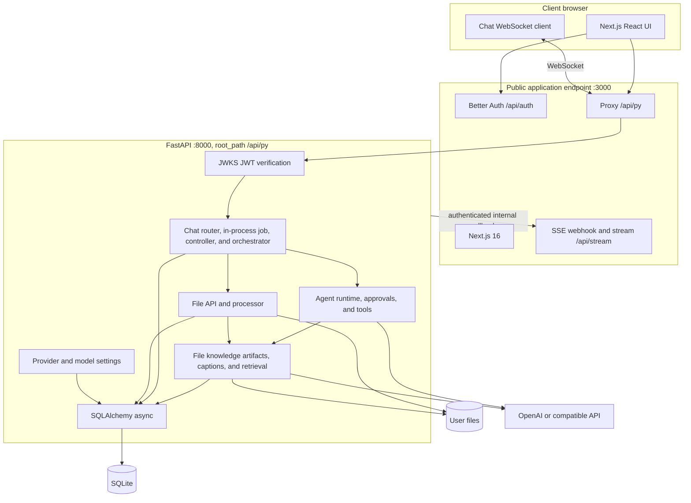

# System Overview

Asterism is a pnpm workspace containing a Next.js 16 frontend and a Python 3.13+
FastAPI backend. The browser talks to the backend only through the public,
same-origin `/api/py` prefix; the backend handles chat jobs and execution, main-agent configuration, sub-agents, files, projects and
search, settings, and tools.

## Topology



In development, Next.js rewrites `/api/py/*` to loopback FastAPI on port 8000. In
the supported container image, nginx proxies that path to the same backend and
proxies all other public traffic to Next.js. The browser never needs an internal
backend URL.

## Technology stack

The supported deployment uses one coordinated backend process and a SQLite
database. Chat jobs, membership-change guards, queues and caches are process-local;
the supported `asterism.serve` launcher rejects worker counts other than one
and inherited `WEB_CONCURRENCY`/`UVICORN_WORKERS` values other than `1`. Multiple
replicas remain unsupported and require a shared coordination design; local
validation cannot detect external replicas. See [ADR-0019](../adr/0019-single-process-runtime-and-storage-seams.md). PostgreSQL
column variants and SQLAlchemy do not establish full database portability:
initialization and FTS search currently require SQLite. FileStore and VectorStore
provide explicit seams, although FileStore's `Path` return type remains local-disk
specific. See the [2026-10-17 assessment](../reviews/2026-10-17-codebase-review.md).

| Layer          | Implementation                                                                   |
| -------------- | -------------------------------------------------------------------------------- |
| Web UI         | Next.js 16, React 19, Tailwind CSS 4, shadcn/ui                                  |
| Authentication | Better Auth with RS256 JWTs and JWKS                                             |
| Backend        | FastAPI, Uvicorn, Pydantic                                                       |
| Persistence    | SQLAlchemy async, SQLite 3.45+ in WAL mode with SQLite FTS5 chat/project indexes |
| API client     | Hey API generated from FastAPI OpenAPI                                           |
| LLM runtime    | OpenAI Python SDK for OpenAI and compatible endpoints                            |
| Files          | `FileStore` protocol, `LocalFileStore`, and MarkItDown conversion                |
| Knowledge      | File-owned artifacts, LanceDB, pinned local CLIP, and optional image captioning  |

## Workspace layout

```text
asterism/
├── apps/
│   ├── backend/                 # FastAPI package, model initialization, and pytest tests
│   │   └── asterism/domains/    # agent, chat, files, settings, tools, and user domains
│   └── frontend/                # Next.js application, generated API client, and Playwright tests
├── docs/architecture/           # This implementation documentation
├── docs/adr/                    # Architecture decision records
├── docker/                      # Combined-container configuration and smoke checks
├── scripts/                     # Root environment and workspace helpers
├── docs/epics/                  # Product plans
└── todo.md                      # Active and pending work; completed history lives in docs/archive
```

## Request lifecycle

1. The browser authenticates with Better Auth and obtains the session/JWT used by
   the generated API client. HTTP uses a bearer token; the chat socket carries its
   token in the WebSocket query string.
2. The public application forwards `/api/py` traffic to FastAPI. FastAPI verifies
   the JWT against `http://127.0.0.1:3000/api/auth/jwks`, checks issuer and
   audience derived from `PUBLIC_URL`, and scopes data access to the token's user.
3. REST accepts chat creation or a new message using owner-scoped file UUIDs,
   request receipts, and revision-checked model selection. The chat uses the user's
   singleton main configuration; project binding is optional. Draft consumption,
   local references, history, and receipt commit atomically.
4. A WebSocket attaches a controller to the process-local chat job and resumes
   persisted pending work. The execution root records model/configuration, composed
   prompt, branch/project/file/target ceilings, and provenance, then injects live
   file/retrieval providers into Agent. See [execution context](execution-context.md).
5. The agent streams text, reasoning, tool calls, and selected-child events. Approval
   decisions use the same socket. Live policy and scope checks remain mandatory
   before tool invocation and release. Cancellation persists a canceled parent and
   partial output; disconnect alone does not cancel generation.

6. The backend uses the shared system key only for loopback callbacks to
   `/api/stream`, such as asynchronous title updates. The frontend fans those
   callbacks out to authenticated SSE clients.

## Knowledge lifecycle

1. An upload creates an immutable library file and a pending artifact generation.
   Bounded background processing extracts text or embeds an image, writes
   file/generation-keyed vectors, and promotes the generation after success.
2. Projects and chats reference library files without repeat processing. Removing
   a project reference preserves the source; physical deletion cancels work and
   removes references, artifacts, vectors, and source bytes.
3. The execution resolver bounds retrieval to current project memberships and
   active-branch chat attachments. LanceDB filters by both owner and allowed file
   IDs; the injected retrieval service rechecks live scope before releasing data.
4. Administrators configure canonical image captions and processing policy.
   Policy changes queue replacement generations while previous ready data remains
   usable until replacements succeed.

## Related guides

- [Authentication and security](auth-and-security.md)
- [Chat and WebSocket](chat-and-websocket.md)
- [Agent runtime](agent-runtime.md)
- [Data and storage](data-and-storage.md)
