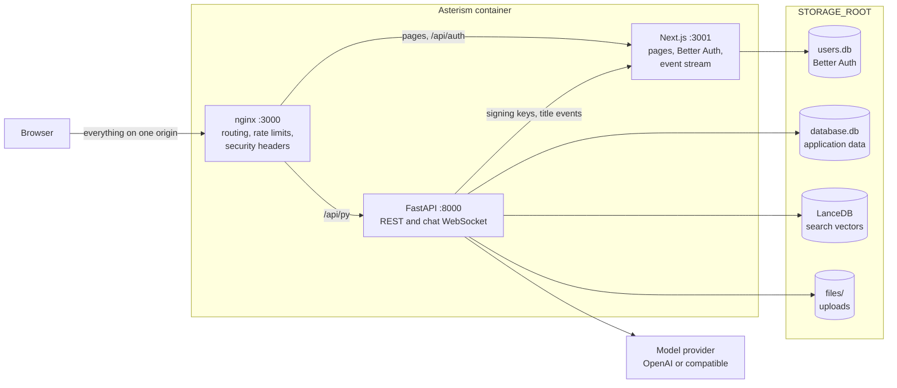

# System overview

This guide shows how Asterism's parts fit together: the processes that run, how a
request travels through them, and which backend domain owns what. Read it first;
the other guides each zoom in on one part of the picture drawn here.

## Concepts

- **One origin.** The browser only ever talks to the public address in
  `PUBLIC_URL`, by default `http://localhost:3000`. Pages, sign-in, the backend
  API and the chat WebSocket all share that origin, so there is no separate API
  URL to configure and no cross-origin request to secure.
- **Three processes, one container.** nginx accepts every request and routes it
  to either Next.js (pages and authentication) or FastAPI (the API). All three run
  in one container and talk over loopback.
- **One backend process.** Chat jobs, queues and caches live in the memory of a
  single FastAPI process, so the supported deployment is one instance with one
  worker ([ADR-0019](../adr/0019-single-process-runtime-and-storage-seams.md)).
  The instance grows with its host, not by adding copies.
- **Domains.** The backend is split into packages under
  `apps/backend/asterism/domains/`, one per area of the product. Each owns its
  tables, queries and services, and other domains reach it through its public
  functions.

## How the pieces connect



nginx listens on port 3000, the only port the container publishes. It sends
`/api/py/` to FastAPI on port 8000 and everything else, including Better Auth's
`/api/auth/` routes, to Next.js on port 3001. On the way it applies the rate limits
and security headers described in [authentication and
security](auth-and-security.md#the-edge-nginx-and-the-browser).

In development there is no nginx. You open Next.js directly on port 3000, and it
forwards `/api/py/` to FastAPI on port 8000 itself, so the browser sees the same
paths in both setups.

The two databases are separate on purpose. Better Auth owns `users.db`, with
accounts, sessions and signing keys. The backend owns `database.db`, with
everything a user creates. They meet only through the user's ID, which appears in
every token.

The backend calls Next.js for two things. It fetches Better Auth's public signing
keys to check tokens, and it posts events such as "this chat has a new title" to
`/api/stream`, which forwards them to the user's open tabs.

## The life of a request

Most requests are ordinary REST calls:

1. **The page gets a token.** The browser has a Better Auth session cookie. When a
   page needs the backend, it asks Better Auth (`/api/auth/token`) for a signed
   JWT that lasts 15 minutes, and reuses it until a minute before it expires.
2. **The request goes to `/api/py/…`** with the token in the `Authorization`
   header. nginx adds an `X-Request-ID` header, which follows the request through
   every log line.
3. **FastAPI checks the token** against Better Auth's public keys, refuses a
   suspended account, and brings its copy of the user's name, email and group up
   to date ([details](auth-and-security.md#from-token-to-user)).
4. **The route calls its domain's service** with the user's ID. Every query on
   user-owned data filters by that ID, so another user's data reads as missing.
5. **The response** is JSON. Errors share one shape, `{code, detail}`, with a
   `reason` for errors the interface handles specially, such as `usage_limit` or
   `mode_policy`.

Sending a chat message is different, because the reply streams over time:

1. The browser **posts the message** over REST. The backend checks it and commits
   it in one transaction, but does not start the reply.
2. The browser **opens the chat's WebSocket** (`/api/py/chat/stream/{chat_id}`),
   passing the token as a query parameter because browsers can't set headers on
   a WebSocket.
3. The backend **starts a chat job** that runs the agent: it builds the prompt,
   calls the model, runs any tools and streams each piece of the answer back over
   the socket.
4. The job **belongs to the chat, not the connection.** Closing the tab doesn't
   stop the reply; reopening the chat reattaches to it.

[Chat and WebSocket](chat-and-websocket.md) covers this path in full, and
[execution context](execution-context.md) explains what goes into each run.

## Work that happens in the background

Some work starts from a request but finishes later:

- **File processing.** An upload is saved and answered at once. A background job
  then extracts its text and embeds it so that it can be searched; an image is
  searchable once it has a caption
  ([file knowledge processing](file-knowledge-processing.md)).
- **Chat titles** are written by a model from the chat's first message, while the
  reply is being written, and reach the sidebar through the event stream.
- **Data exports** ("Download my data") build a zip archive in the background.

These jobs run inside the backend process, with fixed limits on how many run at
once. When the process restarts, interrupted jobs are marked so they can be
retried.

## Starting and stopping

The container's entrypoint
([`docker/entrypoint.sh`](../../docker/entrypoint.sh)) does the work that must
happen before anything serves requests:

1. **Validate configuration.** Missing secrets, placeholders and invalid values stop
   the container with a message naming the setting.
2. **Migrate both databases.** Better Auth migrates `users.db`; Alembic brings
   `database.db` to the current schema
   ([data and storage](data-and-storage.md#schema-versioning)).
3. **Write nginx's settings-dependent snippets** (upload limit, HSTS, trusted
   proxies).
4. **Start FastAPI, Next.js and nginx.** If any of them exits, the container stops,
   so the restart policy can recover it.

When FastAPI starts ([`core/lifespan.py`](../../apps/backend/asterism/core/lifespan.py)),
it checks the schema revision again, opens the database and the vector store,
recovers interrupted jobs and registers the built-in tools. On shutdown it stops
in reverse order: event delivery, chat jobs, background jobs, model clients, and
finally the database.

## The backend domains

| Area                 | Domains                                             | What they own                                                                                                                  |
| -------------------- | --------------------------------------------------- | ------------------------------------------------------------------------------------------------------------------------------ |
| People               | `user`, `groups`, `classes`, `courses`              | Accounts' backend data, About you, groups and their access lists, classes, invites and published courses                       |
| Conversations        | `chat`, `canvas`, `reflections`                     | Chats, the message tree, sending and streaming, comparisons, compaction, canvas documents, end-of-session reflections          |
| Agents               | `agent`, `tools`, `components`, `skills`            | The main agent and sub-agents, the agent loop, tool definitions, the registry of search providers and image generators, skills |
| Models               | `llm`, `chatgpt`, `image_generation`                | Model clients and selection, personal ChatGPT plan connections, image generation                                               |
| Files and knowledge  | `files`, `knowledge`, `retrieval`                   | Uploaded files, processing into searchable text and vectors, scoped search with citations                                      |
| Learning             | `learning`, `prompt_templates`, `study`, `projects` | Learning modes, prompt templates and rubrics, flashcards, quizzes and notes, projects                                          |
| Sharing              | `packs`, `settings_transfer`, `data_export`         | Team packs, the admin settings export and import, users' "Download my data" archives                                           |
| Running the instance | `settings`, `usage`, `status`                       | Providers and admin policies, the usage ledger and budgets, the admin status view                                              |

Shared code sits outside `domains/`: `core/` (configuration, security, startup,
events), `db/` (the session manager, migrations and generic query helpers),
`common/` (logging and small utilities) and `backup/`.

## The repository

```text
asterism/
├── apps/
│   ├── backend/        FastAPI package (asterism/), migrations, pytest tests
│   └── frontend/       Next.js app (src/app routes, src/features), Playwright tests
├── docker/             nginx configuration, entrypoint, smoke tests
├── scripts/            Root launcher, configuration check, backup, capacity check, docs check
├── docs/
│   ├── architecture/   These guides
│   ├── adr/            Architecture decision records
│   ├── epics/          Planned and completed work
│   └── reviews/        Audits and verification records
└── todo.md             The live work checklist
```

The repository is a pnpm workspace. Root scripts such as `pnpm dev`, `pnpm test`
and `pnpm lint` run the matching script in each app.

## Technology

| Layer                       | Implementation                                                                          |
| --------------------------- | --------------------------------------------------------------------------------------- |
| Web interface               | Next.js 16, React 19, Tailwind CSS 4, shadcn/ui                                         |
| Server state in the browser | TanStack Query with a Hey API client generated from the backend's OpenAPI schema        |
| Authentication              | Better Auth with RS256 JWTs and a JWKS endpoint                                         |
| Backend                     | FastAPI, Uvicorn, Pydantic                                                              |
| Relational data             | SQLAlchemy (async) on SQLite 3.45+ in WAL mode, FTS5 for search, Alembic for migrations |
| Vectors                     | LanceDB, with a pinned local multilingual-e5-small model for embeddings                 |
| Files                       | The `FileStore` interface, implemented by `LocalFileStore` on disk                      |
| Models                      | The OpenAI Python SDK, for OpenAI and OpenAI-compatible servers                         |
| Edge                        | nginx                                                                                   |

SQLite, LanceDB and the file store each sit behind an interface so they can be
replaced. Today, though, migrations and full-text search assume SQLite, and
`FileStore` returns local paths, so replacing them is real work rather than
configuration ([ADR-0019](../adr/0019-single-process-runtime-and-storage-seams.md)).

## Where the code lives

1. [`docker/nginx.conf`](../../docker/nginx.conf): which paths go where, and the
   rate limits.
2. [`asterism/main.py`](../../apps/backend/asterism/main.py): the FastAPI app, its
   middleware, error handlers and routers.
3. [`core/lifespan.py`](../../apps/backend/asterism/core/lifespan.py): startup and
   shutdown order.
4. [`core/security.py`](../../apps/backend/asterism/core/security.py): token
   verification.
5. [`src/lib/auth-core.ts`](../../apps/frontend/src/lib/auth-core.ts): the Better
   Auth configuration.
6. [`src/proxy.ts`](../../apps/frontend/src/proxy.ts): the Next.js request proxy,
   which sets the page security policy.

## Related

- [Authentication and security](auth-and-security.md)
- [Chat and WebSocket](chat-and-websocket.md)
- [Operations](operations.md): logs, readiness and the status page
- [Capacity check](capacity.md): how many people one instance serves
- [ADR-0019](../adr/0019-single-process-runtime-and-storage-seams.md): the
  single-process decision
