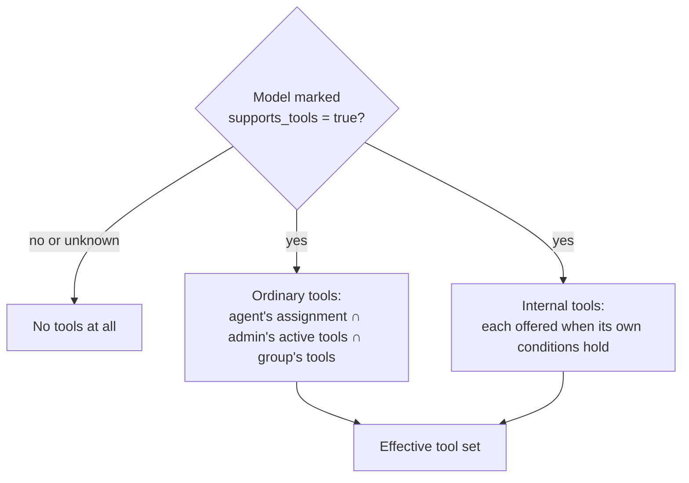

# Tool authorization

This guide explains how Asterism decides which tools an agent may use in a turn,
when the user is asked before a tool runs, and why nothing written in a prompt
or a file can change either. Read it before adding a tool or changing any check
that guards one.

## Concepts

- **A tool** is a function the model may ask to call, such as `web_search` or
  `search_knowledge`. The model sees a tool's name and schema only if the turn is
  allowed to use it.
- **Ordinary tools** are the ones a user assigns to their main agent or a
  sub-agent in settings: web search, web fetch, image search, the date and user
  tools. The admin decides which are available at all.
- **Internal tools** are offered by the server from the turn's context, never
  assigned by a user: `sub_agent`, `search_knowledge`, `load_skill`, the canvas
  tools and `generate_image`. They don't appear in any tool picker.
- **The effective tool set** is the list of tools one execution may use, worked
  out on the server when it starts and checked again at each call.
- **Approval** is a separate, later question: of the tools a turn may use, which
  ones run only after the user says yes.

## How it works

### Working out the effective tool set

`resolve_effective_tools`
([`chat/tool_policy.py`](../../apps/backend/asterism/domains/chat/tool_policy.py))
builds the set for one execution:

1. **The model must support tools.** A model gets tools only when its capability
   is explicitly `true`. `false` and unknown both mean no tools, internal ones
   included.
2. **Ordinary tools are an intersection** of three lists: the tools assigned to
   this agent, the tools the admin has made active, and the tools the user's group
   allows. A tool missing from any one of them is not offered. A group list can
   only remove tools, never add them.
3. **Internal tools are added one by one** when their conditions hold (the table
   below). No user setting can add them.

For the main agent, this also fixes the turn's **scope**: the user, chat, project,
model, the files the turn may search and the sub-agents it may call
(`ContextToolScope`). A sub-agent never works out its own scope. It inherits its
caller's, so it can use the same files and helpers or fewer, never more.

### The internal tools

| Tool                                            | Offered to                | When                                                                                                                                                                                |
| ----------------------------------------------- | ------------------------- | ----------------------------------------------------------------------------------------------------------------------------------------------------------------------------------- |
| `search_knowledge`                              | Main agent and sub-agents | The admin has it among the active tools, and the turn's scope contains files it may still read                                                                                      |
| `sub_agent`                                     | Main agent and sub-agents | The admin has it among the active tools, and the chat's delegation set (the project's selected sub-agents, or the General chat set) holds at least one target other than the caller |
| `load_skill`                                    | Sub-agents only           | The admin's Skills policy is on and the sub-agent has skills assigned ([ADR-0062](../adr/0062-sub-agent-skills.md))                                                                 |
| `canvas_create`, `canvas_update`, `canvas_read` | Main agent only           | The admin's Canvas policy and the user's own Canvas setting are both on, in an ordinary chat ([ADR-0063](../adr/0063-canvas.md))                                                    |
| `generate_image`                                | Main agent only           | The admin's image generation policy is on, the user's group may generate images, the provider is ready, in an ordinary chat ([ADR-0064](../adr/0064-image-generation.md))           |

"An ordinary chat" means a normal conversation, not a hidden special-purpose
chat such as the one used to draft a skill.

The main agent uses skills through `/` in the composer rather than `load_skill`,
because the user chooses them explicitly ([skills](skills.md)).

### Asking the user first

The main agent runs with an interactive approval policy
([`agent/approval.py`](../../apps/backend/asterism/domains/agent/approval.py)). When
the model asks for tools:

- **Internal tools run without asking.** They are already limited by context, and
  asking before every file search would make the feature unusable.
- **Ordinary tools in the chat's `allowed_tools` run without asking.** By default
  that list holds only `get_user_name`, `get_current_timestamp` and
  `get_timestamp_at_timezone`; an operator can change the default with
  `DEFAULT_ALLOWED_TOOLS`.
- **Every other ordinary tool asks first.** The socket sends a
  `tool_permission_request` with the call's name and arguments, and the turn waits
  up to 60 seconds. The browser answers with a `tool_approval` command; no answer
  counts as a refusal. A refused call returns a "rejected" result to the model,
  which can carry on without it.

Approval only ever chooses among tools already in the effective set. A tool name
the model invents, or one the turn isn't allowed, is refused whatever the user
clicks.

Sub-agents run with an allowlist policy instead: the tools in their effective set
run without asking, and anything else is refused. There is nobody to ask in the
middle of a delegation, and the user chose the sub-agent's tools when they set it
up.

### Checking again at the moment of use

The effective set is worked out when an execution starts, but settings can change
while it runs. So every call goes through the tool registry
([`tools/registry.py`](../../apps/backend/asterism/domains/tools/registry.py)), which
checks again, against current data:

- an ordinary tool must still be active for the admin and allowed by the group;
- an internal tool goes through `require_internal_tool`, which rereads the model,
  the policy behind the tool, and the scope it depends on. A `sub_agent` call
  fails if the delegation set has changed; a `search_knowledge` call fails if the
  turn has lost its files.

Retrieval and file reads check the user's access to each file again before they
release anything ([knowledge retrieval](knowledge-retrieval.md)).

### Delegating safely

When the main agent calls `sub_agent`, the built-in
([`tools/builtin/sub_agent.py`](../../apps/backend/asterism/domains/tools/builtin/sub_agent.py))
checks that the target is in the delegation set, belongs to the user, and that its
fixed model is still available. It then guards against runaway chains:

- **No cycles.** Each execution carries the chain of agents that led to it. A
  target already in the chain is refused.
- **Limited depth.** A chain longer than the `max_sub_agent_depth` setting is
  refused.
- **Limited steps.** Each agent's loop is bounded by its own `max_steps`.

While the sub-agent runs, the caller keeps checking that the delegation is still
allowed, even when the sub-agent is silent, and cancels it if not. See
[agent runtime](agent-runtime.md#selected-delegation-projects-and-the-general-set)
for the delegation lifecycle.

### Components behind the tools

Some tools are fronts for a pluggable provider. The component registry
([`components/registry.py`](../../apps/backend/asterism/domains/components/registry.py))
holds these providers by type:

| Type             | Components                             |
| ---------------- | -------------------------------------- |
| Web search       | `BraveWebSearch`, `SearchXNGWebSearch` |
| Image search     | `SearchXNGImageSearch`                 |
| Image generation | `ComfyUI`, `Diffusers` (a local model) |

The admin chooses a component and its settings in Admin Settings, and the tool
asks the registry for the configured one when it runs. Adding a provider means
writing a component and registering it, not a new tool.

## Rules

- No tools for a model unless it is explicitly marked as supporting them.
- An ordinary tool needs the agent's assignment, the admin's activation and the
  group's permission, all three.
- Internal tools come only from server-derived context. They can't be put in an
  agent's configuration, a chat's preferences or an approval.
- A sub-agent's scope is its caller's or narrower, never wider.
- Prompts, project instructions, skills, About you text, file content and search
  results are data. None of them can add a tool, a file or a sub-agent.
- Approval chooses among allowed tools; it never adds one.
- Every call is checked again against current data when it runs.

## Adding a tool

1. Write the tool in `tools/builtin/` with `@tool_registry.tool`, and give it
   arguments as a Pydantic model so they are validated before it runs.
2. Decide whether it is **ordinary** (users assign it, the admin activates it) or
   **internal** (the server offers it from context). An internal tool needs a
   condition in `resolve_effective_tools`, a live check in `require_internal_tool`,
   and its name in `INTERNAL_TOOL_NAMES`
   ([`tools/catalog.py`](../../apps/backend/asterism/domains/tools/catalog.py)), which
   keeps it out of the user-facing catalog.
3. Ordinary tools ask for approval by default. Only add one to
   `DEFAULT_ALLOWED_TOOLS` if it can't change anything or reveal anything the user
   wouldn't expect.

## Where the code lives

1. [`chat/tool_policy.py`](../../apps/backend/asterism/domains/chat/tool_policy.py):
   the effective tool set and the internal-tool checks.
2. [`tools/catalog.py`](../../apps/backend/asterism/domains/tools/catalog.py): which
   tools are internal and which a user may assign.
3. [`agent/approval.py`](../../apps/backend/asterism/domains/agent/approval.py): the
   interactive and allowlist approval policies.
4. [`tools/registry.py`](../../apps/backend/asterism/domains/tools/registry.py):
   registration and the checks at each call.
5. [`tools/builtin/`](../../apps/backend/asterism/domains/tools/builtin/): the tools
   themselves.

## Related

- [Agent runtime](agent-runtime.md): the loop that calls tools
- [Execution context](execution-context.md): where the turn's files and sub-agents
  come from
- [ADR-0058](../adr/0058-user-groups.md): group tool lists
- [ADR-0059](../adr/0059-general-chat-delegation.md): the General chat set
