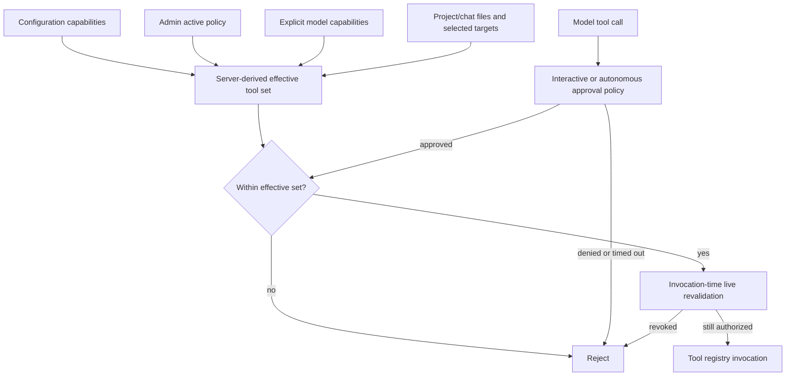

# Tool authorization and approval

Tool availability and per-call approval are separate checks. Neither a model call,
project prompt, chat preference, nor approval click can grant a capability outside
the server-derived effective tool set.

## Ordinary and internal tools

| Tool class         | Availability                                                                                                      | User control                                                            |
| ------------------ | ----------------------------------------------------------------------------------------------------------------- | ----------------------------------------------------------------------- |
| Ordinary tools     | Configured capabilities intersected with live configuration, admin active policy, and explicit model tool support | Main/sub-agent settings; chat approval preferences within that boundary |
| `search_knowledge` | Admin enabled, explicit model tool support, and nonempty live authorized files intersecting the execution ceiling | Context managed; absent from user tool pickers                          |
| `sub_agent`        | Admin enabled, explicit model tool support, project context, and eligible selected targets other than caller      | Context managed; project target selection supplies eligibility          |

[Tool policy](../../apps/backend/asterism/domains/chat/tool_policy.py) derives these
sets and validates `ContextToolScope` identity. General has no delegation scope.
A project selection grants neither arbitrary tools nor extra files. Internal-tool
names cannot be smuggled into user configuration or approval preferences; admin
policy controls remain available as global restrictions.



## Main-agent interactive approval

[Agent](../../apps/backend/asterism/domains/agent/agent.py) checks effective
capabilities before dispatch and uses
[InteractiveApprovalPolicy](../../apps/backend/asterism/domains/agent/approval.py)
for interactive runs. Tools already permitted by the runtime permissions proceed;
other requested calls enter `UserResponseQueue` and request a user decision.
Before invocation, Agent intersects approval with the freshly resolved effective
tool set. Unauthorized/hallucinated names cannot become executable through approval.

`ChatOrchestrator` emits `tool_permission_request` with call identity/name/arguments,
registers a pending future, and waits up to 60 seconds. The browser sends:

```json
{
  "type": "tool_approval",
  "tool_id": "call_abc123",
  "approved": true,
  "always_allow": false
}
```

The socket controller resolves approvals immediately, bypassing its sequential
execution queue so an agent waiting for approval cannot deadlock it. Denial or
timeout produces a rejected tool result. `tool_update` clears the prompt. Approved
calls enter the registry with validated arguments and execution context. An
`always_allow` preference remains bounded by current ordinary capabilities and
cannot persist an internal-tool grant.

## Autonomous delegated tools

A selected child uses `AllowlistApprovalPolicy` with its own authorized active
capabilities. Assigned ordinary tools can execute without nested prompts; absent
capabilities are rejected. Internal tools are derived separately and cannot exceed
the inherited internal/file ceiling. Do not offer an all-owned-agent catalog or
allow a child to resolve a fresh broader scope.

## Sub-agent recursion safety and bounded execution

The root call stack starts with the main configuration ID. Each delegated child
appends its ID. A target already in the stack fails cycle detection before child
allocation. `MAX_SUB_AGENT_DEPTH` defaults to 3; a chain at that depth cannot
create another child. `max_steps` also bounds each child's agent loop.

Delegation validates selected target, owner, live project revision, fixed-model
availability, and configuration revision. The built-in monitors authorization while
waiting for child events, including during silent provider work, and rejects/cancels
revoked work. The return path rechecks before releasing the result.

Retrieval and inline files independently revalidate live file authorization before
provider access and before release. Approval of `search_knowledge` cannot broaden
the execution ceiling or make pending/failed artifacts searchable. See
[execution context](execution-context.md), [agent runtime](agent-runtime.md), and
[retrieval](knowledge-retrieval.md).
