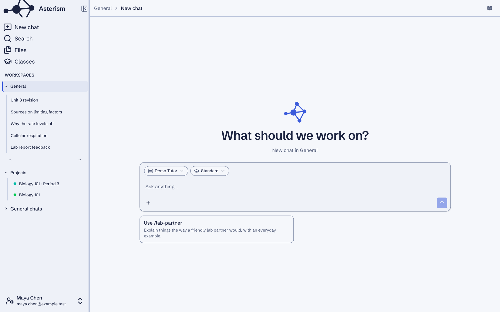
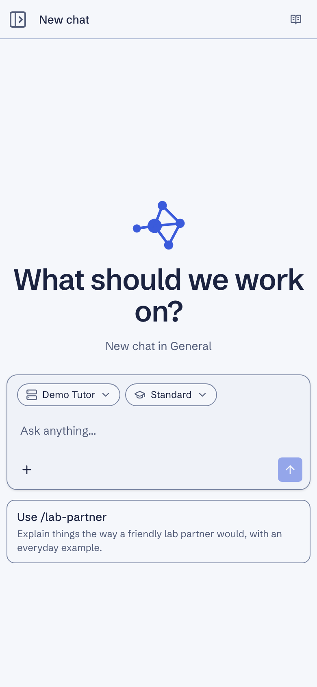
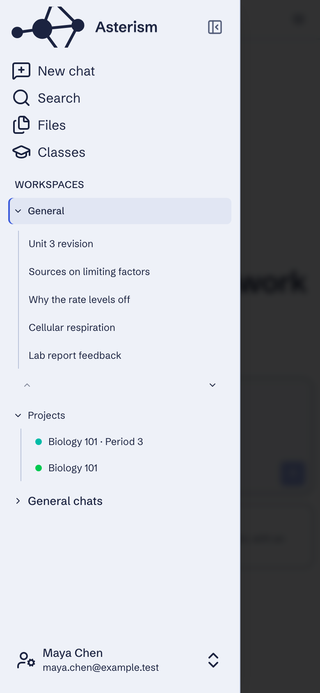

# Finding your way around

This page is a short tour of the screen: what each part of the sidebar is for, and
where to find your settings and help. It's the same on a computer and a phone,
except for how you open the sidebar.

> **Who can do this:** everyone.

## The screen on a computer

The **sidebar** runs down the left side. The rest of the screen shows the page
you're on. When you sign in, that's a new chat.

### At the top of the sidebar

- **New chat** starts a new conversation. If you're in a project, the new chat is
  in that project too.
- **Search** finds your chats and projects by their name, a project's
  description, or words in a conversation.
- **Files** is your file library: every file you've uploaded, in one place. You
  can add files from here to a project or to a chat.
- **Classes** shows the classes you belong to. You can join a class here with a
  code from your educator.

### Workspaces

Under **Workspaces**, your chats are sorted into two places:

- **General** holds your [General chats](../glossary.md): chats that don't belong
  to a project. Use them for quick, one-off questions.
- **Projects** lists your [projects](../glossary.md). A project is a place for one
  subject or piece of work: its chats can all use the project's files, and it has
  its own study material. A course your educator shares with your class shows up
  here as a project too.

Select the small arrow beside **General** or **Projects** to show or hide what's
inside. Select the name itself to open its page.

### The chat list

Below **Workspaces** is a list of the chats in the place you're working in. It's
called **General chats** when you're in General, and has the project's name when
you're in a project. Select a chat to open it again.

### At the bottom of the sidebar

Your name and email are at the bottom. Select them to open a menu with:

- **Settings**, where you change how Asterism looks and works for you.
- **Help center**, where every explanation in the app is kept. See
  [Getting help](getting-help.md).
- **Sign out**. See [Signing in and out](signing-in.md#sign-out).

### Hiding the sidebar

Select the panel button at the top of the sidebar, next to the Asterism name, to
make the sidebar narrow. Select the Asterism star in the same place to open it
again.

### The top of the page

The bar across the top shows where you are, for example **General › New chat**.
Select a part of it to go back there. On the right is the **Help for this page**
button, which looks like an open book.

## The screen on a phone

On a phone the sidebar is hidden, so the page has the whole screen.

1. Select the sidebar button at the top left of the screen.

   The sidebar slides in over the page. It has the same links as on a computer.

   

2. Select where you want to go. The sidebar closes again.

To close the sidebar without going anywhere, select the button at the top right
of the sidebar, or the page beside it.

## Related

- [Your first chat](your-first-chat.md)
- [Getting help](getting-help.md)
