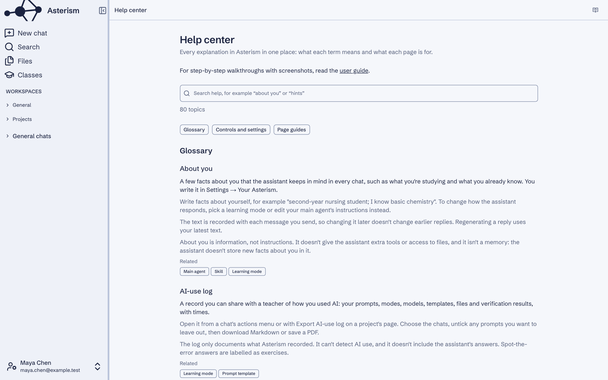
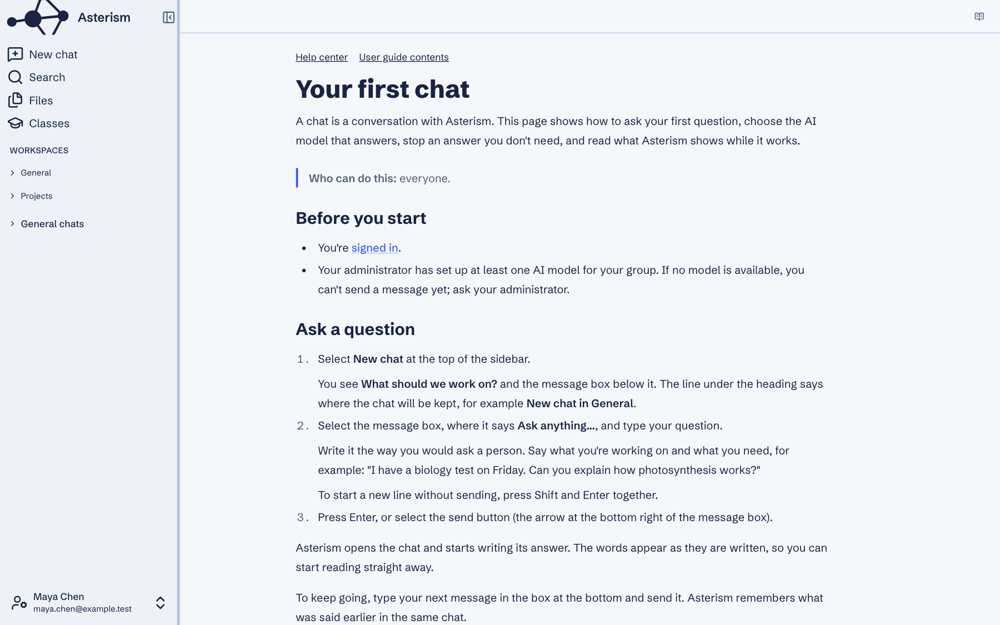
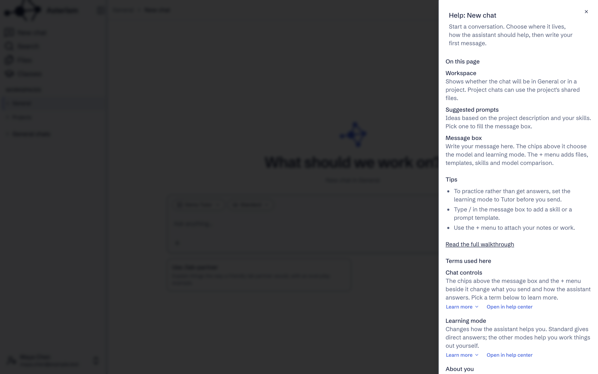
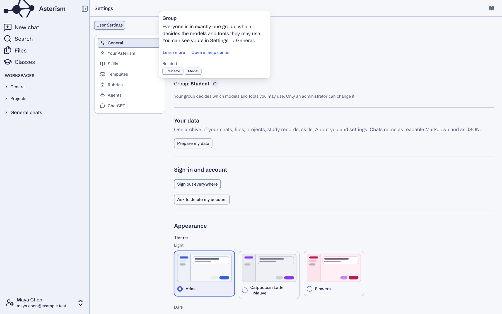
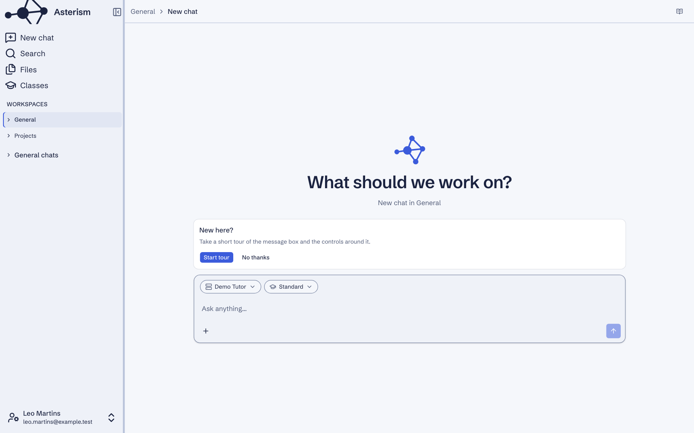
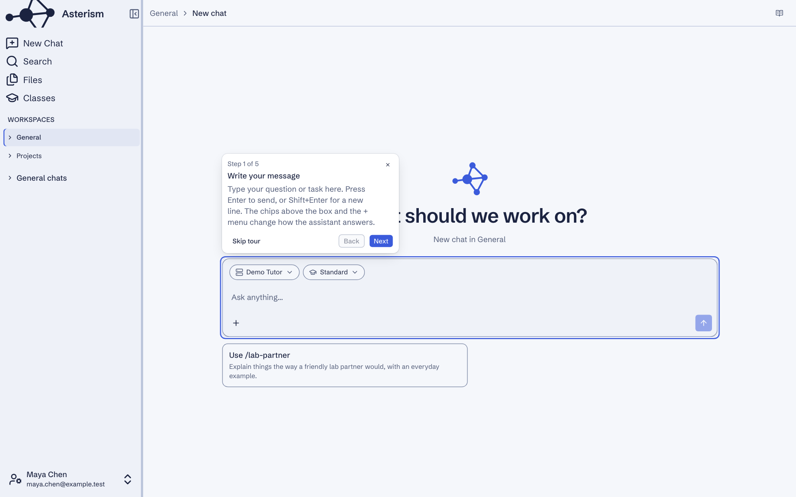

# Getting help

Asterism has help built in, so you can find out what something does without
leaving the page. This page shows the four kinds: the Help center, the help for
each page, the small help icons, and the chat tour.

> **Who can do this:** everyone.

## The Help center

The Help center keeps every explanation in Asterism in one place, and you can
search it.

1. Select your name at the bottom of the sidebar.
2. Select **Help center**.

   

3. Type a word in the search box, for example "hints" or "about you". The list
   shows only the topics that match.

The Help center has three parts. Select a name near the top to jump to it:

- **Glossary** explains the words Asterism uses, such as _project_ or _learning
  mode_.
- **Controls and settings** explains buttons and settings one by one.
- **Page guides** describes each page: what it's for, what's on it and some tips.

Under a topic, select a name under **Related** to read about a connected idea.

At the top of the Help center, **user guide** opens this guide inside Asterism, for
the version you're using. A page guide's **Read the full walkthrough** opens the
guide page about that page.

## Help for this page

Most pages have their own short guide.

1. Select **Help for this page**, the open-book button at the top right of the
   screen. You can also press the ? key when you're not typing in a box.

   A panel opens on the right.

   

2. Read the parts of the panel:
   - **On this page** names each part of the page and what it does.
   - **Tips** suggests things to try.
   - **Terms used here** explains the words the page uses. Select **Learn more**
     to read more about one, or **Open in help center** to see it there.
3. To close the panel, select the X at its top right, or press Escape.

At the bottom of the panel, **Open the help center** takes you to this page's
guide in the Help center, and **Take the chat tour** starts the tour.

## Help icons

A small question mark in a circle sits beside some settings and controls. It
explains that one thing.

1. Select the question mark.

   A small box opens with a short explanation.

   

2. Select **Learn more** for a longer explanation, or **Open in help center** to
   read it there. Select a name under **Related** to read about a connected term;
   the back arrow takes you back.
3. Select anywhere outside the box, or press Escape, to close it.

In a chat, the **+** button beside the message box also has **Help: chat
controls**, which explains the controls around the message box.

## The chat tour

The chat tour points at each control around the message box in turn and says
what it does. It takes about a minute.

### Start the tour

Until you take the tour or turn it down, Asterism offers it above the message box
when you start a new chat.

1. Select **Start tour**.

   A box points at the first control and explains it.

   

2. Select **Next** to go to the next control, or **Back** to see the last one
   again.
3. On the last step, select **Finish**.

To leave the tour at any time, select **Skip tour** or press Escape.

Once you finish, skip or select **No thanks**, Asterism stops offering the tour.
You can still take it whenever you like.

### Take the tour again

Do one of these:

- Select **Help for this page**, then **Take the chat tour**.
- Select your name, then **Settings**. Under **Guided tour**, select
  **Restart the chat tour**.

The tour skips controls that aren't on your screen, such as skills when your
administrator has turned them off, so it may have fewer steps than someone
else's.

## If you still need help

- Your educator can help with anything about your class, such as invite links
  and course material.
- Your administrator can help with your account, passwords, and the models and
  features your group can use.

## Related

- [Glossary](../glossary.md)
- [Your first chat](your-first-chat.md)
- [Finding your way around](finding-your-way-around.md)
