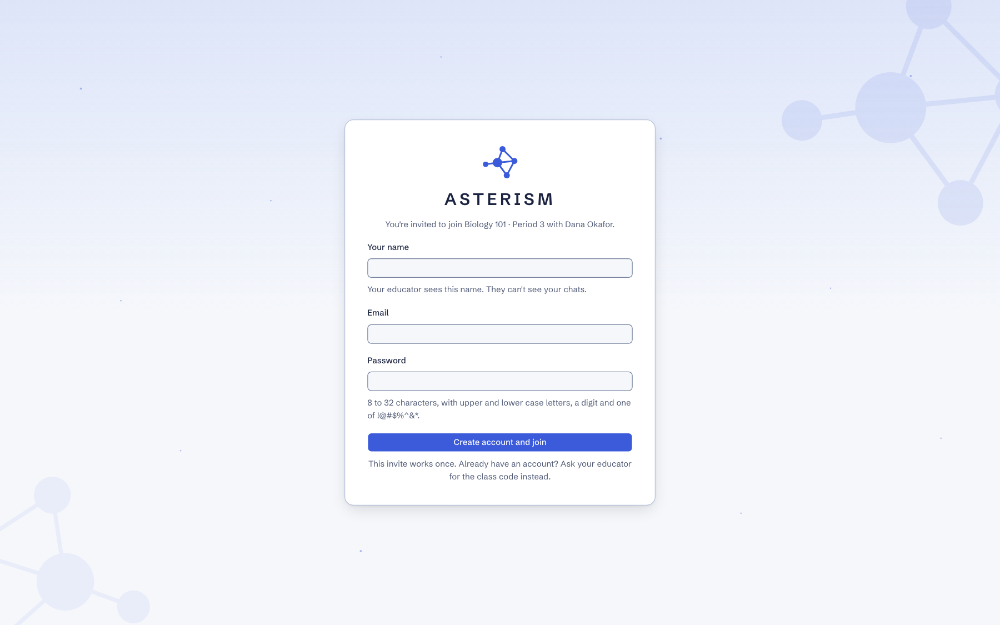
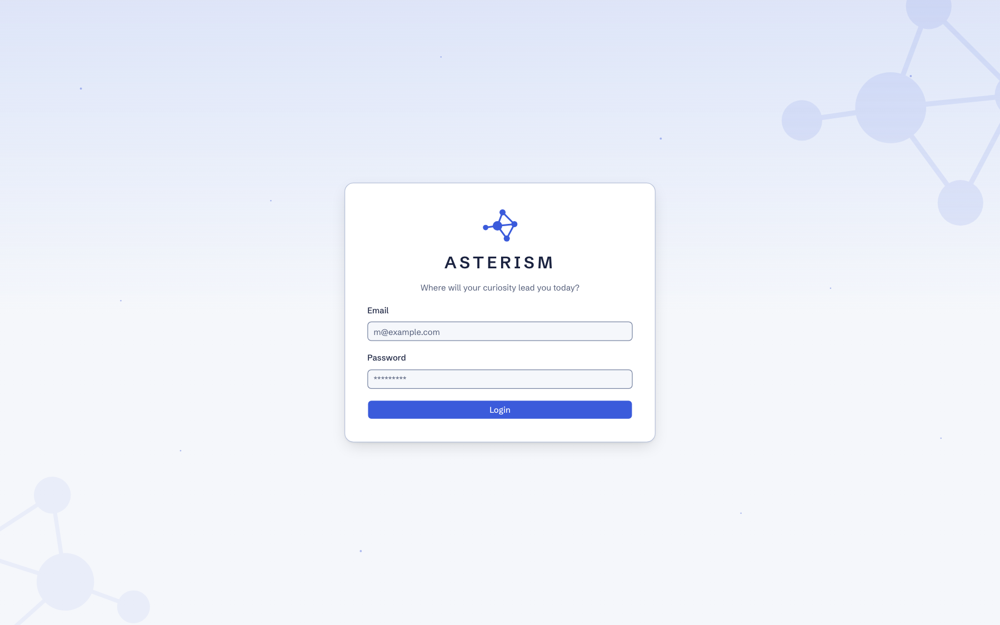
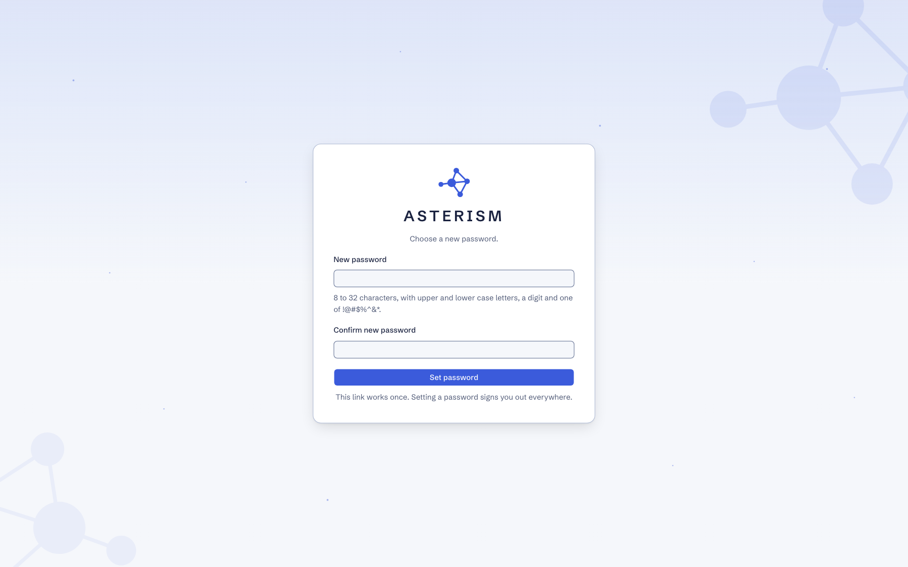
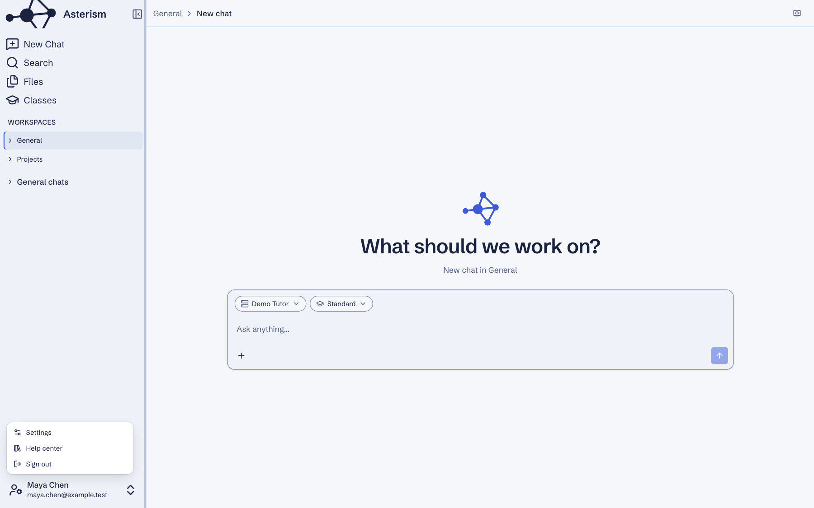
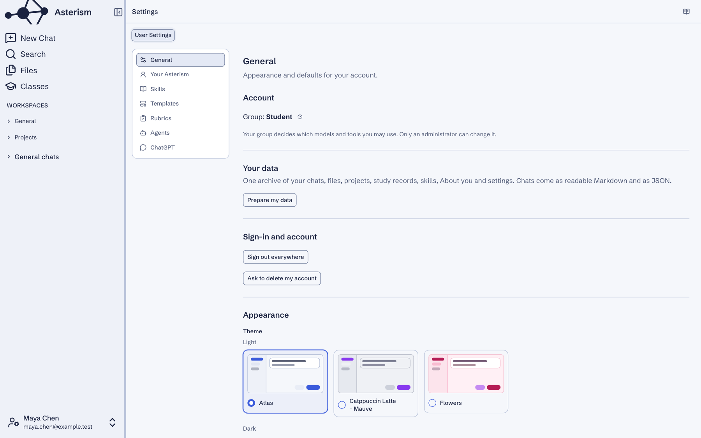

# Signing in and out

To use Asterism you need an account. This page shows how to create one from an
invite link, sign in, set a new password and sign out.

> **Who can do this:** everyone.

## Before you start

- **The web address of your Asterism.** Your educator or administrator gives it to
  you. It opens in any web browser, on a computer or a phone.
- **An invite link, or an account.** You can't sign yourself up. New accounts are
  made from a class invite link that an educator sends you. If you're not in a
  class, ask your administrator how to get an account.

## Create your account from an invite link

An invite link creates your account and puts you in your educator's class in one
step. Each link works only once.

1. Open the invite link your educator sent you.

   The page says which class you're joining and who runs it.

   

2. Type your name in **Your name**. Your educator sees this name.
3. Type your email address in **Email**.
4. Choose a password and type it in **Password**. It must be 8 to 32 characters
   long, with upper and lower case letters, a number and one of these symbols:
   `! @ # $ % ^ & *`
5. Select **Create account and join**.

Asterism opens your **Classes** page, with the class you joined.

Already have an account? Don't use the invite link. Ask your educator for the
**class code** instead, and join the class from **Classes** in the sidebar.

## Sign in

1. Open your Asterism's web address. You see the sign-in page.

   

2. Type your email address in **Email**.
3. Type your password in **Password**.
4. Select **Login**.

Asterism opens a new chat, ready for your first question. If you opened a link to
a page in Asterism before you signed in, you go back to that page instead.

## Set a new password

There is no "forgot password" button. If you've forgotten your password, ask your
administrator for a **password reset link**.

1. Open the reset link your administrator sent you.

   

2. Type your new password in **New password**.
3. Type it again in **Confirm new password**.
4. Select **Set password**.
5. Select **Sign in**, and sign in with your new password.

Setting a new password signs you out on every device, so anyone using your old
password is signed out too. The link works once.

## Sign out

1. Select your name at the bottom of the sidebar.

   

2. Select **Sign out**.

On a phone, open the sidebar first with the button at the top left of the screen.

Sign out when you're done on a shared or school computer.

## Sign out everywhere

Use this if you signed in on a computer you no longer have, or you think someone
else knows your password. It signs you out on every computer and phone, including
the one you're using.

1. Select your name at the bottom of the sidebar, then select **Settings**.
2. Under **Sign-in and account**, select **Sign out everywhere**.

   

3. Select **Sign out everywhere** again to confirm.

Pages left open on other devices stop working within 15 minutes. Sign in again
with your password. If you think someone knows your password, ask your
administrator for a reset link and choose a new one.

## If something goes wrong

- **"This invite can't be used."** The link has been used already, has expired or
  was withdrawn. Ask your educator for a new one.
- **"You're already signed in."** You opened an invite link while signed in. An
  invite makes a new account; to join the class with the account you have, ask
  your educator for the class code.
- **The sign-in page says your email or password is wrong.** Check the spelling
  and that Caps Lock is off. If you still can't sign in, ask your administrator
  for a reset link.
- **"This reset link can't be used."** It has been used already or has expired.
  Ask your administrator for a new one.
- **"This reset link is incomplete."** Part of the link is missing. Copy the whole
  link your administrator sent and try again.
- **"Too many sign-up attempts."** Wait a few minutes, then try again.

## Related

- [Finding your way around](finding-your-way-around.md)
- [Your first chat](your-first-chat.md)
