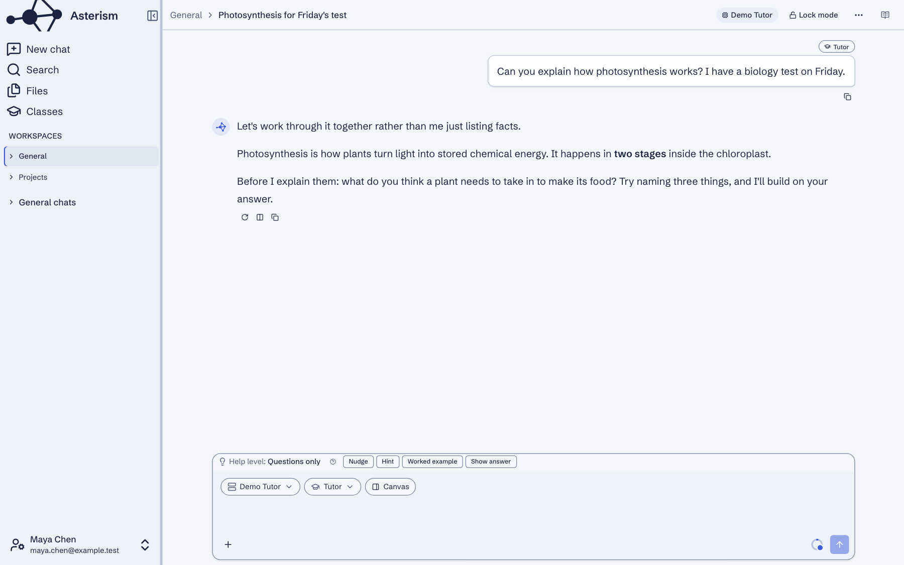

# What Asterism is

Asterism is an AI assistant for learning. You write to it in plain words, the way
you would write to a person, and it writes back. This page explains what it can
help you with and what to keep in mind.

> **Who can do this:** everyone.

## What you can do with it

- **Ask questions.** Ask about a topic you're studying, a word you don't know or a
  problem you're stuck on. Asterism answers in a chat, and you can ask
  follow-up questions.
- **Work from your own material.** Upload your notes, handouts and readings.
  Asterism can read them and answer from them, and it shows you which file each
  part of the answer came from.
- **Learn instead of just getting answers.** Choose a
  [learning mode](../glossary.md) to change how Asterism helps. In Tutor mode it
  asks you questions and gives hints, so you work the answer out yourself.
- **Practise.** Make flashcards and practice quizzes from your files, and see
  which topics need more work.
- **Keep things together.** A [project](../glossary.md) keeps the chats, files and
  study material for one subject in one place.
- **Join a class.** If your educator uses Asterism, they can invite you to a class
  and share course material with you.

## Things to keep in mind

- **Asterism can be wrong.** An AI writes answers that sound sure even when they
  are not right. Check important facts, especially for schoolwork, against your
  notes or a trusted source.
- **Your chats are saved.** You can come back to any chat later. Your educator
  can't read your chats.
- **What you can use depends on your group.** Your
  [administrator](../glossary.md) decides which AI models and features each
  [group](../glossary.md) can use. If something in this guide isn't on your
  screen, your group may not have it.
- **Follow your school's rules on AI.** Asterism can keep a record of how you
  used it, which you can share with a teacher if they ask.

## Related

- [Signing in and out](signing-in.md)
- [Finding your way around](finding-your-way-around.md)
- [Your first chat](your-first-chat.md)
