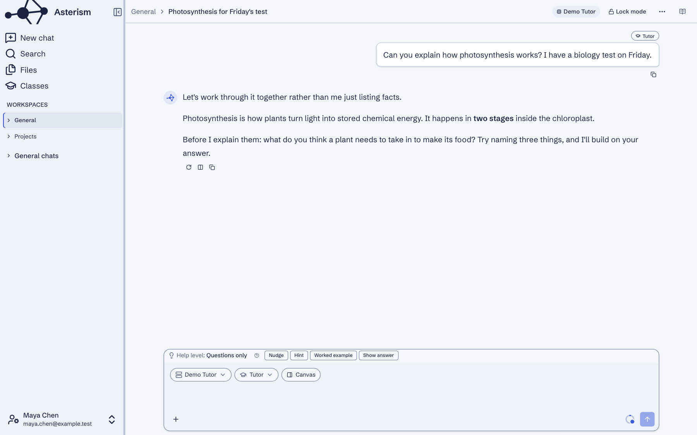
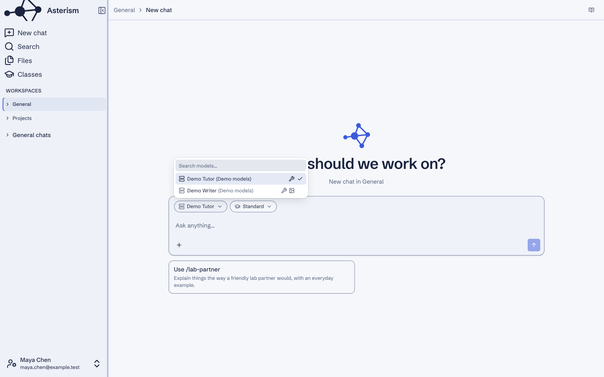
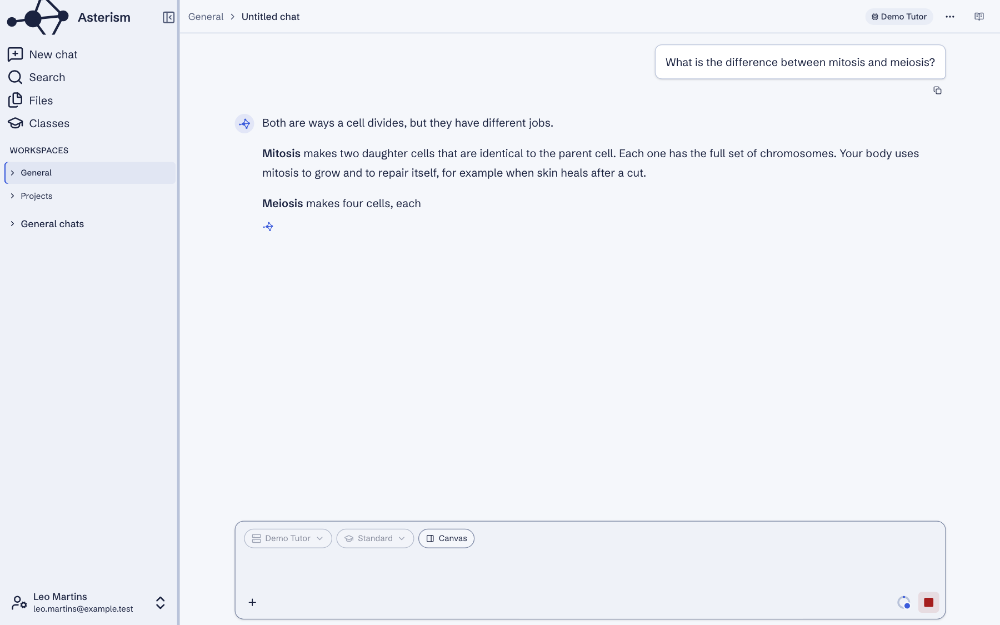
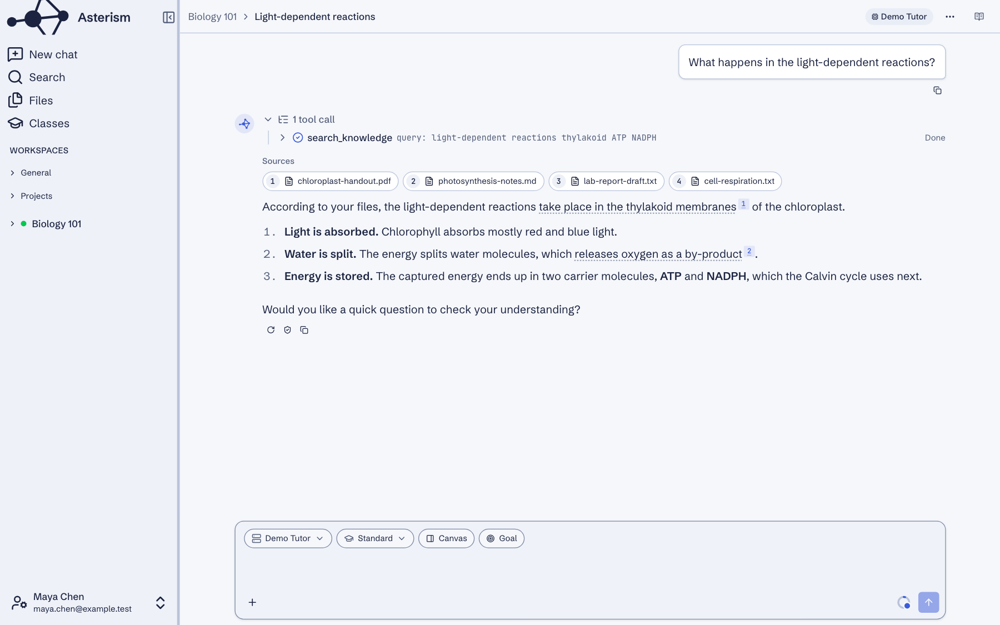

# Your first chat

A chat is a conversation with Asterism. This page shows how to ask your first
question, choose the AI model that answers, stop an answer you don't need, and
read what Asterism shows while it works.

> **Who can do this:** everyone.

## Before you start

- You're [signed in](signing-in.md).
- Your administrator has set up at least one AI model for your group. If no model
  is available, you can't send a message yet; ask your administrator.

## Ask a question

1. Select **New chat** at the top of the sidebar.

   You see **What should we work on?** and the message box below it. The line
   under the heading says where the chat will be kept, for example
   **New chat in General**.

2. Select the message box, where it says **Ask anything…**, and type your
   question.

   Write it the way you would ask a person. Say what you're working on and what
   you need, for example: "I have a biology test on Friday. Can you explain how
   photosynthesis works?"

   To start a new line without sending, press Shift and Enter together.

3. Press Enter, or select the send button (the arrow at the bottom right of the
   message box).

Asterism opens the chat and starts writing its answer. The words appear as they
are written, so you can start reading straight away.

To keep going, type your next message in the box at the bottom and send it.
Asterism remembers what was said earlier in the same chat.

The chat gets a name from your first message, and it's saved in the sidebar's
chat list, so you can come back to it any time.

## Choose a model

A **model** is the AI that writes the answers. Your administrator decides which
models you can use. Models differ in speed, cost and what they're good at; some
can read images, for example.

The model chip is the first chip above the message box. It shows the model that
will answer, such as **Demo Tutor**.

1. Select the model chip.

   A list of the models you can use opens, with a tick beside the one chosen.

   

2. Select a model. To find one in a long list, type part of its name in
   **Search models…**.

The model you choose is kept with this chat. You can change it in the middle of a
chat; the new model answers from your next message.

If the chip says **Select a model...**, no model is chosen yet: choose one before
you send. To start every new chat with the same model, choose a
**Default model** in **Settings**, under **General** › **Chat**.

The chip beside it, **Standard**, is the [learning mode](../glossary.md). Standard
gives direct answers. To have Asterism guide you with questions and hints instead,
choose **Tutor**.

## Stop an answer

If an answer is going in the wrong direction, or is longer than you need, you can
stop it.

1. While Asterism is writing, select the red square at the bottom right of the
   message box. It's in the place of the send button and is called
   **Stop generating**.

   

Asterism stops writing. What it had written so far stays in the chat, marked
**Stopped**. Send a new message to try again, or say what you'd like instead, such
as "Shorter, please".

While an answer is being written, the chips above the message box are greyed out.
They come back when the answer is finished or stopped.

## What Asterism shows while it works

- **The twinkling star.** While Asterism is working on an answer, a small star
  shape twinkles under the last message. When it stops, the answer is finished.
- **Steps.** Sometimes Asterism does something before it answers, such as
  searching your files. A line above the answer counts these steps, for example
  **1 tool call**. Select it to see each step and whether it finished. A tick
  and **Done** mean the step worked.

  

- **Sources.** If the answer uses your files, they are listed under **Sources**
  above the answer, and small numbers in the text show which file each part came
  from.
- **The status ring.** A small ring beside the send button fills up as the chat
  gets longer. Select it to see **Chat status**: how much of the model's memory
  this chat uses, and whether you're connected.
- **Under the answer.** Small buttons to ask for another version of the answer
  (**Regenerate**), compare it with other models, and copy it. Next to them you
  may see which model answered and how much text it read and wrote.

## If something goes wrong

- **You can't send, and the model chip is outlined in red.** The chosen model
  isn't available any more. Choose another model.
- **An answer is marked Failed.** Something went wrong while it was written.
  Send your message again. If it keeps failing, try another model or ask your
  administrator.
- **The answer is wrong or doesn't make sense.** AI models make mistakes. Ask
  again in other words, give more detail, or check the facts in your notes.

## Related

- [Getting help](getting-help.md), including the chat tour
- [Finding your way around](finding-your-way-around.md)
