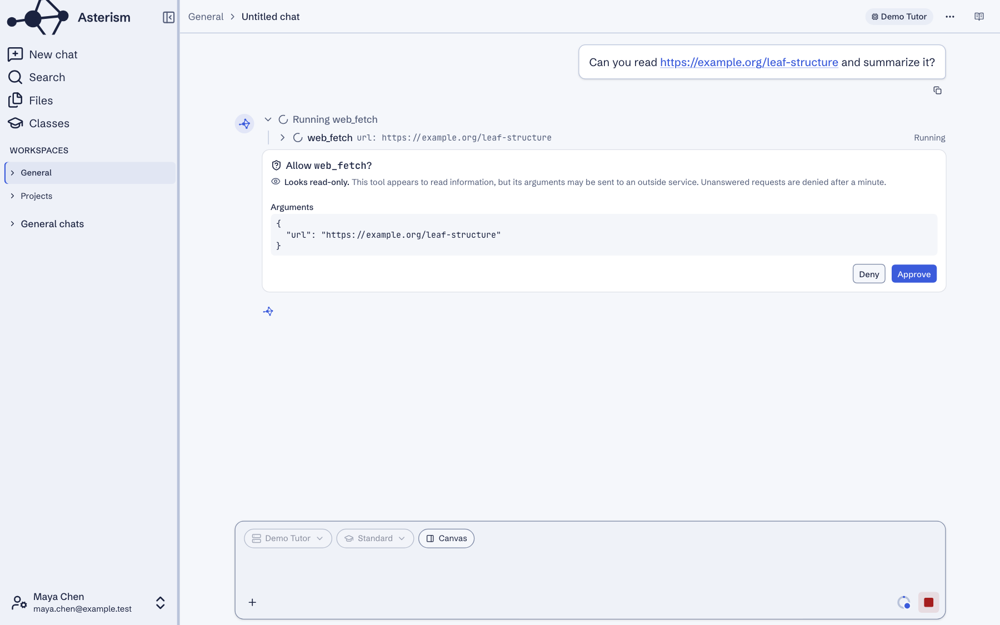

# Approving or denying a tool request

Sometimes Asterism wants to do something outside the chat to answer you, such as
reading a web page. Some of these actions wait for your permission first. This
page shows what that looks like and how to decide.

> **Who can do this:** everyone.

## What a tool is

A **tool** is an action Asterism can take while answering, such as searching
your files, reading a web page or making an image. Your administrator decides
which tools exist, and you decide which ones your
[main agent](../glossary.md) may use: in **Settings** › **Agents**, edit the main
configuration and tick them under **Allowed tools**.

Searching your own files and a few harmless tools, such as telling the time, run
without asking. Others ask you first.

## Answer a request

1. When Asterism wants to use a tool that needs permission, a box appears in the
   chat, titled **Allow** and the tool's name.

   

2. Read what it wants to do:
   - The line under the title says what kind of action it is, for example
     **Looks read-only**, and whether anything is sent outside Asterism.
   - **Arguments** shows exactly what the tool will use, such as the web address
     it will open.
3. Select **Approve** to let it run, or **Deny** to stop it.

Asterism carries on with its answer. If you denied the request, it's told so and
answers without that action.

If you don't answer within a minute, the request is denied for you.

## How to decide

- Approve when the action matches what you asked for, for example reading the
  page you named.
- Deny when you don't recognize the address, or the action isn't what you
  expected.
- Remember that whatever a tool sends, such as a search, leaves Asterism. Don't
  approve sending private information.

## If something goes wrong

- **The request disappeared before you answered.** It was denied after a minute.
  Ask again, and answer the box when it appears.
- **Asterism never asks to use a tool you expected.** The tool may be turned off
  by your administrator, not allowed for your group, or not chosen for your main
  agent. Check **Allowed tools** in **Settings** › **Agents**, or ask your
  administrator.

## Related

- [What Asterism shows while it works](../01-getting-started/your-first-chat.md#what-asterism-shows-while-it-works)
