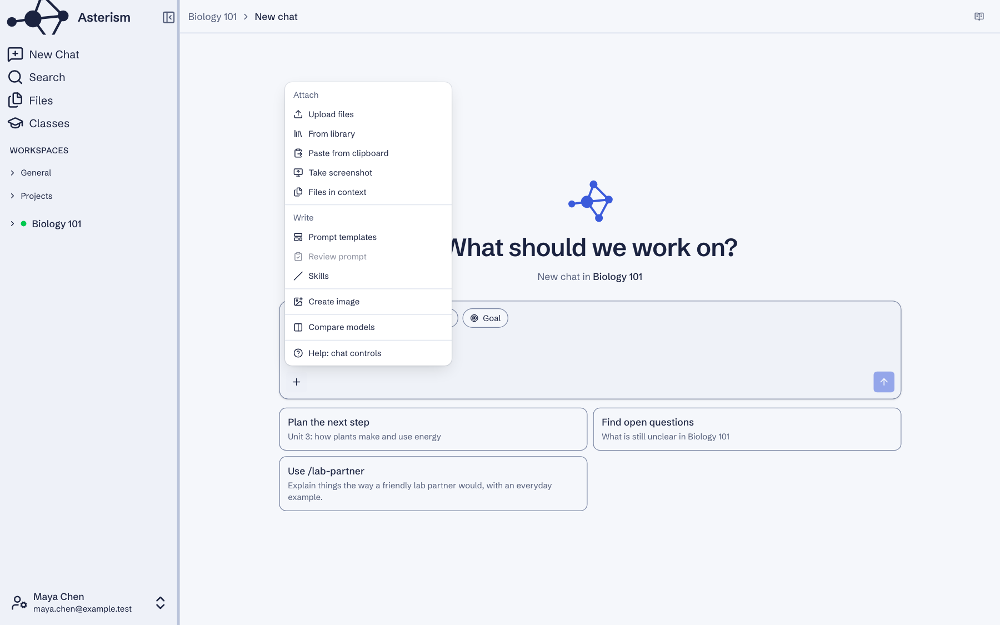
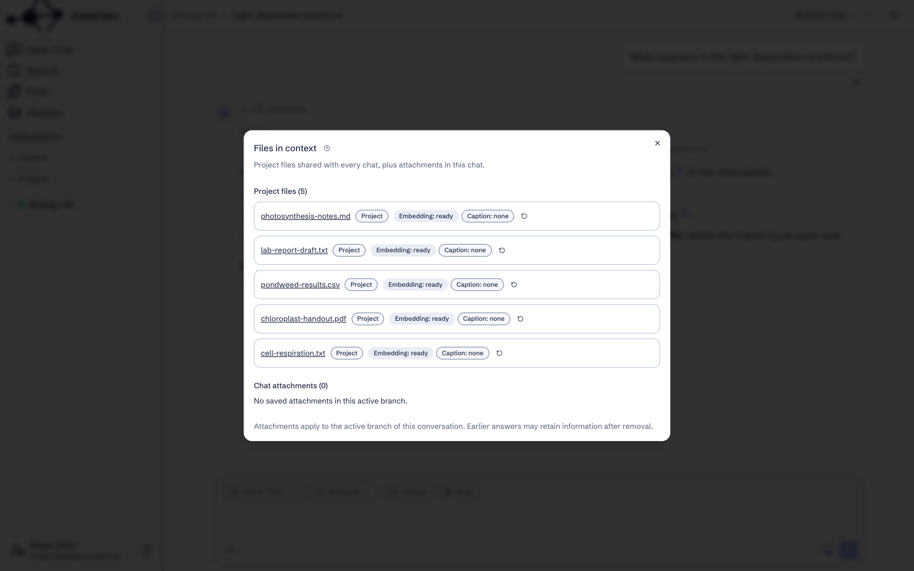

# Attaching files and files in context

You can give Asterism your own material, such as notes, a handout, a draft or a
photo of your work, so it answers from that instead of from general knowledge.
This page shows how to attach a file to a message and how to see which files
Asterism can use in a chat.

> **Who can do this:** everyone.

## Two ways Asterism gets your files

- **Attachments** are files you add to one chat. Only that chat can use them.
- **Project files** are files added to a [project](../glossary.md). Every chat in
  the project can use them, so you don't have to attach them again. Projects are
  explained in the _Files and projects_ chapter.

Together these are the chat's **files in context**: everything Asterism may read
in this chat. A General chat has only its own attachments.

## Attach a file

1. Select the **+** button beside the message box.

   

2. Under **Attach**, choose where the file comes from:
   - **Upload files** picks a file from your computer or phone.
   - **From library** picks a file you uploaded before, from your
     [Files](../01-getting-started/finding-your-way-around.md#at-the-top-of-the-sidebar)
     library.
   - **Paste from clipboard** adds an image or file you copied.
   - **Take screenshot** captures a window or screen you choose.
3. The file appears above the message box with its status: **Uploading…**, then
   **Ready**.
4. Type your message and send it.

Files you upload are also kept in your Files library, so you can use them again.

To take a file off before you send, select the X beside its name.

### What Asterism does with a file

- **Text files**, such as notes, documents and PDFs, are read and searched.
  Asterism finds the parts that matter for your question.
- **Images** are shown to the model if it can look at pictures (the picture icon
  in the model list). Otherwise, Asterism uses a written description of the image
  if your administrator has turned that on.
- Asterism treats what's in your files as material to work with, never as
  instructions to follow.

## See which files are in context

1. Select the **+** button, then select **Files in context**.

   

2. Read the two lists:
   - **Project files** are shared with every chat in the project.
   - **Chat attachments** are this chat's own files.
3. Select a file's name to see more about it. For an attachment, you can remove
   it from the chat, or add it to the project so other chats can use it too.

A file is ready to use when its status says **ready**. A file that is still
processing can't be searched yet.

## If something goes wrong

- **An attachment says Failed.** The upload didn't finish. Select the upload
  button above the message box to try again, or remove the file and attach it
  again.
- **Asterism doesn't seem to use your file.** Check **Files in context**: the file
  must be listed and ready. Then ask about it by name, for example "Using my
  lab-report-draft.txt, …".
- **Removing an attachment didn't change an earlier answer.** Removing a file
  stops Asterism using it from now on. Answers it already wrote stay as they are.

## Related

- [Sources and citations](sources-and-citations.md)
- [Choosing and comparing models](choosing-and-comparing-models.md)
