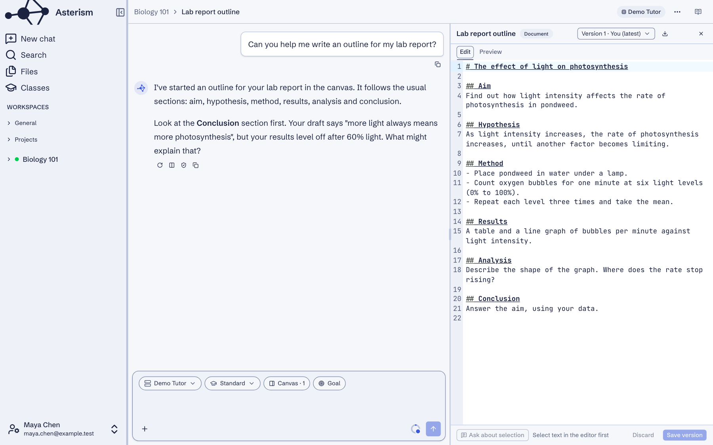

# Working in the canvas

The **canvas** is a panel beside the chat for longer work, such as an essay
outline, a lab report, some code or a web page. Asterism writes into it, you can
edit it, and every saved version is kept.

> **Who can do this:** everyone, when your administrator allows the canvas.

## Before you start

1. Select your name at the bottom of the sidebar, then **Settings**.
2. Under **General**, tick **Canvas**.

If there's no Canvas box, your administrator has turned the canvas off. The
chat's model must also be able to use tools.

## Ask Asterism to write in the canvas

1. Ask for something long in a chat, for example "Start an outline for my lab
   report in the canvas."

   Asterism writes the outline into the canvas, and its answer shows a card for
   it.

2. Select **Open** on the card to show the canvas beside the chat. On a phone, it
   fills the screen.

Every canvas item in the chat is also listed under the **Canvas** chip above the
message box. Select the chip, then an item, to open it.

## Start a canvas item yourself

1. Select the **Canvas** chip above the message box.
2. Select **New canvas item**.
3. Under **Kind**, choose a document, code or a web page, and type a **Title**.
   For code, choose its **Language** too.
4. Select **Create**, and start writing.

## Edit and save

- A document has **Edit** and **Preview** tabs. Write in **Edit**; see how it
  looks in **Preview**.
- Code opens in an editor. A web page shows a preview, which can't reach the
  internet.
- Select **Save version** to keep your changes. Asterism reads the latest saved
  version the next time it answers.

To have Asterism change just one part, select the text, then select
**Ask about selection** and say what you want.

## Pictures in a document

Pictures Asterism made in this chat, and files attached to the chat or its
project, show in a document's **Preview** as they do in an answer. Select a
picture to see it full size. A file that isn't part of this chat shows as
**File unavailable**, and a picture added while you edit appears once you
select **Save version**.

## Go back to an earlier version

1. In the canvas, open the **Version** list and choose an older version.

   The canvas says, for example, **Viewing version 1 of 3**.

2. To use it again, select **Restore this version**. It's saved as a new version,
   so nothing is ever overwritten.

## Download it

Use the download menu to save a version as Markdown, plain text, a source file, a
web page, Word or PDF, to add it to your Files, or to download every canvas item
in the chat as a ZIP file.

In Word and PDF files, [diagrams](diagrams.md) appear as pictures, in light
colors whatever your theme. If a diagram can't be drawn, the file shows its code
with the words **Diagram not drawn**. Markdown, plain text and the ZIP file keep
the diagram's text.

## Good to know

- Canvas items belong to the [branch](regenerating-and-branches.md) that wrote
  them. If you regenerate an answer, the items the old answer wrote are hidden
  while you look at the new one.
- Text in the canvas is treated as material to work on, never as instructions.

## Related

- [Regenerating answers and switching branches](regenerating-and-branches.md)
