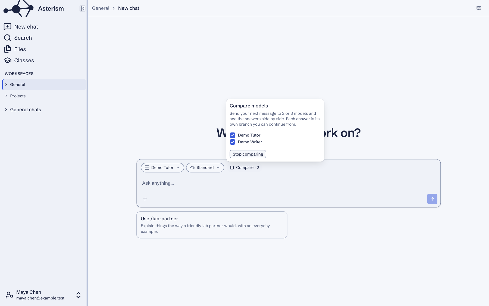
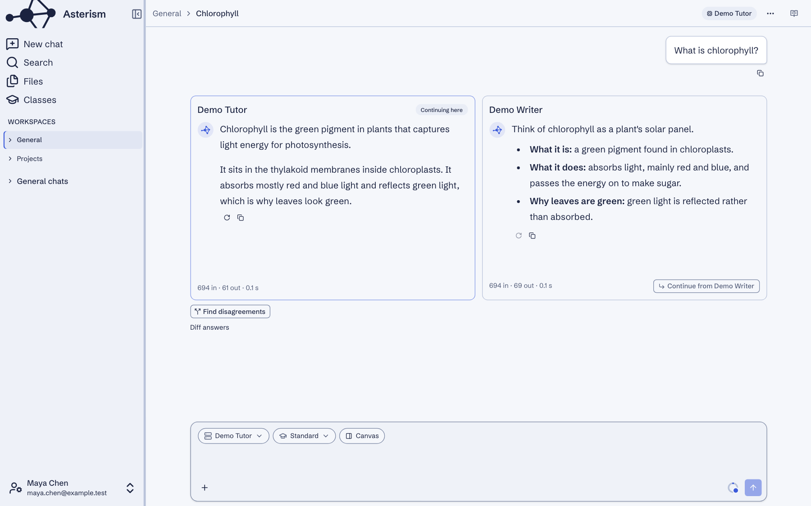

# Choosing and comparing models

A **model** is the AI that writes Asterism's answers. This page shows how to
choose the model for a chat, and how to send one question to two or three models
so you can compare their answers side by side.

> **Who can do this:** everyone.

## Before you start

- Your administrator decides which models your group can use. To compare, you
  need at least two.
- Choosing a model is introduced in [Your first chat](../01-getting-started/your-first-chat.md#choose-a-model).

## Choose a model for a chat

1. Select the model chip, the first chip above the message box.
2. Select a model from the list.

The choice is saved with the chat, and each answer records which model wrote it.
You can change the model at any time; the new one answers from your next message.

To start every new chat with the same model, choose a **Default model** in
**Settings**, under **General** › **Chat**.

### Which model should I pick?

Models differ in speed, cost and what they can do. Your administrator may have
named them to help you choose. Look for these small icons beside a model's name
in the list:

- a **wrench**: the model can use tools, such as searching your files. Sub-agents,
  the canvas and image creation need a model like this.
- a **picture**: the model can look at pictures you attach.

If you're not sure, keep the default. Try another model when an answer isn't
good enough, or compare them.

## Compare models before you send

1. Select the **+** button beside the message box, then select
   **Compare models**.
2. Tick two or three models.

   

   A **Compare** chip appears above the message box, with the number of models.

3. Type your question and send it.

Each model answers in its own column.

4. Read the answers. The one marked **Continuing here** is the one the chat
   carries on from. To carry on from another, select **Continue from** and the
   model's name under it.

Each answer is kept as its own version, or [branch](regenerating-and-branches.md),
so you can switch back later.

To stop comparing, select the **Compare** chip, then **Stop comparing**.

### Find where the answers differ

Under the columns:

- **Find disagreements** asks Asterism to list where the answers disagree, so
  you know what to check.
- **Diff answers** shows the words that differ between two answers.

## Compare an answer you already have

1. Under an answer, select the **Compare with other models** button (two
   columns side by side).
2. Choose one or two more models. The answer you have is kept as the first
   column.
3. Select **Compare**.

## If something goes wrong

- **"Choose at least two models to compare, or stop comparing."** You ticked
  only one model. Tick another, or select **Stop comparing**.
- **Compare models is greyed out.** You can't compare while you're making an
  image, or while an answer is being written.
- **One column says Failed.** That model couldn't answer. The other answers are
  still fine; try again later or pick another model.

## Related

- [Regenerating and branches](regenerating-and-branches.md)
- [Your first chat](../01-getting-started/your-first-chat.md)
