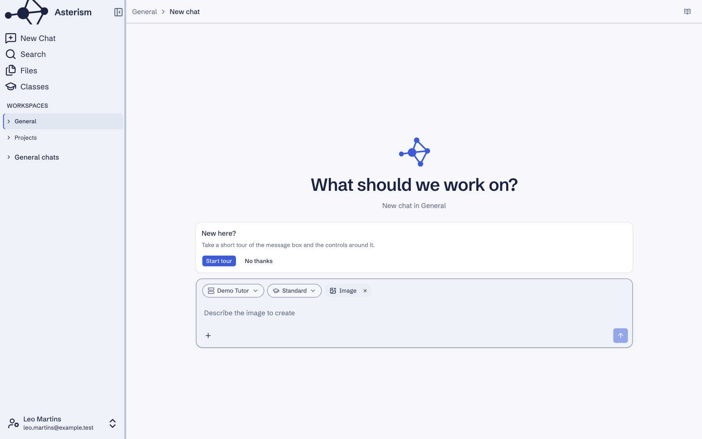
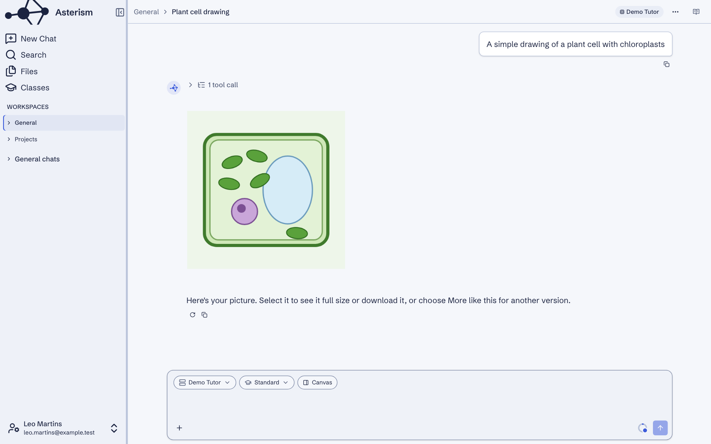

# Creating images

Asterism can make a picture from a description, such as a diagram idea or an
illustration for a poster. This page shows the two ways to ask.

> **Who can do this:** everyone, when your administrator has turned image
> creation on for your group.

## Before you start

- If **Create image** isn't in the **+** menu beside the message box, your group
  can't create images. Ask your administrator.

## Ask with Create image

This way works with any model.

1. Select the **+** button beside the message box, then select **Create image**.

   An **Image** chip appears above the message box, and the box says
   **Describe the image to create**.

   

2. Describe the picture: what's in it, the style and the colors. For example: "A
   simple drawing of a plant cell with chloroplasts."
3. Send the message.

While the picture is being made, the chat shows what's happening and how many
steps are left. The first picture can take a few minutes if the image model has
to start up. To cancel, select the stop button.

To stop making an image before you send, select the X on the **Image** chip.

## Ask in plain words

If the chat's model can use tools (the wrench icon in the model list), you can
simply ask: "Draw a red fox in the snow." Asterism writes the description for you
and makes the picture.

## Use the picture

- Select the picture to see it full size and to download it.
- Select **More like this** to get another picture from the same description.
- [Regenerating](regenerating-and-branches.md) the answer also makes a new one.

Every picture is saved in your **Files** library.

## Good to know

- Every request is recorded, and some requests are always refused, such as
  sexual content involving anyone under 18.
- Pictures made by AI can contain mistakes, for example a diagram with the wrong
  labels. Check them before you use them in your work.

## If something goes wrong

- **Create image is greyed out.** You can't make an image while comparing models.
  Stop comparing first.
- **The request is refused.** The description asked for something that isn't
  allowed. Change the description.
- **It takes a long time or fails.** The image service may be busy or
  unavailable. Try again later, or ask your administrator.

## Related

- [Choosing and comparing models](choosing-and-comparing-models.md)
