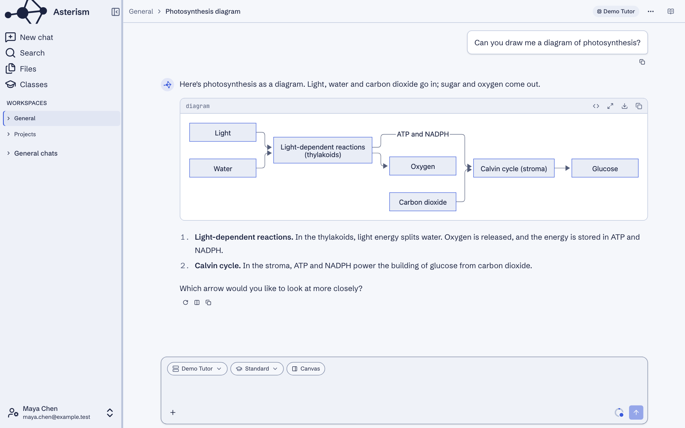

# Diagrams

Asterism can answer with a diagram, such as a flowchart, a timeline, a mind map or
the steps of a process. Diagrams can make an idea easier to see at a glance, and
unlike pictures, their labels come out exactly as written.

> **Who can do this:** everyone.

## Steps

1. Ask for a diagram in your message. For example: "Can you draw me a diagram of
   photosynthesis?" or "Show the causes of the First World War as a mind map."
2. Send the message.

   The diagram appears in the answer, with an explanation in words.

   

Asterism sometimes adds a diagram without being asked, when it helps explain
something.

## Use the diagram

The buttons above the diagram let you:

- **Expand** it, to see it full size. Select the X or press Esc to close it.
- **Download** it, then choose **SVG image** or **PNG image**. A PNG works almost
  everywhere, such as in slides and documents. An SVG stays sharp at any size.
- **Copy** it, as text you can paste back into a chat later.
- **Show code**, to see the text the diagram is drawn from. Select
  **Show diagram** to go back.

A very wide diagram scrolls sideways inside the answer. You can also use the
arrow keys after selecting it, or select **Expand**.

## Change a diagram

Ask in the same chat, for example: "Add respiration to the diagram" or "Make the
labels shorter." Asterism draws a new one in its answer.

## Good to know

- A diagram can still be wrong. Check it the same way you'd check any answer.
- Diagrams follow your theme's colors.
- Screen readers read the diagram's name and description, and the code view
  shows the text it's drawn from.

## If something goes wrong

- **"Couldn't draw this diagram" above some code.** The model wrote a diagram
  Asterism can't draw. Ask it to try again, or
  [regenerate](regenerating-and-branches.md) the answer.
- **You see code while the answer is still being written.** The diagram is drawn
  once that part of the answer is finished.
- **You wanted a picture, not a diagram.** Ask for an image instead; see
  [Creating images](creating-images.md).

## Related

- [Creating images](creating-images.md)
- [Working in the canvas](canvas.md)
- [Regenerating answers and switching branches](regenerating-and-branches.md)
