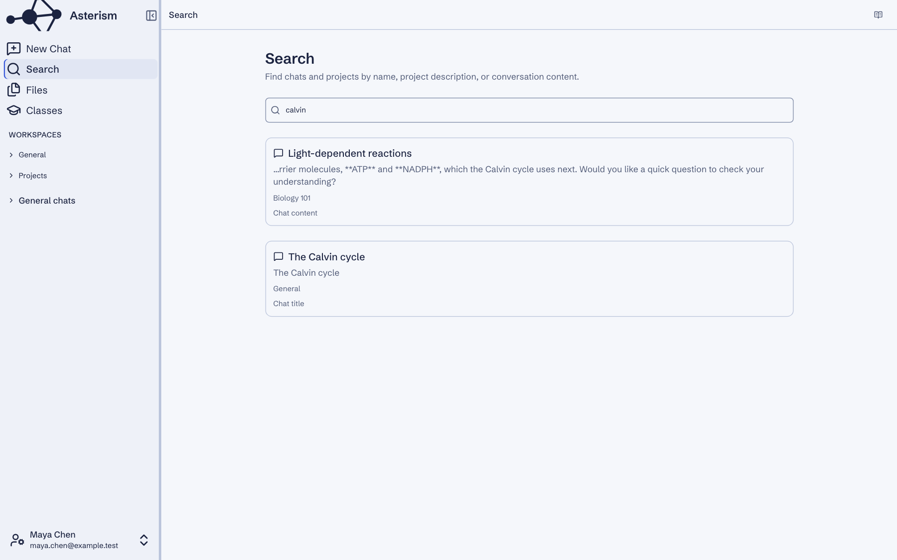

# Finding old chats

Every chat is saved. This page shows how to find one again, from the sidebar or
with search.

> **Who can do this:** everyone.

## From the sidebar

- Your recent chats are listed in the sidebar, under **General chats**, or under
  the project's name when you're in a project.
- Under **Workspaces**, open **General** or a project to see all of its chats.

See [Finding your way around](../01-getting-started/finding-your-way-around.md).

## Search

1. Select **Search** at the top of the sidebar.
2. Type a word or two in **Search chats and projects**.

   Matching chats and projects appear as you type.

   

3. Select a result to open it.

Each result shows where it was found:

- **Chat title**: the word is in the chat's name.
- **Chat content**: the word is somewhere in the conversation. A short piece of
  the text is shown.
- **Project description**: the word is in a project's description.

It also shows where the chat lives: **General** or the project's name.

## Tips

- Use one or two distinctive words, such as "Calvin" rather than "the cycle".
- If nothing matches, try different or fewer words.

## Related

- [Finding your way around](../01-getting-started/finding-your-way-around.md)
