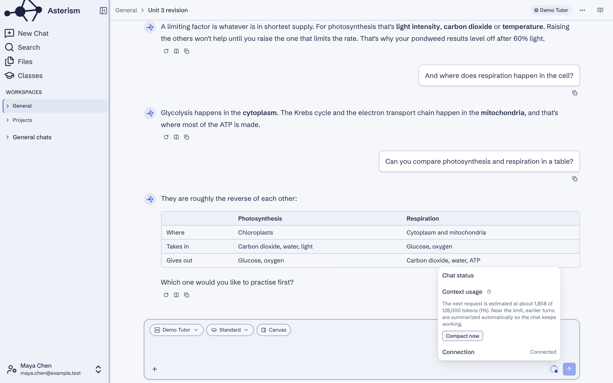
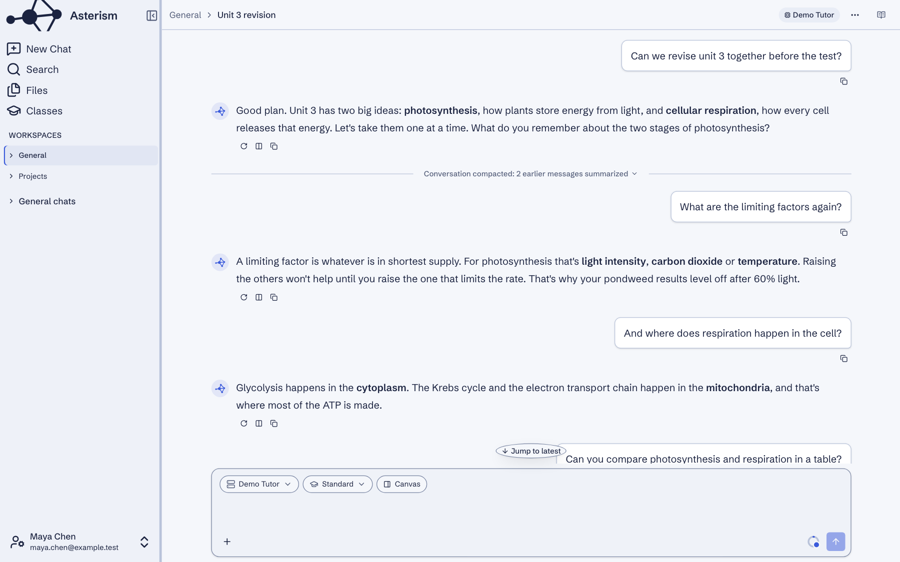

# Long conversations

A model can only read so much at once. This limit is called its **context
window**. When a chat gets long, Asterism keeps it working by summarizing the
earlier part. This page explains what happens, and how to do it yourself.

> **Who can do this:** everyone.

## What happens in a long chat

Each time you send a message, the model reads the conversation so far. As the
chat grows, it gets closer to the model's limit. When it's nearly full, Asterism
**compacts** the chat: a model writes a summary of the earlier messages, and from
then on reads the summary instead of those messages, plus your most recent
messages in full.

- **Your messages are never deleted.** You can still scroll up and read
  everything.
- A line in the chat marks where the summary starts.
- A summary can miss details. If something from early in the chat matters, say
  it again in your message.

## See how full the chat is

The ring beside the send button fills up as the chat grows.

1. Select the ring.

   **Chat status** opens. **Context usage** says how much of the model's limit
   your next message will use.

   

**Connection** at the bottom says whether the chat is connected. If it isn't,
check your internet connection and reload the page.

## Compact a chat yourself

You can summarize earlier messages before the chat is full, for example when you
move on to a new topic in the same chat.

1. Select the ring beside the send button.
2. Select **Compact now**.

A line appears in the chat, such as
**Conversation compacted: 2 earlier messages summarized**.

Select the line to read the summary.

## Good to know

- The summary never changes your About you text, skills or instructions.
- If you [regenerate](regenerating-and-branches.md) an answer from before the
  line, that version uses the full conversation as it was.
- For a new topic, a [new chat](../01-getting-started/your-first-chat.md) is
  often better than a very long one.

## Related

- [What Asterism shows while it works](../01-getting-started/your-first-chat.md#what-asterism-shows-while-it-works)
