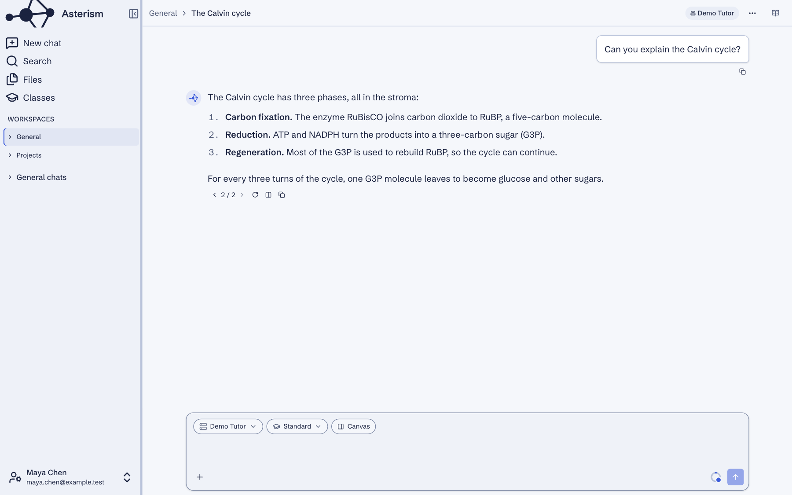
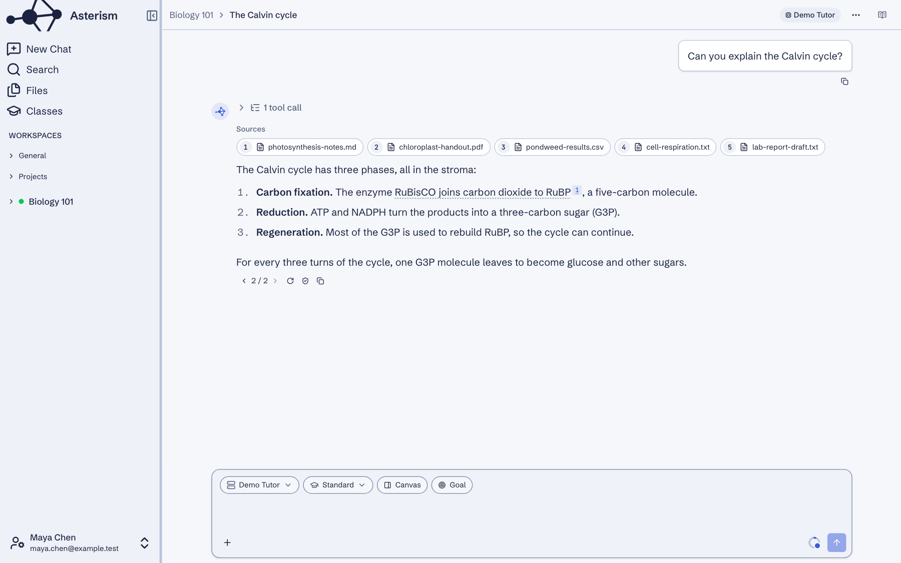

# Regenerating answers and switching branches

If you don't like an answer, you can ask Asterism to try again. The new answer is
kept beside the old one, so you can switch between them. Each version is called
a **branch**.

> **Who can do this:** everyone.

## Get another answer

1. Under the answer, select **Regenerate** (the circular arrow).

   Asterism writes a new answer to the same message.

2. Read the new answer.

The old answer isn't lost. Under the answer you now see arrows and a count, such
as **2 / 2**: this is the second of two versions.

## Switch between versions

1. Under the answer, select the left arrow to see the previous version, or the
   right arrow to see the next.

Whichever version is showing is the one the chat carries on from. If you send a
new message, it follows the version on screen.

In a [project](../03-files-and-projects/projects.md) chat, an answer often searches your
files before it replies. The switcher is still under the answer, and the search
steps above it change with the version.

Things that belong to a version change with it. For example, a
[canvas](canvas.md) document that one version wrote is hidden when you switch to
another.

## Change what you asked

You can't edit a message once it's sent. To ask in a different way:

- send a new message that corrects or adds to the first, for example "I meant
  the Calvin cycle, not the light reactions", or
- start a [new chat](../01-getting-started/your-first-chat.md) and ask again.

## Good to know

- A regenerated answer uses your latest About you text and settings, so it may
  differ from the first for that reason too.
- [Comparing models](choosing-and-comparing-models.md) also makes one version
  per model, and you choose which to continue from.

## Related

- [Choosing and comparing models](choosing-and-comparing-models.md)
- [Glossary: branch](../glossary.md)
