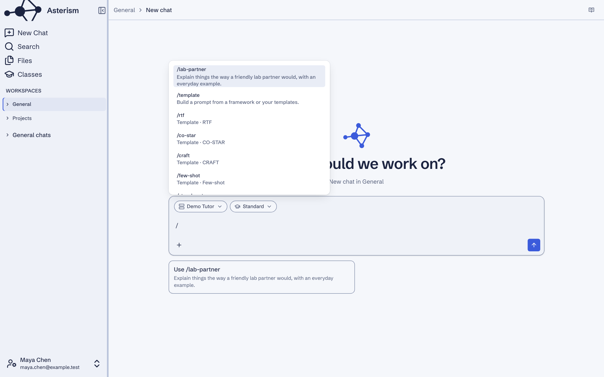
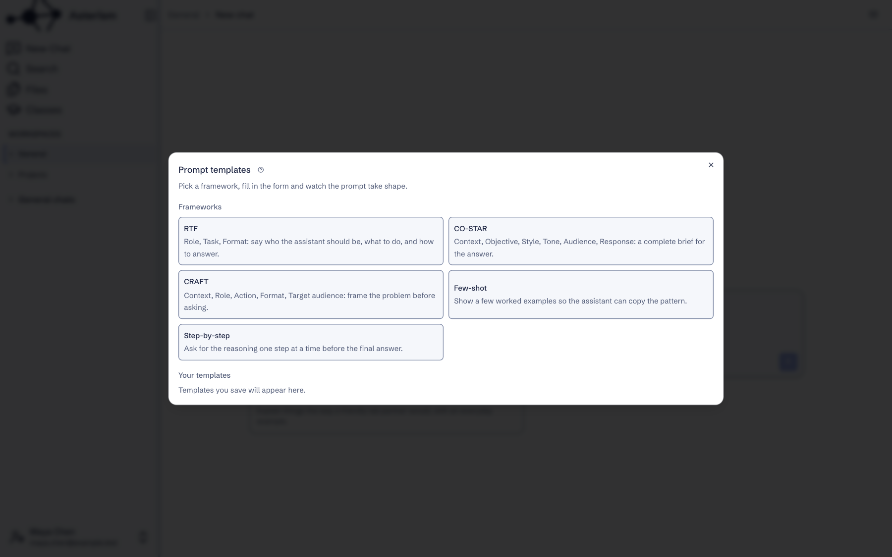
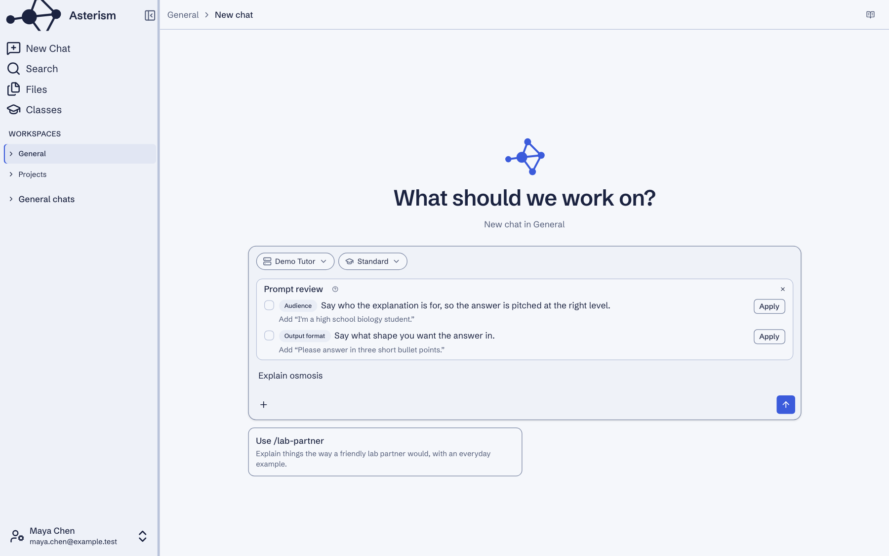

# Skills, prompt templates and the prompt coach

Three tools help you write better messages:

- A **skill** is a set of instructions you wrote once and can switch on in any
  chat, for example "explain things the way a lab partner would".
- A **prompt template** is a form that builds a clear message from a few
  fields.
- The **prompt coach** reads your draft before you send it and suggests how to
  make it clearer.

> **Who can do this:** everyone. Skills need your administrator to turn them on.

## Use a skill with /

1. Select the message box and type **/**.

   A list opens with your skills first, then the prompt templates.

   

2. Select a skill. You can keep typing to narrow the list.

The skill appears as a chip above the message box and stays on for the messages
you send in this chat. Select its chip to move it or take it off. You can add
more than one.

You can also add a skill from the **+** menu: select **Skills**.

A skill only adds instructions. It doesn't let Asterism use tools or files it
couldn't use before.

To write your own skills, see the _Making Asterism yours_ chapter. A skill must
be assigned to your main agent before it appears in the list.

## Build a message from a template

1. Select the **+** button beside the message box, then select
   **Prompt templates**. (Or type **/template** in the message box.)

   

2. Choose a framework. Each one asks for different things; for example, **RTF**
   asks for a role, a task and a format.
3. Fill in the fields. The finished message takes shape as you type.
4. Select **Use prompt**. The message goes into the message box, where you can
   still change it before you send it.

Choose how much help the form gives: **Guided** shows every field with examples,
**Standard** hides the optional ones, and **Freeform** shows just a checklist.
Use less help as you get more confident.

Templates you save in **Settings** › **Templates** appear under
**Your templates**.

## Ask the prompt coach to review a draft

First turn the coach on: in **Settings** › **General**, under **Chat**, tick
**Prompt Coach**.

1. Type your draft in the message box, but don't send it yet.
2. Select the **+** button, then select **Review prompt**.

   A **Prompt review** appears above your draft, with a suggestion for each thing
   that could be clearer, such as who the answer is for or what shape it should
   take.

   

3. Select **Apply** beside a suggestion to add it to your draft. Text in
   [square brackets] is for you to fill in.
4. Change anything else you like, then send.

Nothing is sent until you send it, and reviews aren't saved. After you apply
suggestions, you can compare the answers to your original and improved messages
side by side.

## Related

- [Choosing and comparing models](choosing-and-comparing-models.md)
- [Glossary](../glossary.md)
