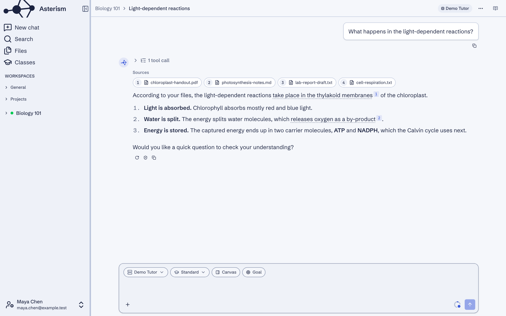
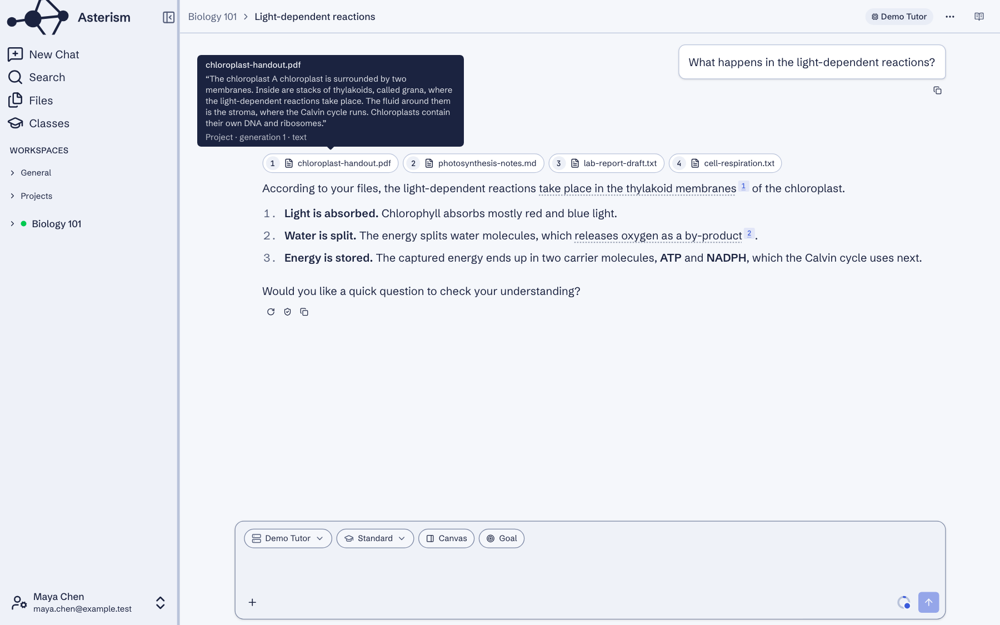
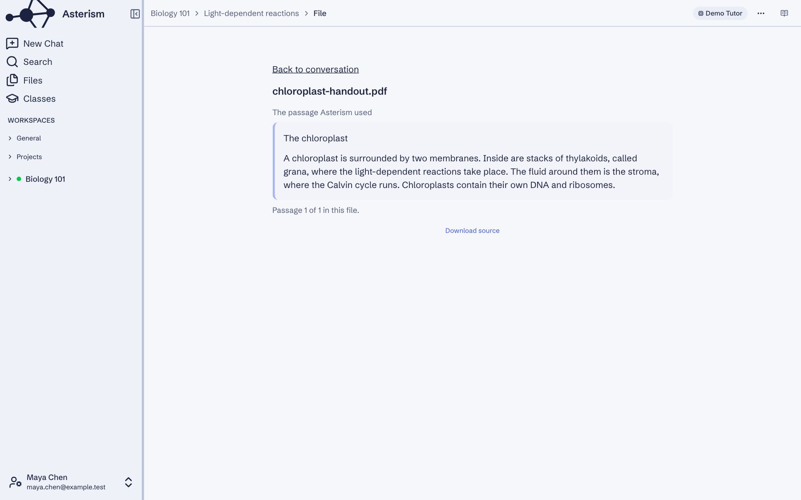

# Sources and citations

When Asterism answers from your files, it shows which files it used and which
part of the answer came from where. This page shows how to read that, so you
can check the answer yourself.

> **Who can do this:** everyone.

## Before you start

- Asterism needs files to work from: [attach them](attaching-files.md) to the
  chat, or ask in a project that has files.
- The chat's model must be able to use tools, so it can search your files.

## Read the sources

When an answer uses your files, two things appear:

- **Sources**, a row of numbered chips above the answer, one for each file
  Asterism read.
- **Citations**, small numbers in the answer's text, after the sentence they
  support. Words that came from a file are underlined with dots.

The number in a citation matches a source chip, so a "1" in the text came from
source 1.

## Check a source

1. Rest the pointer on a source chip or a citation number. On a phone, press
   and hold it.

   A box shows the passage Asterism used, and where the file comes from:
   **Project** or **This chat**.

   

2. To read more, select the chip or the number.

   A page opens with the file's name and the whole passage Asterism used, with
   its place in the file, such as **Passage 2 of 12 in this file**. For a
   picture, the passage is the description Asterism wrote of it.

   

3. To open the whole file, select **Download source**. Select **Back to
   conversation** to return.

## Why checking matters

Asterism can misread a file or say more than the file does. Before you rely on
an answer for schoolwork, read the passage it cites and make sure it really says
that. If an answer has no sources, it didn't come from your files.

## If something goes wrong

- **A source says "Source unavailable in this chat".** The file was removed from
  the chat or the project, or deleted. Select the retry button beside it if you
  think it should still be there.
- **The page says "This passage is no longer in the file".** The file was
  changed and processed again since the answer was written. Select **Download
  source** to read the current file.
- **No sources appear.** Asterism didn't use your files for this answer. Check
  [Files in context](attaching-files.md#see-which-files-are-in-context), then ask
  again and mention the file, for example "According to my notes, …".

## Related

- [Attaching files and files in context](attaching-files.md)
- [Glossary: citation and source](../glossary.md)
