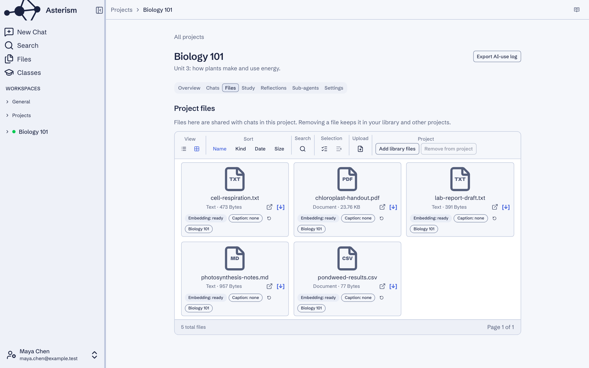
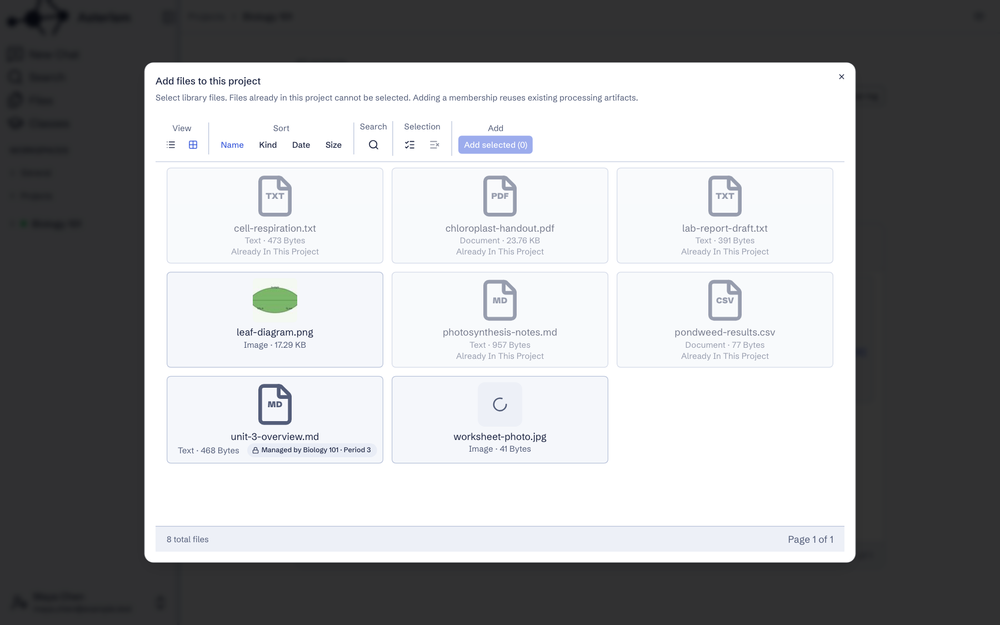

# Project files

Files you add to a project are shared with every chat in it. Add your course
notes or readings once, and you can ask about them in any of the project's
chats. This page shows how to add and remove them.

> **Who can do this:** everyone.

## See a project's files

Open the project and select the **Files** tab.

These files are listed under **Project files** in each chat's
[Files in context](../02-chatting/attaching-files.md#see-which-files-are-in-context).

## Add files from your library

1. In the **Files** tab, select **Add library files**.

   A window lists the files in your library. Files already in the project can't
   be chosen again.

   

2. Select the files you want, then select **Add selected**.

Adding a file doesn't make a copy: the project uses the file in your library.

## Upload new files to the project

In the **Files** tab, select the **Upload** button, or drag files onto the list.
The files go into your library and into the project at the same time.

## Remove a file from the project

1. In the **Files** tab, select the file, or several files.
2. Select **Remove from project**.
3. Read the message, then select **Confirm**.

The file is no longer shared with the project's chats, but it stays in your
library and in any other project. See
[Removing or deleting a file](removing-or-deleting-a-file.md) for the difference
from deleting.

## Good to know

- A new or changed file can be used once its **Embedding** label says **ready**.
  See [Processing](the-files-library.md#processing-is-a-file-ready).
- Files from a course your educator shared are managed by the course. You can use
  them, but not remove or delete them.

## Related

- [Projects](projects.md)
- [The Files library](the-files-library.md)
