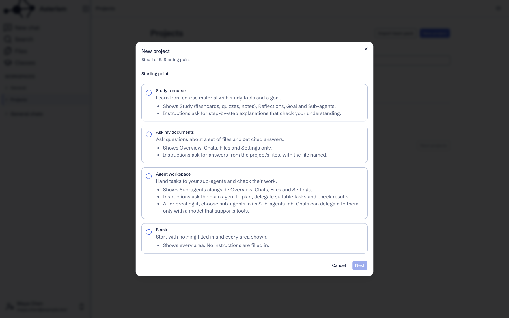
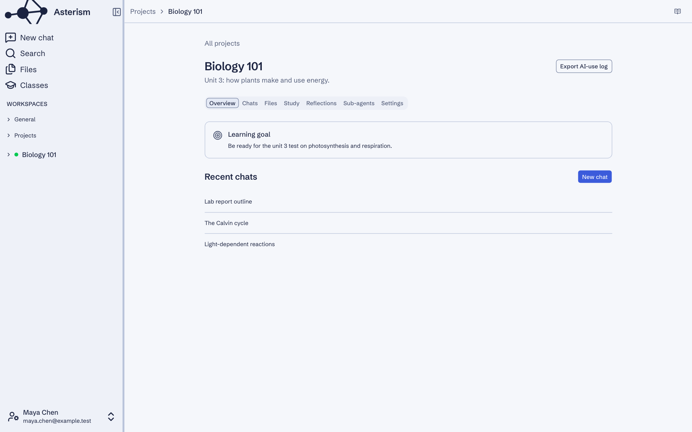
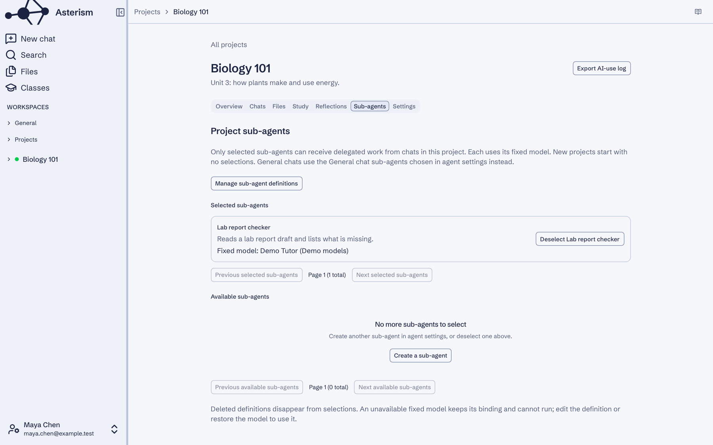

# Projects

A **project** is a place for one subject or piece of work, such as a course or an
assignment. Its chats can all use the project's files, so you add your notes
once instead of attaching them to every chat. A project also keeps its own study
material, reflections and settings.

> **Who can do this:** everyone.

## Create a project

1. In the sidebar, under **Workspaces**, select **Projects**.
2. Select **New project**.

   A short set of steps opens. The first is **Starting point**.

   

3. Choose a starting point, then select **Next**:
   - **Study a course**: study tools, reflections and a goal, with instructions
     that ask for step-by-step explanations.
   - **Ask my documents**: answers from the project's files, naming the file.
   - **Agent workspace**: for handing tasks to your sub-agents.
   - **Blank**: nothing filled in, every part shown.

   A starting point only fills things in for you. You can change all of it
   before and after you create the project.

4. **Name and description:** type a name (you must give one), a short
   description, and choose a sidebar color. Select **Next**.
5. **Files and instructions:** choose files from your library to add, and edit
   the project's instructions if you like. Select **Next**.
6. **Goal** (only if the project has one): write what you're working toward and,
   if you like, a target date. Select **Next**.
7. **Review:** check what will be created, and switch parts of the project on or
   off. Select **Create project**.

Nothing is created until you select **Create project**. **Cancel** leaves nothing
behind.

To upload new files for the project, create it first, then use its **Files** tab.

## Find your way around a project

Open a project from **Projects** in the sidebar. Its page has tabs:

- **Overview**: the goal and the latest chats.
- **Chats**: every chat in the project. **New chat** here starts a chat that can
  use the project's files.
- **Files**: the files shared with every chat in the project. See
  [Project files](project-files.md).
- **Study**: flashcards, quizzes and notes made from this project.
- **Reflections**: your private notes on what you learned.
- **Sub-agents**: helpers this project's chats may use. See
  [Sub-agents for a project](#choose-sub-agents-for-a-project).
- **Settings**: the name, description, instructions, goal and which parts of the
  project to show.

## Change a project's settings

1. Open the project and select the **Settings** tab.
2. Change what you need:
   - **Name**, **Description** and **Sidebar color**.
   - **Learning goal** and **Target date**. A chat only sees the goal when you
     turn on **Goal** above the message box for a message.
   - **Project instructions**: what every chat in the project should keep in
     mind, such as "I'm in a first-year biology course; use simple terms". They
     shape answers, but they don't give Asterism extra tools or files.
   - **Feature areas**: switch off the parts you don't use, such as Study or
     Reflections. Switching one off hides it but keeps what's in it.
3. Select **Save settings**.

## Project memory

When memory is on, a project's **Settings** tab has **Project memory**: things
Asterism keeps in mind about your work in this project, such as a decision or a
convention you chose. Only this project's chats use them, together with your
[memories about you](../06-making-it-yours/about-you-and-usage.md#memory), and
only you can see them. Add, edit or delete them there.

## Choose sub-agents for a project

A **sub-agent** is a helper with its own instructions and its own model, such as a
"Lab report checker". Your main agent can hand it part of a task. You create
sub-agents in **Settings** › **Agents**; each project then chooses which ones its
chats may use. New projects start with none.

1. Open the project and select the **Sub-agents** tab.

   

2. Under **Available sub-agents**, select **Select** beside a sub-agent. It moves
   to **Selected sub-agents**.
3. To stop a project using one, select **Deselect** beside it.

For a sub-agent to help, the chat's model must be able to use tools (the wrench
icon in the model list), and your administrator must allow sub-agents. A
sub-agent can only use the same files as the chat, or fewer.

General chats don't use a project's sub-agents; they use the ones you choose
for General chats in **Settings** › **Agents**.

## Move a chat into a project

1. Open the chat, then select the **…** button at the top right.
2. Select **Move**.
3. In **Move chat**, choose the project (or **General**), then select
   **Move to workspace**.

A chat moved into a project can use the project's files from then on.

## Delete a project

1. Open the project and select the **Settings** tab.
2. At the bottom, select **Delete project**, then confirm.

The project's chats move to **General** with their history and their own
attachments. Your files stay in your library. Only the project, its settings and
its memories are gone.

A course from your educator shows **Leave course** instead. You can add it again
from **Classes**.

## Related

- [Project files](project-files.md)
- [Removing or deleting a file](removing-or-deleting-a-file.md)
- [Team packs](team-packs.md)
