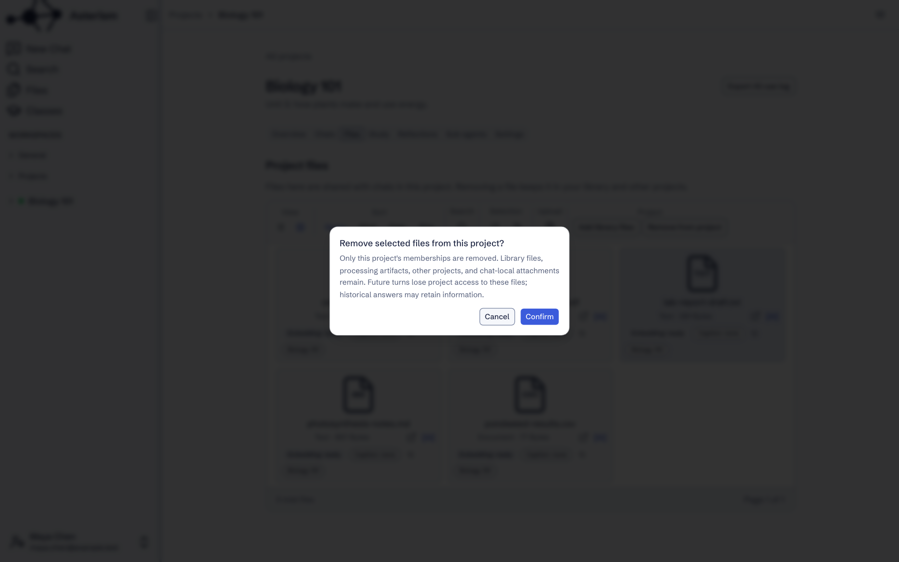

# Removing or deleting a file

There are three ways to stop Asterism using a file, and they do very different
things. This page explains which to choose.

> **Who can do this:** everyone.

## At a glance

| What you do                          | Where                           | What happens to the file                                                                                    |
| ------------------------------------ | ------------------------------- | ----------------------------------------------------------------------------------------------------------- |
| **Remove an attachment** from a chat | The chat's **Files in context** | That chat stops using it. It stays in your library and your projects.                                       |
| **Remove from project**              | The project's **Files** tab     | That project's chats stop using it. It stays in your library, other projects and any chat it's attached to. |
| **Delete**                           | **Files**                       | It's gone for good: from your library, every project and every chat.                                        |

In all three cases, answers Asterism already wrote stay as they are. Removing or
deleting a file only changes what Asterism can read from now on.

## Remove a file from a project

Use this when a file doesn't belong in the project any more, but you want to
keep it.

See [Project files](project-files.md#remove-a-file-from-the-project) for the
steps.

## Delete a file

Use this when you don't want the file at all, for example a wrong upload or a
broken copy. It can't be undone.

See [The Files library](the-files-library.md#delete-files) for the steps.

## Remove an attachment from one chat

Use this when you attached the wrong file to a chat.

1. In the chat, select the **+** button beside the message box, then
   **Files in context**.
2. Select the file under **Chat attachments**.
3. Select **Remove chat attachment**, and confirm.

## Related

- [The Files library](the-files-library.md)
- [Project files](project-files.md)
- [Attaching files and files in context](../02-chatting/attaching-files.md)
