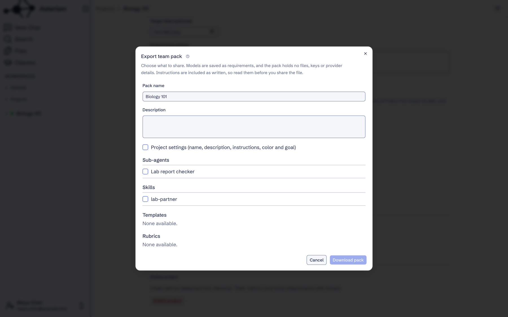
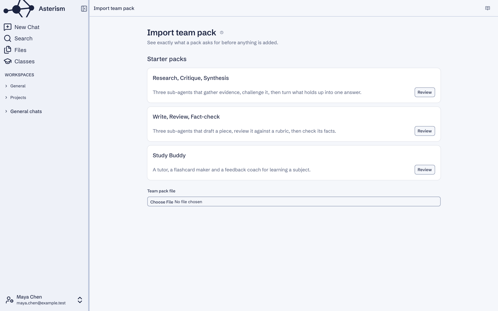
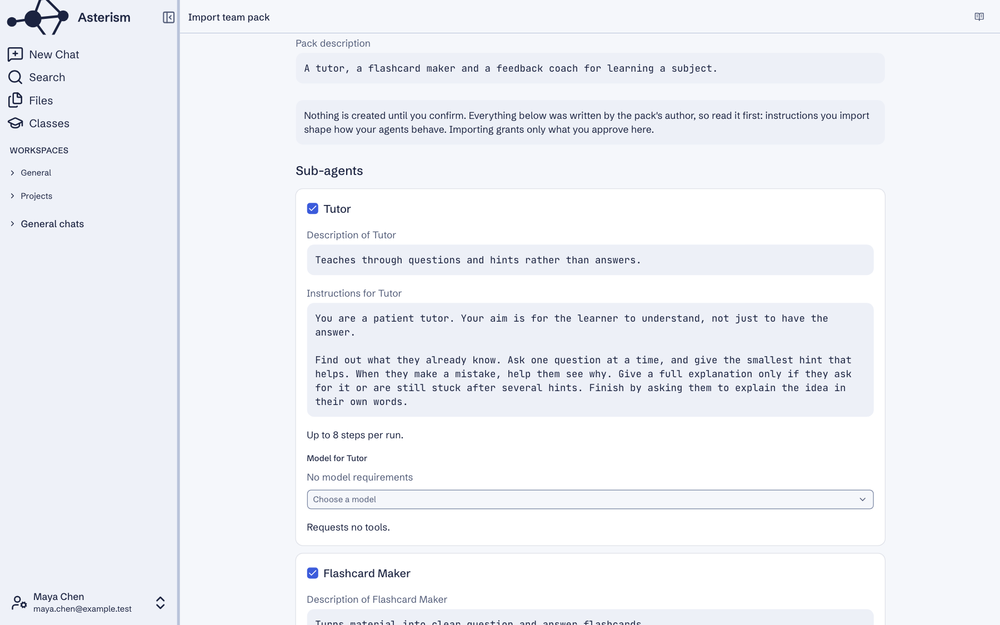

# Team packs

A **team pack** is a file that shares a setup with someone else: sub-agents,
skills, prompt templates, rubrics and a project's settings. A teacher might share
one with a class, or a study group might share the helpers that worked well.
This page shows how to export one, import one, and what a pack never holds.

> **Who can do this:** everyone.

## What a pack holds, and what it never holds

A pack holds only instructions and settings:

- sub-agents, with their instructions and the kind of model they need;
- skills;
- prompt templates and rubrics;
- a project's name, description, instructions, color and goal.

A pack **never** holds:

- your files;
- your chats;
- passwords, keys or details of your administrator's model providers.

Models are saved as requirements ("needs a model that can use tools"), not as a
particular model, so the person who imports the pack chooses their own.

## Export a pack from a project

1. Open the project and select the **Settings** tab.
2. Select **Export team pack**.

   

3. Check the **Pack name** and write a **Description** that says what the pack is
   for.
4. Tick what to share: the project settings, and any of your sub-agents, skills,
   templates and rubrics.
5. Select **Download pack**.

Asterism saves a pack file you can send to someone.

Instructions are included exactly as you wrote them. Read them before you share
the file, and take out anything private.

## Import a pack

1. In the sidebar, select **Projects**, then select **Import team pack**.

   

2. Choose a pack:
   - Under **Starter packs**, select **Review** beside one of the packs that come
     with Asterism, or
   - under **Team pack file**, choose a pack file someone sent you (up to 1 MB).

   Asterism shows everything in the pack, below.

   

3. Read it. Everything here was written by the pack's author, including the
   instructions your agents will follow.
4. Choose what to include: untick anything you don't want. You can rename items.
5. For each sub-agent, choose a model under **Model for**. The pack says what kind
   of model it needs.
6. Approve each tool a sub-agent asks for, and each skill it asks to load. For a
   skill, tick **Assign … to my main agent** if you want to use it with `/` in
   chats.
7. Select **Import**. The button says how many items will be added.

Nothing is created until you select **Import**.

## If something goes wrong

- **"Name already in use".** You already have something with that name. Rename
  the item in the review, or untick it.
- **"Before you can import:"** The page lists what's still missing, such as a
  model for a sub-agent. Fix each one, then import.
- **"Could not import the pack. Nothing was created."** Try again. If it keeps
  failing, the pack file may be damaged; ask for a new copy.

## Good to know

- A pack's instructions shape how your agents behave, but a pack can't give them
  tools: you approve those yourself.
- Starter packs go through the same review as any other pack.

## Related

- [Projects](projects.md)
- [Glossary: team pack](../glossary.md)
