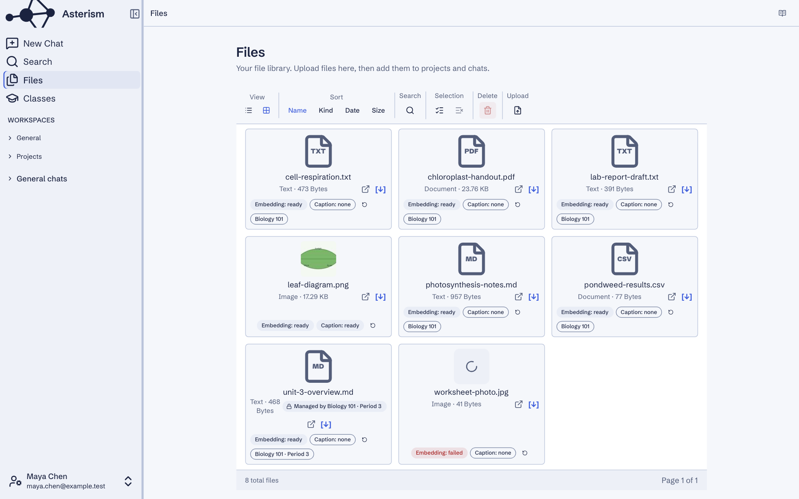
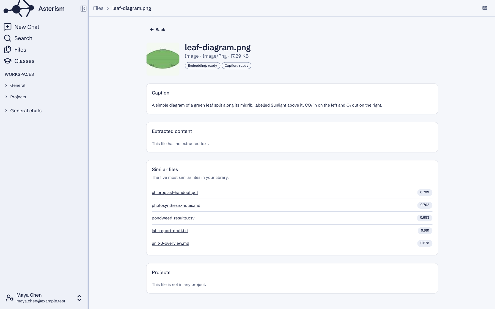
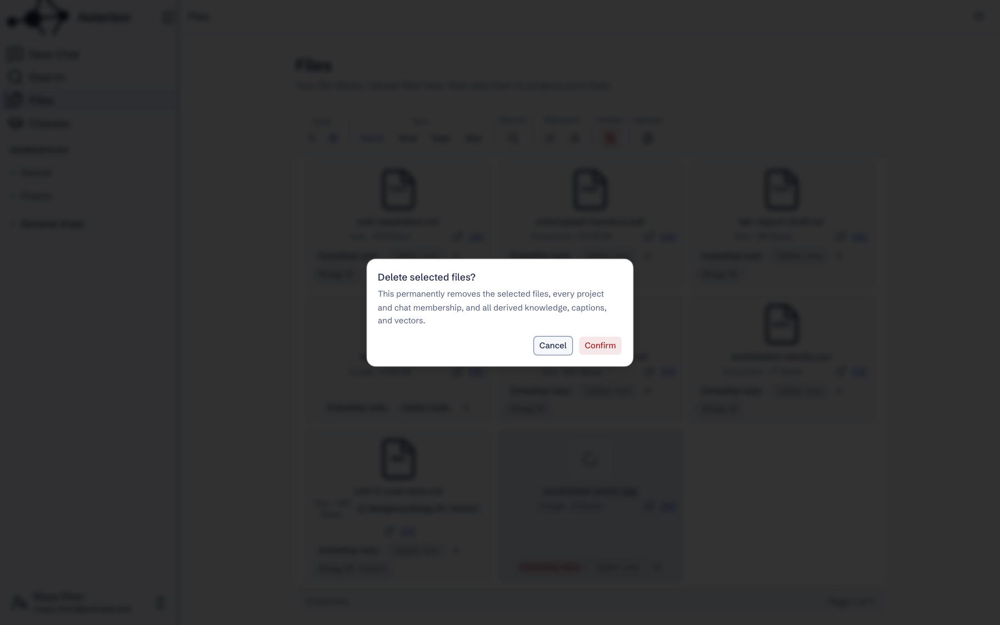

# The Files library

**Files** keeps everything you've uploaded in one place: notes, handouts,
readings, spreadsheets and pictures. From here you can add files to projects or
attach them to chats. This page shows how to upload, check, download and delete
files.

> **Who can do this:** everyone.

## Open your library

Select **Files** at the top of the sidebar.

Each file shows its name, kind and size, whether it's ready to use, and the
projects it's in. The bar across the top lets you switch between a grid and a
list (**View**), sort by **Name**, **Kind**, **Date** or **Size**, and search by
name (**Search**).

## Upload files

1. Select the **Upload** button at the top of the library, then choose one or
   more files. You can also drag files from your computer onto the library.
2. Wait while each file is processed.

Asterism can read PDF, Word, PowerPoint and Excel files, e-books (EPUB), web
pages, plain text and Markdown, CSV spreadsheets, code, and pictures.

## Processing: is a file ready?

After you upload a file, Asterism **processes** it: it reads the text and gets it
ready to search, so it can find the right passage when you ask a question. Two
labels under each file show how that went:

- **Embedding** is the search part. **ready** means Asterism can use the file.
  **failed** means it couldn't read the file.
- **Caption** is a short written description of a picture, so Asterism can find
  pictures by what's in them. It says **none** for files that aren't pictures,
  or when your administrator hasn't turned captions on.

A file can't be used in a chat until its embedding is **ready**.

### Try again after a failure

If a file says **Embedding: failed**:

1. Select the circular arrow beside its labels (**Regenerate embedding and
   caption**) to try again.
2. If it fails again, the file is probably damaged or empty. Open it on your
   computer to check, then upload a good copy and delete the broken one.

## Look inside a file

1. Select the open button (the arrow pointing out of a box) on a file.

   The file's page shows what Asterism read from it.

   

2. Read the parts of the page:
   - **Caption**: the description of a picture.
   - **Extracted content**: the text Asterism read. This is what it searches.
   - **Similar files**: the five files in your library most like this one.
   - **Projects**: the projects this file is in.
3. Select **Back** to return.

## Download a file

Select the download button (the arrow pointing down) on a file. You get the
file exactly as you uploaded it.

## Delete files

Deleting a file removes it everywhere, for good.

1. Select the file, or several files. Selected files are highlighted.
2. Select the **Delete** button (the red bin) at the top of the library.

   

3. Select **Confirm**.

The file is removed from your library, from every project it was in and from
every chat it was attached to. Answers Asterism already wrote stay as they are.

If you only want a file out of one project, don't delete it: remove it from the
project instead. See [Removing or deleting a file](removing-or-deleting-a-file.md).

## If something goes wrong

- **A file says "Managed by" and a class name.** It comes from a course your
  educator shared. You can't delete course files; they go when you leave the
  course.
- **A file stays processing for a long time.** Large files take longer. Reload
  the page after a few minutes; if it's still not ready, try the circular arrow.

## Related

- [Projects](projects.md)
- [Attaching files to a chat](../02-chatting/attaching-files.md)
