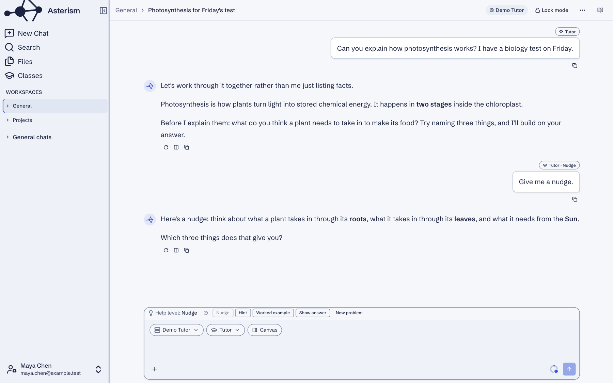
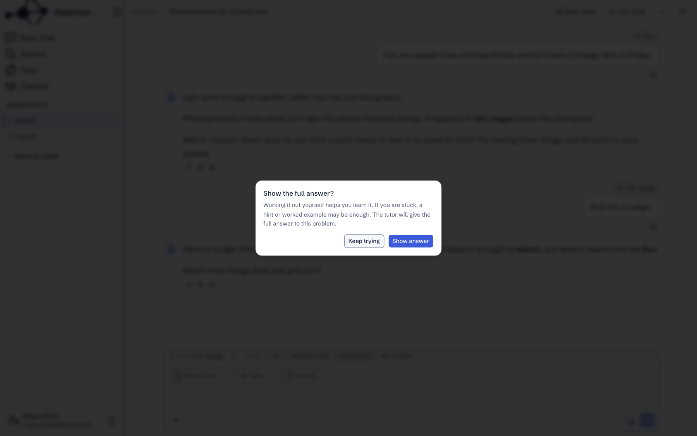
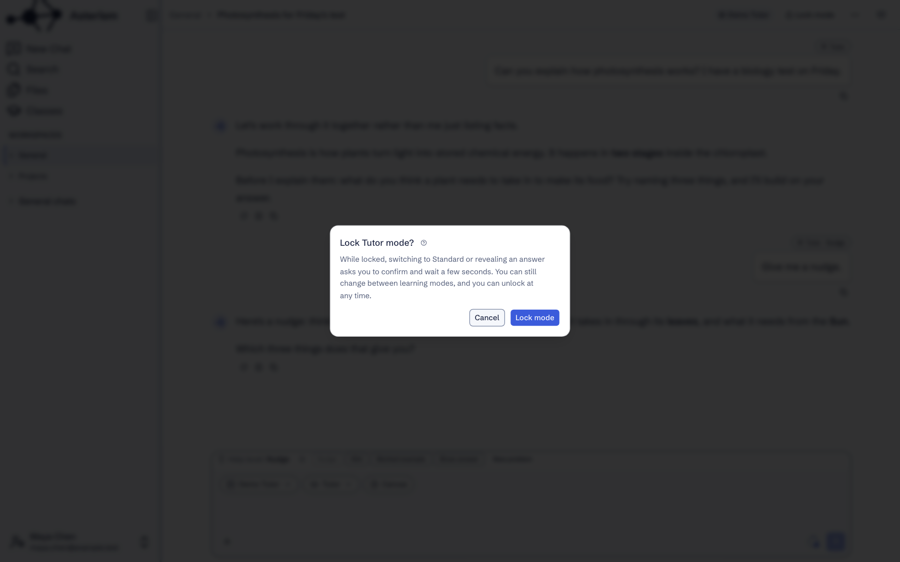

# Hints and Show answer

In **Tutor** mode Asterism doesn't give you the answer straight away. When you're
stuck, you can ask for a little more help at a time, and see the full answer only
when you choose to. This page shows how. **Review my work** mode works the same
way, with **Show solution** instead of **Show answer**.

> **Who can do this:** everyone. A class may turn **Show answer** off in its
> course project.

## The help bar

In a Tutor chat, a bar above the message box shows how much help you've had so
far, after **Help level**, and the buttons for more:

- **Nudge** points you in the right direction.
- **Hint** gives you a key idea.
- **Worked example** shows the method on a similar problem.
- **Show answer** gives the full answer, after you confirm.

You start at **Questions only**. Help only gets stronger when you ask for it.

## Ask for a hint

1. In a Tutor chat, select **Nudge** in the help bar.

   Asterism answers with a nudge, and the help bar now says
   **Help level: Nudge**.

   

2. Try again with your own answer. If you're still stuck, select **Hint**, then
   **Worked example**.

Each button sends a short message for you, such as "Give me a nudge."

## See the full answer

Try the hints first: working through the problem yourself is how the learning
sticks.

1. Select **Show answer** in the help bar.

   Asterism asks you to confirm.

   

2. Select **Show answer** to see it, or **Keep trying** to go back.

If you've [locked the mode](#lock-a-mode-to-keep-yourself-on-track), you wait a few
seconds before you can confirm.

## Start a new problem

After you've had hints or the answer, the help bar shows **New problem**. Select
it before you ask about the next problem, so the help level starts again from
**Questions only**. Select it again (**Keep current level**) if you change your
mind.

## Lock a mode to keep yourself on track

If you're tempted to skip ahead, lock the chat's mode. While it's locked,
switching to Standard or showing an answer asks you to confirm and wait a few
seconds, so it's a deliberate choice.

1. At the top right of the chat, select **Lock mode**.

   

2. Select **Lock mode**.

The button now says, for example, **Tutor locked**. You can still change to another
learning mode. To unlock, select it, then **Unlock** after the short wait.

## Good to know

- Each version of an answer keeps its own help level, so
  [regenerating](../02-chatting/regenerating-and-branches.md) an answer doesn't
  skip ahead.
- In a class's course project, your educator may turn **Show answer** off. Then the
  button isn't there. See [Mode restrictions](mode-restrictions.md).

## Related

- [Learning modes](learning-modes.md)
- [Mode restrictions](mode-restrictions.md)
