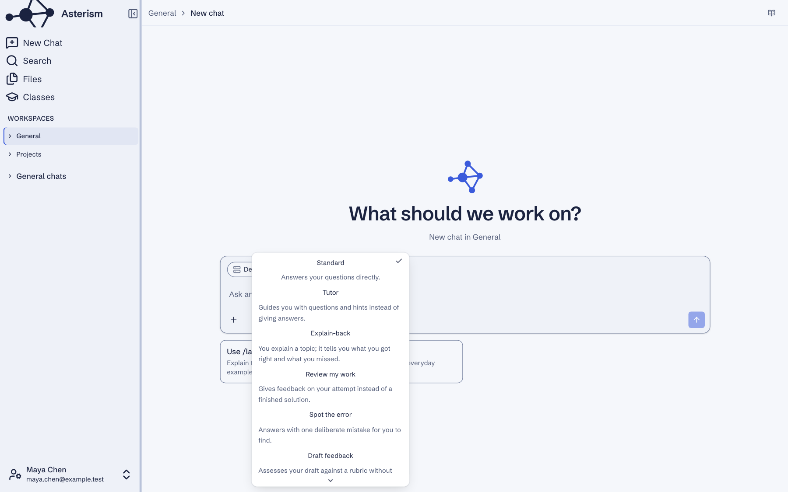
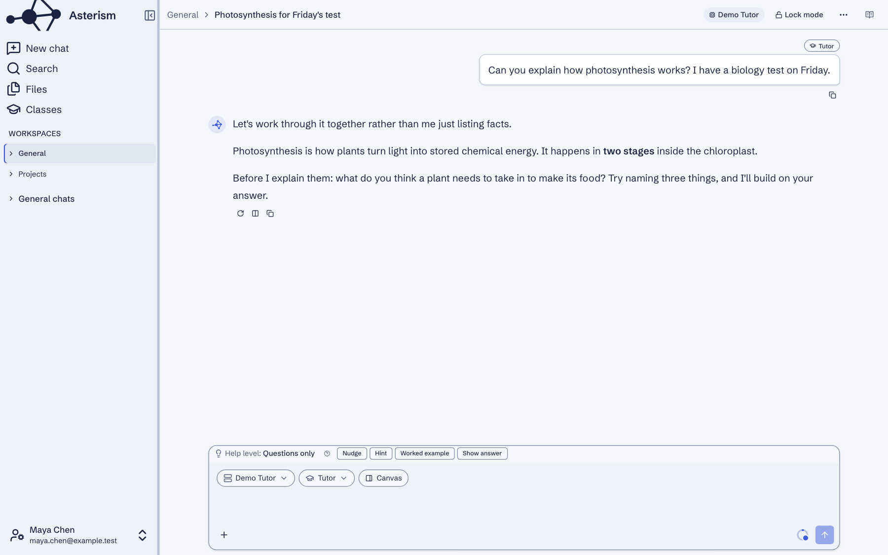
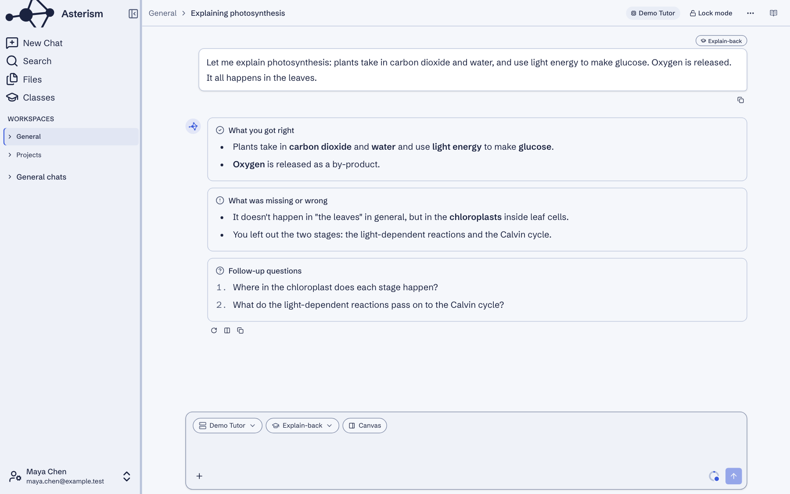
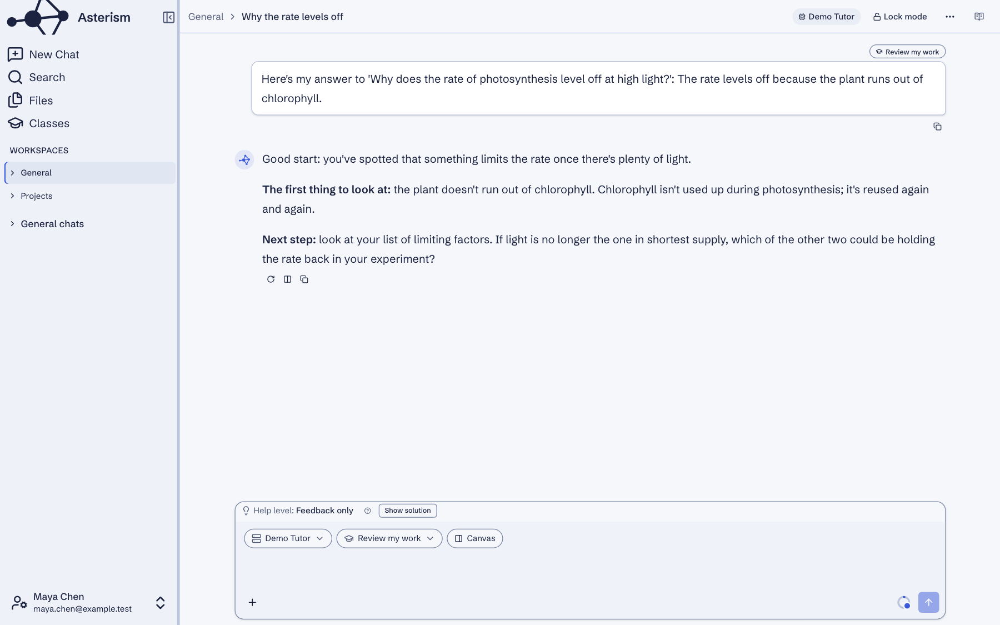
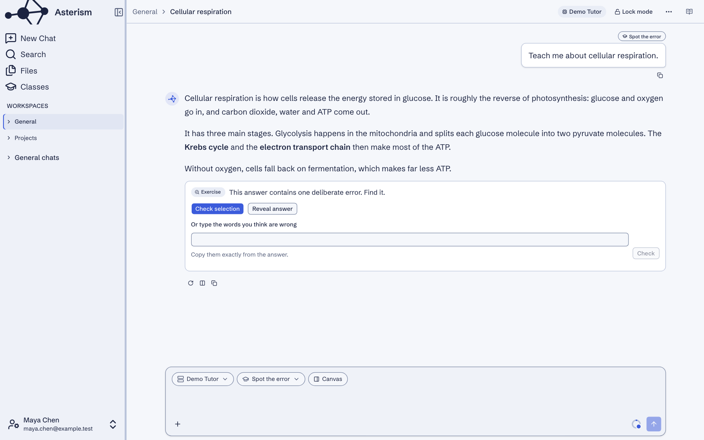

# Learning modes

A **learning mode** changes how Asterism helps you. In **Standard** mode it
answers your questions directly. The other modes help you work things out
yourself: they ask you questions, check your explanation or review your work,
instead of doing it for you. This page explains each mode, when to use it, and
what a chat in that mode looks like.

> **Who can do this:** everyone. In a class's course project, your educator may
> limit which modes you can use (see [Mode restrictions](mode-restrictions.md)).

## Choose a mode

1. Select the mode chip above the message box. It shows the current mode, such as
   **Standard**.

   

2. Select a mode.

The mode belongs to the chat. You can change it at any time; the new mode applies
from your next message. Each message shows the mode it was sent in, in a small
label above it.

Modes are instructions to the model. Most models follow them well, but a model can
still slip and give away more than it should.

## Which mode should I use?

| You want to…                                          | Use                    |
| ----------------------------------------------------- | ---------------------- |
| Get an answer or a finished piece of work             | **Standard**           |
| Learn how to solve a problem yourself                 | **Tutor**              |
| Check that you really understand a topic              | **Explain-back**       |
| Get feedback on an answer, solution or code you wrote | **Review my work**     |
| Practise checking AI answers for mistakes             | **Spot the error**     |
| Get feedback on a piece of writing against a rubric   | **Draft feedback**     |
| Find and judge sources, and plan an essay             | **Research assistant** |

## Standard

Asterism answers your question directly, as an ordinary chat assistant would. Use
it when you want an answer rather than practice.

> **You:** What is the formula for photosynthesis?
>
> **Asterism:** Carbon dioxide plus water, with light energy, makes glucose and
> oxygen: 6CO₂ + 6H₂O → C₆H₁₂O₆ + 6O₂.

## Tutor

Asterism guides you with questions and hints instead of giving the answer. When
you're stuck, ask for more help one step at a time. See
[Hints and Show answer](hints-and-show-answer.md).

Use it for homework problems and topics you'll be tested on.

## Explain-back

You explain a topic in your own words, and Asterism tells you what you got right,
what was missing or wrong, and what to think about next. Explaining something is
a good test of whether you understand it. Asterism won't rewrite your
explanation unless you ask.

Start with something like "Let me explain photosynthesis: …". If you just name a
topic, Asterism asks you to explain it first.

## Review my work

Share your attempt, such as a solution, some code or an essay paragraph, and
Asterism points out the first mistake or weakest point and suggests a next step.
Paste your work into the message, or [attach it](../02-chatting/attaching-files.md).

Asterism won't hand you a corrected version unless you ask for it with
**Show solution**, which you confirm first.

## Spot the error

Asterism answers your question or explains a topic, but puts **one deliberate
mistake** in the answer for you to find. It's practice for checking AI answers,
which can be wrong without seeming wrong.

1. Ask about a topic, for example "Teach me about cellular respiration."
2. Read the answer carefully, and compare it with your notes.
3. Select the words you think are wrong in the answer, then select
   **Check selection**. Or type them in **Or type the words you think are wrong**
   and select **Check**.

   Asterism tells you whether you found it, whether your selection is too broad,
   or that it's not the mistake.

4. When you've found it, or want to give up, select **Reveal answer**, then
   **Reveal**. You see the mistake, the correction and, if there is one, the
   source that shows it.

Every answer in a Spot the error chat contains a mistake, so don't rely on them
for anything else.

## Draft feedback

Get feedback on your own writing against a **rubric**: an estimated level for
each criterion, with quotes from your draft. Your draft isn't rewritten. See
[Rubrics and draft feedback](rubrics-and-draft-feedback.md).

## Research assistant

Asterism helps you find and judge sources and plan your structure. It suggests
where to look, checks a source's credibility, relevance and bias, and builds an
outline that shows which source supports each point. It doesn't write paragraphs
for you.

> **You:** Where can I find good sources about limiting factors for my essay?
>
> **Asterism:** Here are some places to look, and how to judge what you find… Share
> a source you've found and I'll help you check its credibility, relevance and
> bias.

Asterism only searches the web if your main agent has a search tool turned on.
Otherwise it suggests searches you can run yourself and works with the sources
you share. Always check a source yourself before you rely on it.

## Related

- [Hints and Show answer](hints-and-show-answer.md)
- [Mode restrictions](mode-restrictions.md)
- [Rubrics and draft feedback](rubrics-and-draft-feedback.md)
