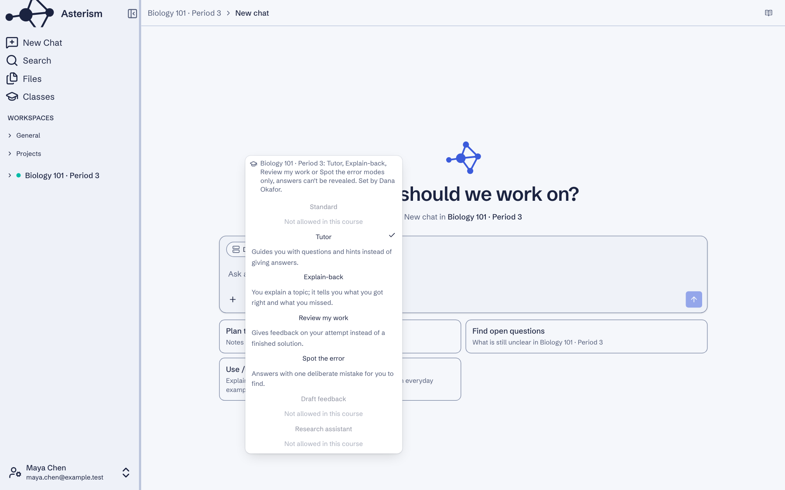
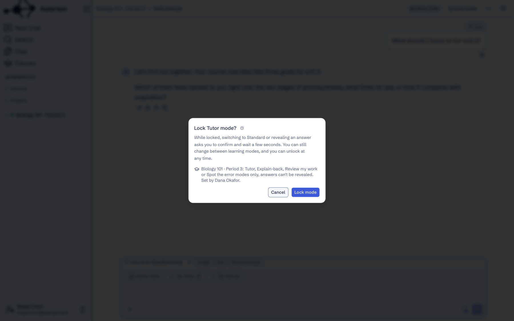

# Mode restrictions

Sometimes a chat can't use every learning mode, or can't show answers. These
**mode restrictions** come from two places: your own lock, and your educator's
rules for a class. This page explains how each appears and what you can change.

> **Who can do this:** everyone.

## Your own lock

You can lock a chat's mode yourself, so that switching to Standard or showing an
answer needs a confirmation and a short wait. You can unlock it at any time. See
[Lock a mode](hints-and-show-answer.md#lock-a-mode-to-keep-yourself-on-track).

## Your class's rules

When an educator shares a course with your class, it appears as a project in
your sidebar. In that project's chats, your educator can:

- allow only some learning modes, such as Tutor and Explain-back, and
- turn off **Show answer** and **Show solution**.

Only your educator can change these rules, and they apply only in the course
project. Your other chats aren't affected.

## How the rules appear

- **The mode chip** shows a small padlock. Its menu starts with a line naming the
  class's rules and who set them, and modes the class doesn't allow are greyed
  out and marked **Not allowed in this course**.

  

- **The help bar** has no **Show answer** button if answers can't be revealed.
- **Lock mode**, at the top right of the chat, shows the class's rules and who set
  them. Select it to read them.

## When both apply

If you lock a chat in a course project, the stricter rule wins. Unlocking only
lifts your own lock, never the class's rules.

## Good to know

- A class's rules can only limit. They never give Asterism extra tools, files or
  modes.
- When your educator changes the rules, the change applies from your next
  message.

## Related

- [Learning modes](learning-modes.md)
- [Hints and Show answer](hints-and-show-answer.md)
