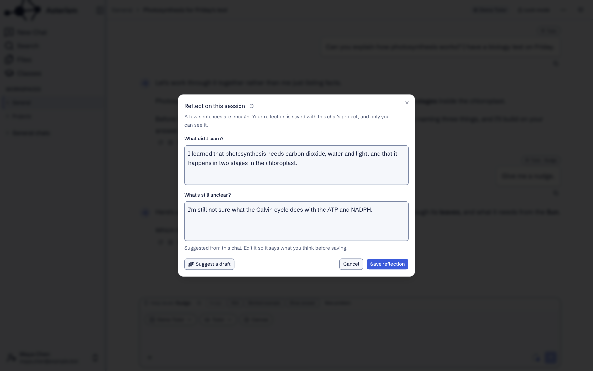
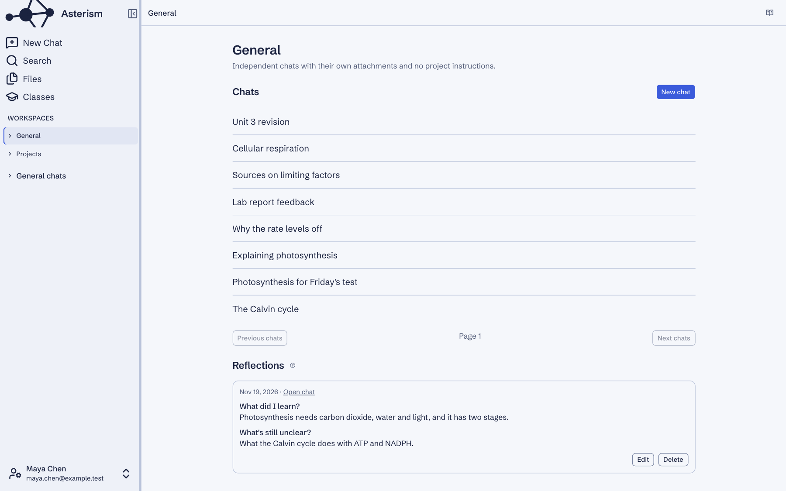
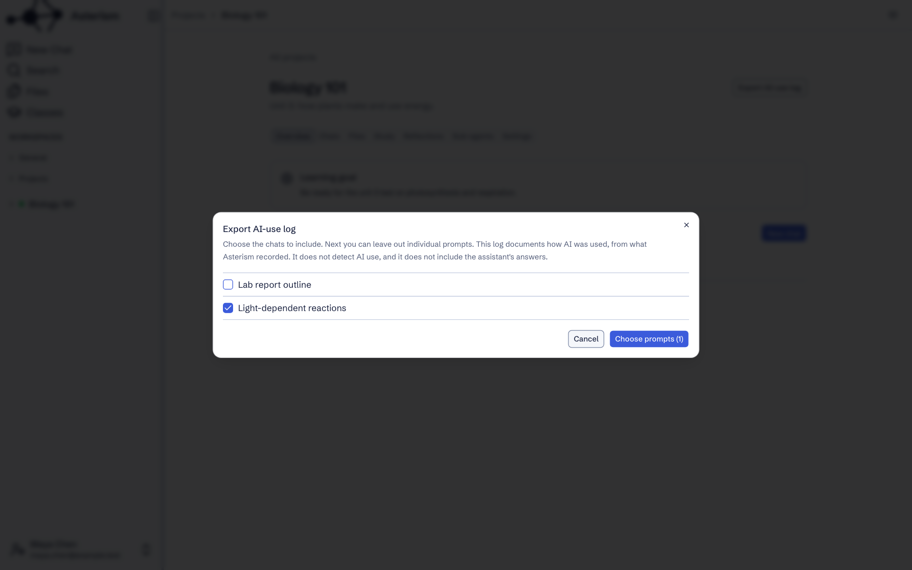
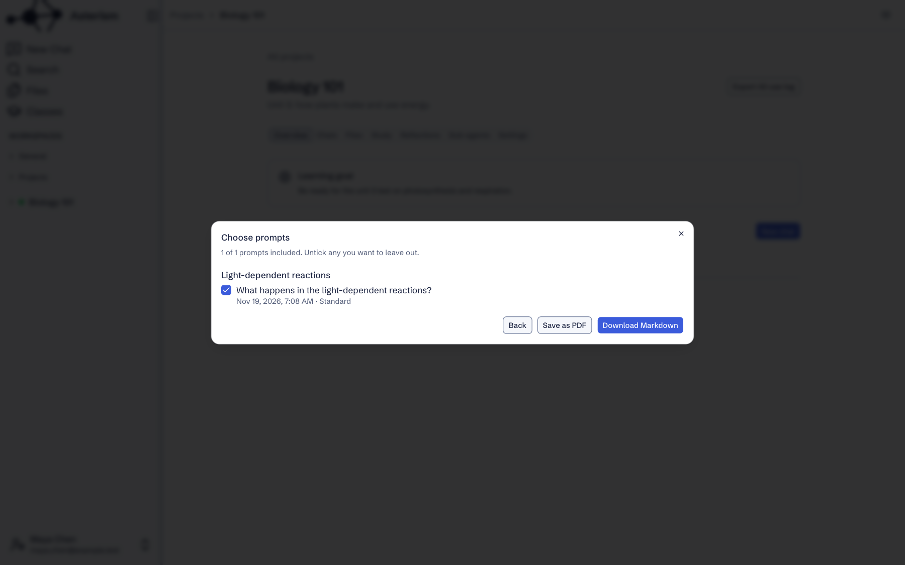

# Reflections and the AI-use log

Two tools help you look back on how you learned:

- A **reflection** is a short note at the end of a session: what you learned and
  what's still unclear. Only you can see your reflections.
- The **AI-use log** is a record of how you used AI, which you can share with a
  teacher if they ask.

> **Who can do this:** everyone.

## Reflect on a session

1. In the chat, select the **…** button (**Chat actions**) at the top right.
2. Select **Reflect on this session**.
3. Answer the two questions, **What did I learn?** and **What's still unclear?**
   A few sentences are enough.

   To get started, select **Suggest a draft**. Asterism fills in both answers from
   the chat. Edit them so they say what you really think.

   

4. Select **Save reflection**.

## Read your reflections

Reflections are kept with the chat's project, in the project's **Reflections**
tab. Reflections on General chats are on the **General** page, under
**Reflections**.

Select **Open chat** to go back to the chat, or **Edit** or **Delete** to change
it.

Asterism doesn't read your reflections when it answers. In a project, the things
you said were unclear show up in the **Study** tab's **Progress** panel, where
you can turn them into flashcards.

## Export an AI-use log

The log lists your prompts, with the learning mode, model, templates and files
you used and when. It **doesn't** include Asterism's answers, and it can't detect
AI use: it only shows what Asterism recorded.

1. Open the log in one of two ways:
   - for one chat, select **Chat actions** (**…**) at the top right of the chat,
     then **Export AI-use log**;
   - for a project, open the project and select **Export AI-use log** at the top
     right.
2. Tick the chats to include, then select **Choose prompts**.

   

3. Untick any prompts you want to leave out.

   

4. Select **Download Markdown** for a text file, or **Save as PDF**.

Answers from [Spot the error](learning-modes.md#spot-the-error) chats are marked
as exercises in the log.

## Related

- [Learning modes](learning-modes.md)
- [Projects](../03-files-and-projects/projects.md)
