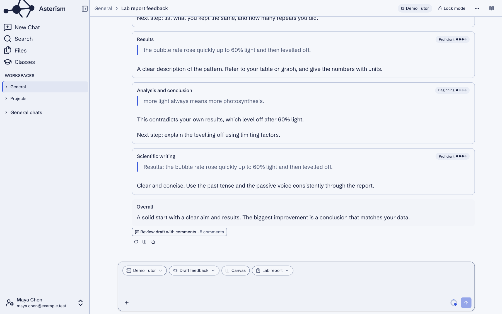
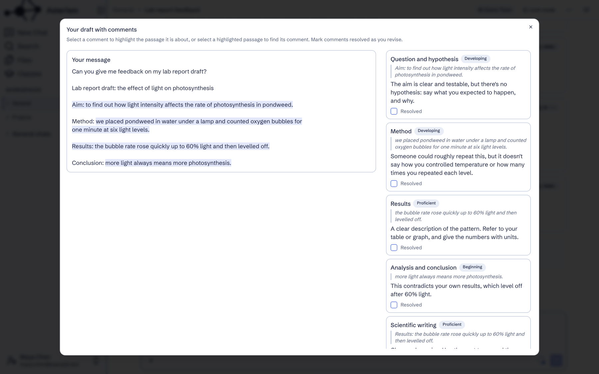
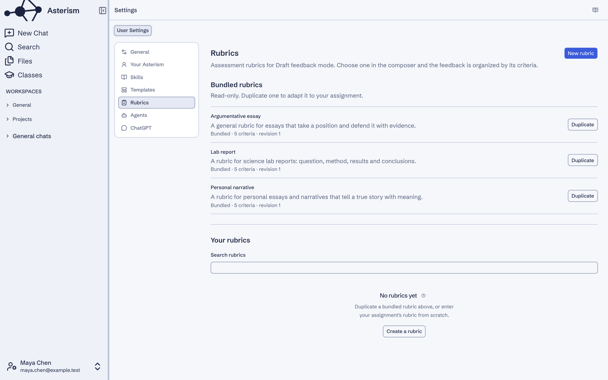
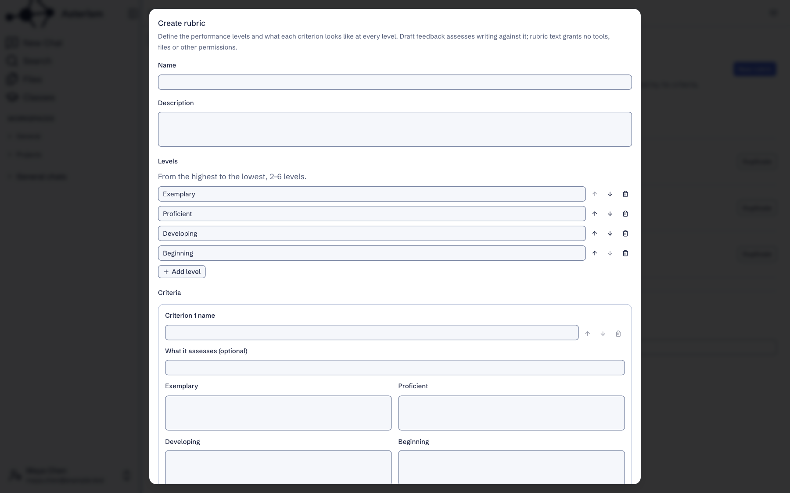

# Rubrics and draft feedback

A **rubric** lists what your work is assessed on, the **criteria**, and what each
**level** looks like, from best to weakest. In **Draft feedback** mode, Asterism
reads your writing against a rubric and gives an estimated level for each
criterion, with quotes from your draft. It never rewrites your draft for you.

> **Who can do this:** everyone.

## Get feedback on a draft

1. Start a chat, select the mode chip and choose **Draft feedback**.
2. Select the **Rubric** chip that appears next to the mode, and choose a rubric:
   one of the **Bundled** rubrics that come with Asterism, or one of
   **Your rubrics**.
3. Paste your draft into the message box, or
   [attach it](../02-chatting/attaching-files.md), and send.

Asterism answers with a section for each criterion: an estimated level, the
passage it's about, a comment and, often, a next step. An **Overall** note comes
last.

The levels are Asterism's estimate, not a grade. The rubric stays selected for
your next messages, so you can send a revised draft.

## Read the comments beside your draft

1. Under the feedback, select **Review draft with comments**.

   Your draft opens with each quoted passage highlighted, and the comments beside
   it.

   

2. Select a comment to highlight its passage, or a passage to find its comment.
3. Tick **Resolved** on each comment as you fix it in your draft.

If you'd like to see how one passage could read, ask for an example rewrite of
just that passage.

## Use your assignment's own rubric

If your teacher gave you a rubric, enter it in Asterism so the feedback follows
it.

1. Select your name at the bottom of the sidebar, then **Settings**, then
   **Rubrics**.

   

2. Start from a bundled rubric with **Duplicate**, or select **New rubric** to
   start from scratch.
3. Fill in the rubric:

   
   - **Name** and **Description**.
   - **Levels**: from highest to lowest, two to six. Select **Add level** for
     another.
   - **Criteria**: for each one, a name, what it assesses, and what work at each
     level looks like. Select **Add criterion** for another.

4. Select **Save rubric**.

Your rubric now appears under **Your rubrics** in the **Rubric** chip.

## Good to know

- Each message keeps a copy of the rubric it was sent with, so editing a rubric
  later doesn't change earlier feedback.
- A rubric only describes the assessment. It doesn't give Asterism any extra
  tools or files.

## Related

- [Learning modes](learning-modes.md)
- [Attaching files](../02-chatting/attaching-files.md)
