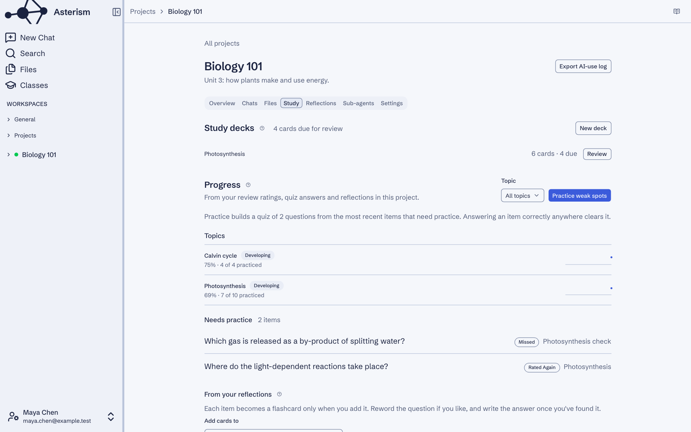
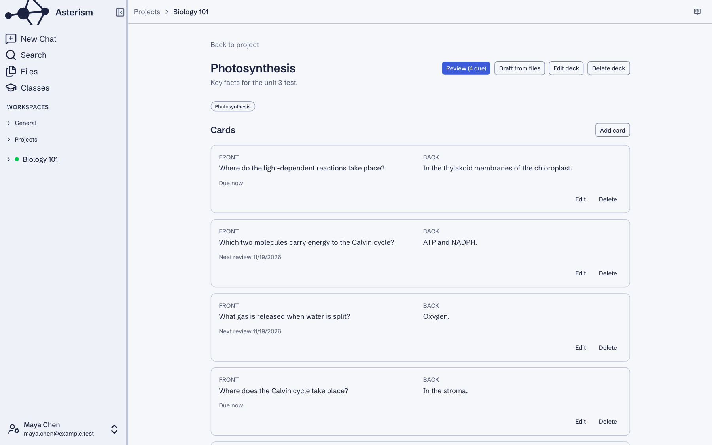
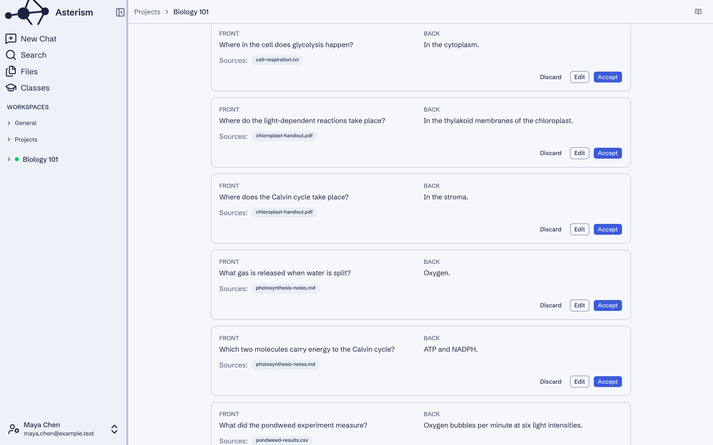
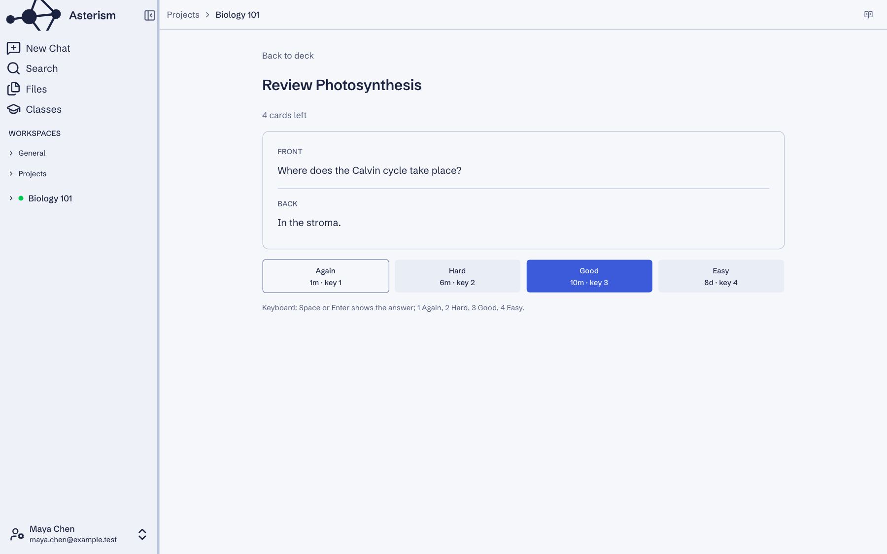

# Flashcards

A **flashcard** has a question on the front and the answer on the back. A **deck**
groups a project's cards. When you review, cards you know well come back less
often, and cards you find hard come back sooner. This page shows how to make a
deck, draft cards from your files, and review them.

> **Who can do this:** everyone. Flashcards belong to a project.

## Before you start

- Open a [project](../03-files-and-projects/projects.md) and select its **Study**
  tab. If there's no Study tab, turn **Study** on under **Feature areas** in the
  project's **Settings**.

## Make a deck

1. In the Study tab, under **Study decks**, select **New deck**.
2. Type a **Name** and, if you like, a **Description**. Add **Topics**, such as
   "Photosynthesis", to follow the deck in the [Progress](progress.md) panel.
3. Select **Create deck**.

Select a deck's name to open it.

## Add cards yourself

1. In the deck, select **Add card**.
2. Type the question in **Front** and the answer in **Back**.
3. Select **Add card**.

To change a card, select **Edit** on it; to remove it, select **Delete**.

## Draft cards from your files

Asterism can suggest cards from the project's files. Nothing is saved until you
accept a card.

1. In the deck, select **Draft from files**.
2. Choose the files to use (**All project files**, or **Choose files**), the
   **Number of cards** and a **Model**.
3. Select **Draft cards**.

   Suggested cards appear under **Drafts**, each with the file it came from.

   

4. For each draft, select **Accept** to add it to the deck, **Edit** to change it
   first, or **Discard** to leave it out. **Accept all** adds every draft.

Check each draft against your notes: Asterism can get things wrong.

## Review your cards

1. In the Study tab or the deck, select **Review**. The button shows how many cards
   are due.
2. Read the front and try to remember the answer.
3. Select **Show answer** (or press Space or Enter).

   

4. Rate how well you remembered it: **Again**, **Hard**, **Good** or **Easy** (or
   press 1 to 4). Each button says when you'll see the card next.
5. Carry on until no cards are left.

Rate honestly. **Again** brings the card back soon, and it appears under
**Needs practice** in the [Progress](progress.md) panel until you get it right.

## Related

- [Practice quizzes](practice-quizzes.md)
- [Following your progress](progress.md)
