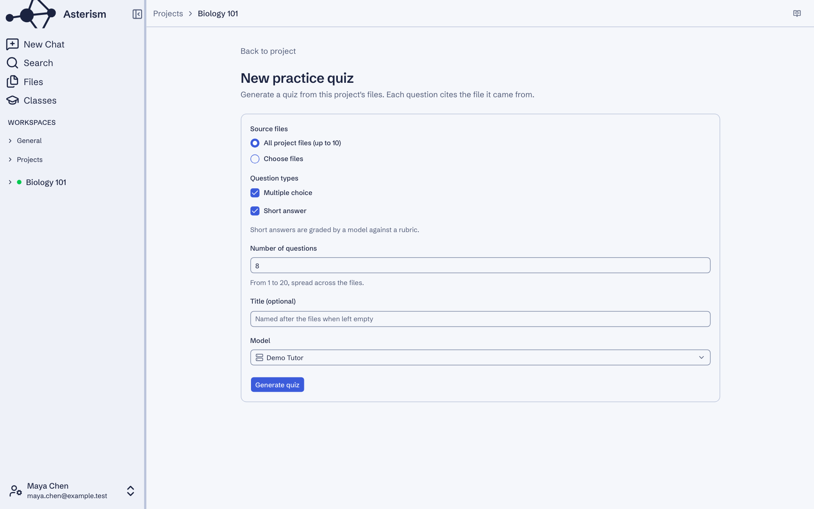
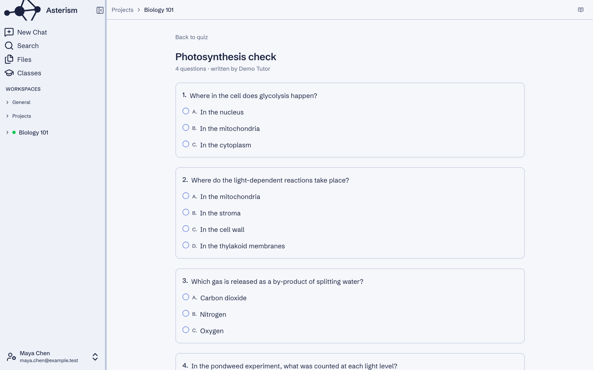
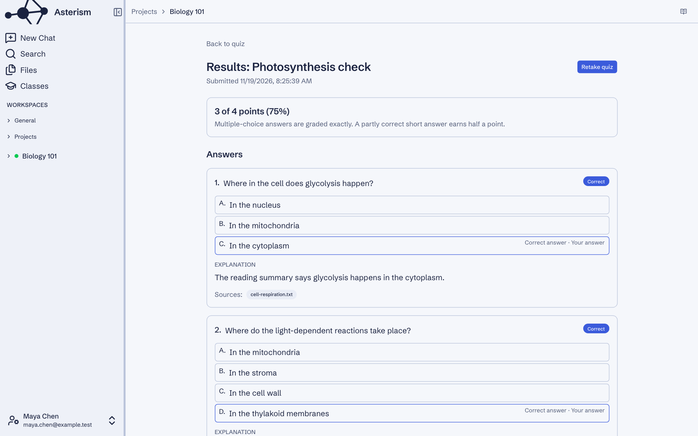
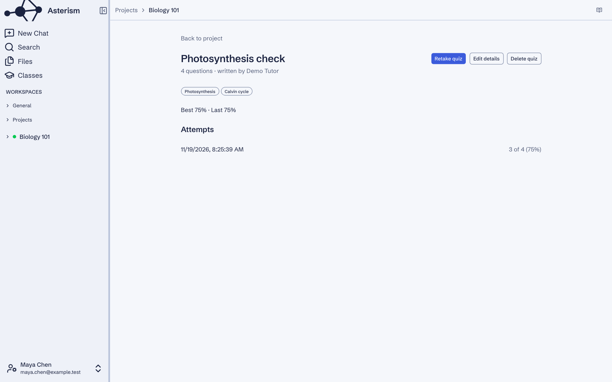

# Practice quizzes

A **practice quiz** is a set of questions Asterism writes from a project's files.
Take it as often as you like: each time is an **attempt**, with its own score and
feedback. This page shows how to make a quiz, take it and read your results.

> **Who can do this:** everyone. Quizzes belong to a project.

## Make a quiz

1. Open the project's **Study** tab. Under **Practice quizzes**, select
   **New quiz**.

   

2. Choose:
   - **Source files**: all the project's files, or the ones you pick.
   - **Question types**: **Multiple choice**, **Short answer**, or both.
   - **Number of questions**: from 1 to 20.
   - **Title** (optional) and **Model**.
3. Select **Generate quiz**.

Asterism writes the questions and saves the quiz. Each question cites the file it
came from.

## Take the quiz

1. Open the quiz, then select **Take** (or **Retake quiz**).
2. Answer each question: choose an option, or write a short answer. You can leave
   a question blank.

   

3. Select **Submit answers**.

## Read your results

- The score at the top counts each correct answer as one point.
- Multiple-choice answers are marked exactly.
- A model marks short answers against what a good answer should include. A
  partly right short answer earns half a point. One it couldn't mark earns no
  points and says so.
- Under each answer: whether it was right, the correct answer, an explanation and
  the source file.

Questions you missed appear under **Needs practice** in the
[Progress](progress.md) panel.

## The quiz page

- **Best** and **Last** show your scores. Every attempt is listed; select one to
  see its answers again.
- **Edit details** changes the title and **Topics**. Add topics to follow the
  quiz in the [Progress](progress.md) panel.
- **Delete quiz** removes the quiz and all its attempts.

## Good to know

- Practice quizzes are for your own practice. If you're in a class, your educator
  only sees class totals, and only if you choose to share them.

## Related

- [Flashcards](flashcards.md)
- [Following your progress](progress.md)
