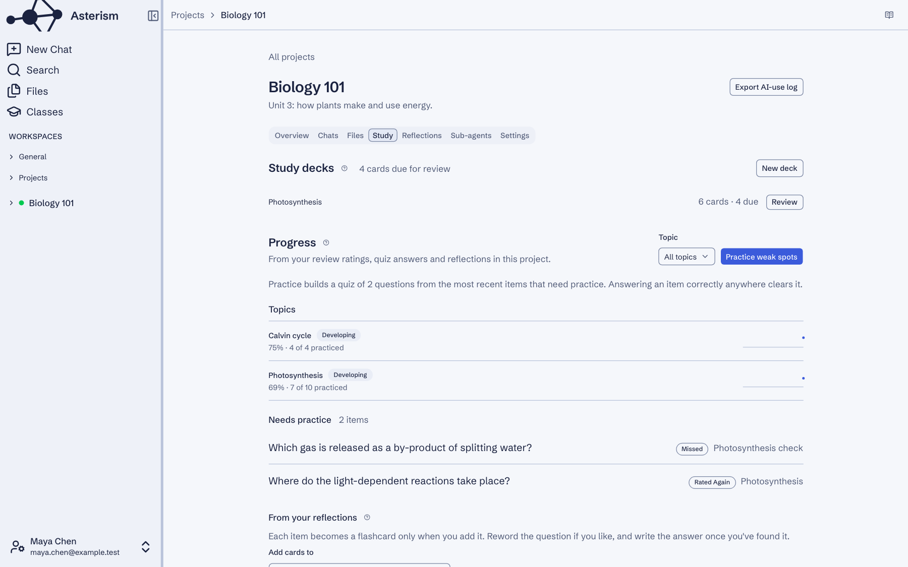
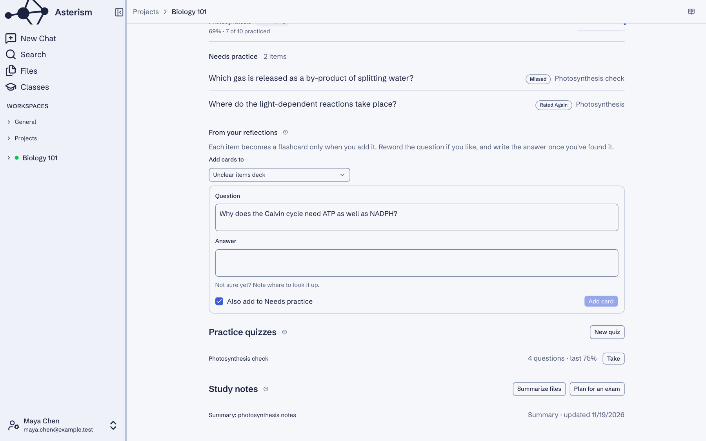

# Following your progress

The **Progress** panel in a project's Study tab shows how your studying is going:
which topics you know, what needs more practice, and what your reflections said
is still unclear. Only you can see it.

> **Who can do this:** everyone.

## Open the Progress panel

Open the project and select the **Study** tab. **Progress** is under the decks.

Progress comes only from your flashcard reviews, quiz answers and reflections in
this project, never from your chats.

## Topics

**Topics** come from the topics you add to decks and quizzes. Each topic shows:

- a level: **Not started**, **Needs work**, **Developing** or **Mastered**;
- a score, from your latest rating or answer on each card and question;
- how many of the topic's items you've practiced;
- a small line showing how it changed over the last eight weeks.

**Mastered** needs a score of at least 80%, with at least 80% of the topic's items
practiced.

To get topics, add them to your decks (**Edit deck**) and quizzes
(**Edit details**).

## Needs practice

**Needs practice** lists the cards you rated **Again** and the quiz questions you
missed or got partly right, newest first. Answer one correctly in a review or a
quiz, and it leaves the list.

To practice them, select **Practice weak spots**. Asterism builds a short quiz of
up to 10 of them. To practice one topic instead, choose it under **Topic** first:
the quiz then uses that topic's weakest and unpractised items.

## From your reflections

When a [reflection](../04-learning/reflections-and-the-ai-use-log.md) in this
project says something is still unclear, it's listed under
**From your reflections**, so you can turn it into a flashcard.

1. Under **Add cards to**, choose the deck for the new card.
2. Check the **Question**; reword it if you like.
3. Write the **Answer** once you've found it. Not sure yet? Note where to look it
   up.
4. Leave **Also add to Needs practice** ticked if you want to practice it until you
   remember it.
5. Select **Add card**.

## Related

- [Flashcards](flashcards.md)
- [Practice quizzes](practice-quizzes.md)
- [Reflections and the AI-use log](../04-learning/reflections-and-the-ai-use-log.md)
