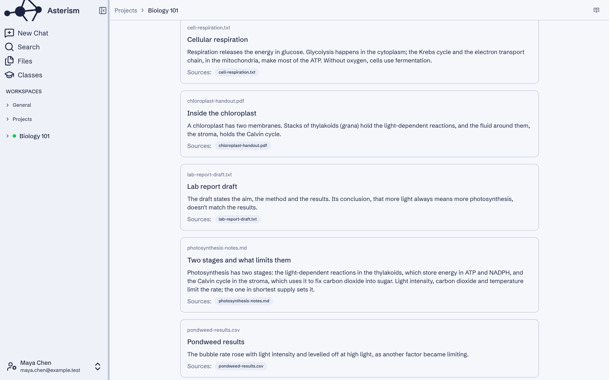
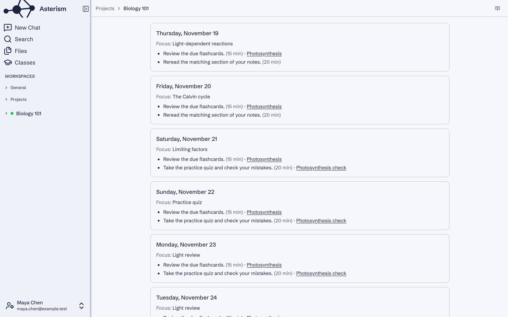

# Summaries and study plans

Asterism can write two kinds of **study notes** for a project: a **summary** of
your files, and a day-by-day **study plan** for an exam. Both are drafts until you
save them as a note. This page shows how.

> **Who can do this:** everyone. Study notes belong to a project.

## Summarize your files

1. Open the project's **Study** tab. Under **Study notes**, select
   **Summarize files**.
2. Choose the **Source files** and a **Depth**:
   - **Simple**: plain words and examples, for a first pass.
   - **Standard**: key ideas and definitions, for revision.
   - **Expert**: dense and precise, with formulas and edge cases.
3. Choose a **Model**, then select **Summarize**.

   Asterism writes a summary, with each section naming the file it came from.

   

4. Read it and check it against the files. To keep it, type a **Note title** if you
   like and select **Save as note**.

## Plan for an exam

1. In the Study tab, under **Study notes**, select **Plan for an exam**.
2. Set the **Start date**, the **Exam date** (up to 60 days away) and the
   **Minutes per day** you can study.
3. Choose a **Model**, then select **Plan study days**.

   Asterism plans each day up to the exam, with a focus and links to the
   project's decks and quizzes.

   

4. To keep the plan, select **Save as note**.

To make the plan, Asterism reads the names of the project's decks and quizzes and
your scores, not your files.

## Read, edit and delete notes

Saved notes are listed under **Study notes** in the Study tab. Select one to read
it.

- **Edit note** changes its **Title** and **Body**. Select **Save note** when you're
  done.
- **Delete note** removes it.

A note is your own copy: editing it doesn't change your files.

## Related

- [Flashcards](flashcards.md)
- [Practice quizzes](practice-quizzes.md)
