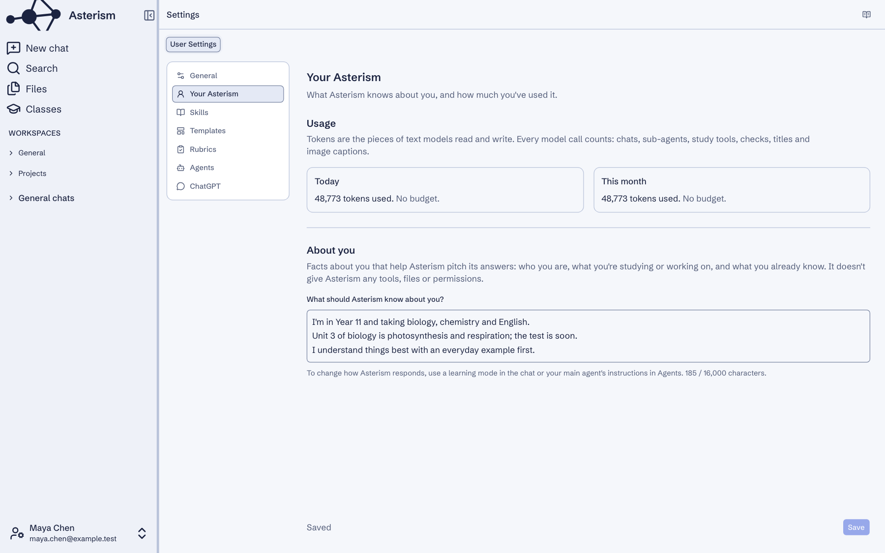

# About you and your usage

**Settings** › **Your Asterism** has two things: **About you**, a few facts about
you that Asterism keeps in mind in every chat, and **Usage**, how much you've used
Asterism.

> **Who can do this:** everyone.

## About you

### What to write

Write facts that help Asterism pitch its answers at you:

- who you are: your year, course or job;
- what you're studying or working on;
- what you already know, and what's new to you;
- anything that helps you learn, such as "English is my second language" or "I
  like an everyday example first".

For example:

> I'm in Year 11 and taking biology, chemistry and English. I understand things
> best with an everyday example first.

### What not to write

- **Instructions about how to answer**, such as "always answer in bullet points".
  About you is information, not instructions. To change how Asterism answers,
  choose a [learning mode](../04-learning/learning-modes.md) in the chat, or write
  instructions for your [main agent](agents.md).
- **Anything private you wouldn't want an AI to read**, such as passwords, your
  address or health details. Asterism sends About you to the model with every
  message.

### Change it

1. Select your name at the bottom of the sidebar, then **Settings**, then
   **Your Asterism**.
2. Type in **What should Asterism know about you?** (up to 16,000 characters).
3. Select **Save**.

New messages use the text you saved. Messages you've already sent keep the text
they were sent with, so changing it doesn't change earlier answers.
[Regenerating](../02-chatting/regenerating-and-branches.md) an answer uses your
latest text.

About you isn't a memory: Asterism doesn't add things to it by itself. It doesn't
give Asterism any extra tools or access to files either. Memories are kept
separately, under [Memory](#memory).

## Memory

**Memory**, below About you, lists what Asterism remembers about you when your
administrator has turned memory on. While memory is off for you, the section
appears only if you have memories saved, so you can still delete them. See
[What Asterism remembers](what-asterism-remembers.md).

## Usage

**Usage** shows how many **tokens** you've used **Today** and **This month**.
Tokens are the small pieces of text that models read and write; every chat,
sub-agent, study tool and caption uses some.

If your group has a **budget**, Usage also shows how much is left and when it
resets. When a budget is used up:

- new messages, regenerated answers and study tools wait until it resets, and the
  message says when that is;
- an answer that's already being written still finishes.

Days start at midnight and months on the 1st, in the time zone your administrator
chose. Only an administrator can change a budget.

## Related

- [What Asterism remembers](what-asterism-remembers.md)
- [Agents](agents.md)
- [Learning modes](../04-learning/learning-modes.md)
- [Glossary: About you](../glossary.md)
