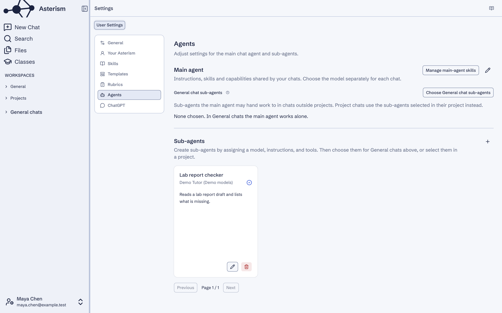
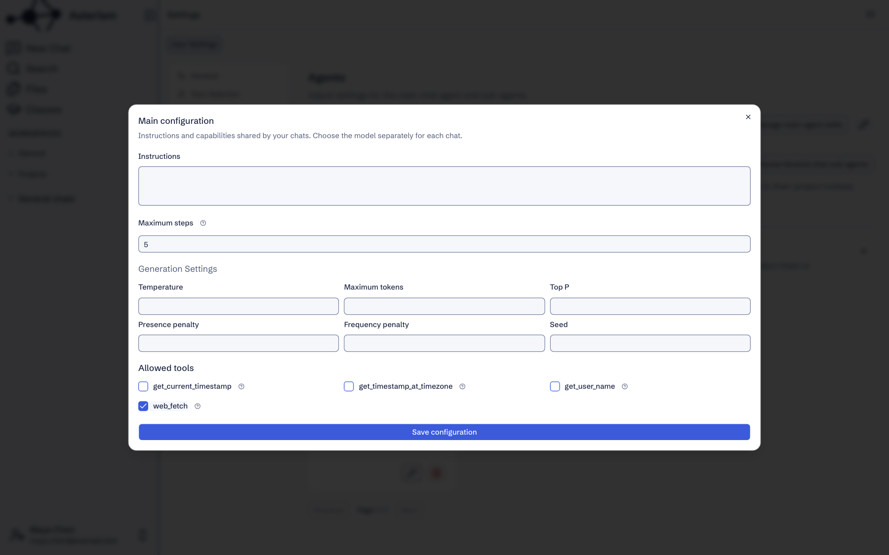
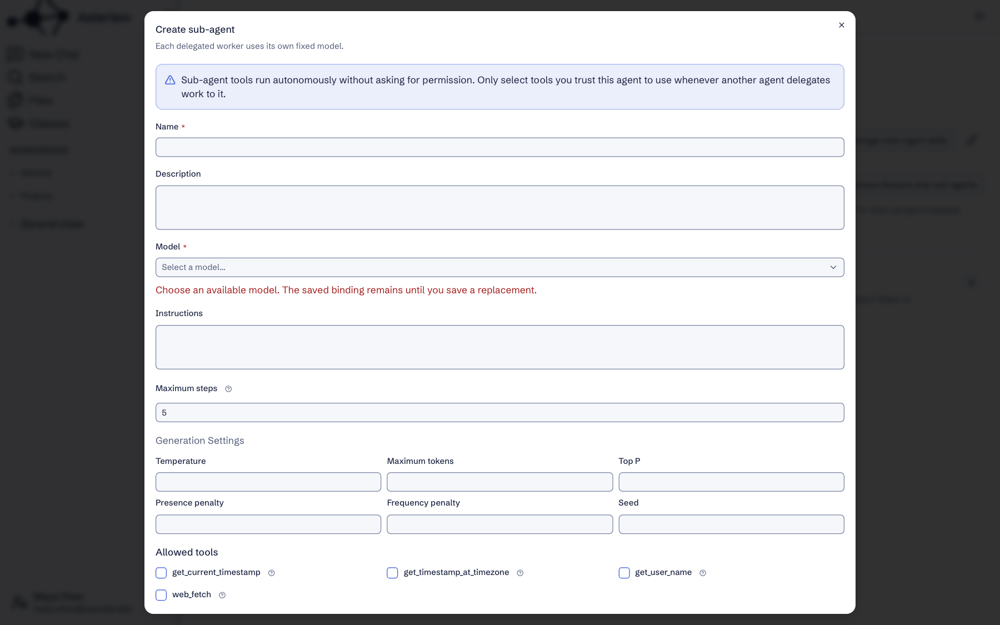
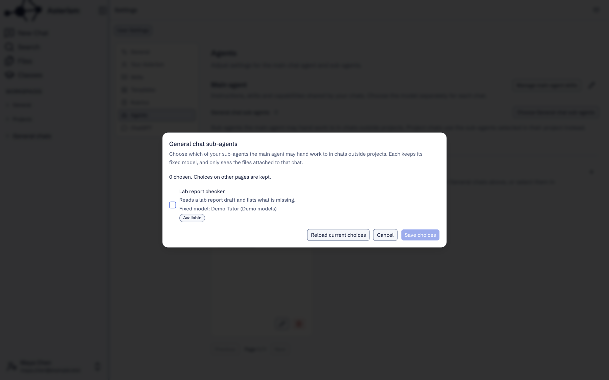

# Agents

Your **main agent** is the assistant that answers your chats. You can give it
standing instructions and choose the tools it may use. You can also create
**sub-agents**: helpers with their own instructions and their own model, which
your main agent can hand part of a task to. This page shows how, in
**Settings** › **Agents**.

> **Who can do this:** everyone. Sub-agents need your administrator to allow them
> and a model that can use tools.

## Your main agent

Every chat uses your main agent, with whichever model you choose in that chat.

### Give it instructions

1. In **Settings** › **Agents**, select the pencil button beside **Main agent**.

   

2. Change what you need:
   - **Instructions**: how you'd like it to answer in every chat, for example
     "Keep answers short and use British spelling."
   - **Maximum steps**: how many steps it may take for one answer, such as
     searching and then answering. The default is fine for most people.
   - **Generation Settings** such as **Temperature**: leave these empty unless you
     know what they do.
   - **Allowed tools**: tick the tools it may use. Tools that act outside Asterism,
     such as `web_fetch`, ask for your [approval](../02-chatting/approving-tool-requests.md)
     each time.
3. Select **Save configuration**.

Instructions shape how Asterism answers, but they can't give it tools or files you
haven't allowed.

### Choose its skills

Select **Manage main-agent skills** to choose which of your
[skills](skills.md) appear when you type `/` in a chat.

## Sub-agents

A sub-agent is a helper for one kind of job, such as a "Lab report checker" that
lists what a report is missing. It has its own instructions and a fixed model.
Your main agent decides when to hand it work, and you see what it did in the
chat.

### Create a sub-agent

1. In **Settings** › **Agents**, select the **+** button beside **Sub-agents**.

   

2. Fill in:
   - **Name** and **Description**. The main agent reads the description to decide
     when to use it, so say what it's for.
   - **Model**: the model it always uses. Choose one that can use tools if it needs
     them.
   - **Instructions**: how it should do its job.
   - **Allowed tools** and **Skills**, if it needs them.
3. Select **Save configuration**.

A sub-agent's tools run **without asking** for approval each time. Only allow
tools you're happy for it to use whenever it's asked to help.

To change a sub-agent, select the pencil button on its card; to delete it, select
the bin.

### Let your chats use it

A new sub-agent isn't used anywhere until you choose where:

- **In a project**: open the project's **Sub-agents** tab and select it. See
  [Projects](../03-files-and-projects/projects.md#choose-sub-agents-for-a-project).
- **In General chats**: choose it in your **General chat set**, below.

## The General chat set

The **General chat sub-agents** are the ones your main agent may use in chats
outside projects. You start with none.

1. In **Settings** › **Agents**, select **Choose General chat sub-agents**.

   

2. Tick the sub-agents to use. Each shows its fixed model and whether it's
   **Available**.
3. Select **Save choices**.

In a General chat, a sub-agent only sees the files attached to that chat.

## If something goes wrong

- **A sub-agent says its model is unavailable.** The administrator turned that
  model off. Edit the sub-agent and choose another model.
- **The main agent never uses a sub-agent.** Check that it's chosen for this
  project or for General chats, and that the chat's model can use tools (the
  wrench icon in the model list).

## Related

- [Skills](skills.md)
- [Projects](../03-files-and-projects/projects.md)
- [Approving or denying a tool request](../02-chatting/approving-tool-requests.md)
