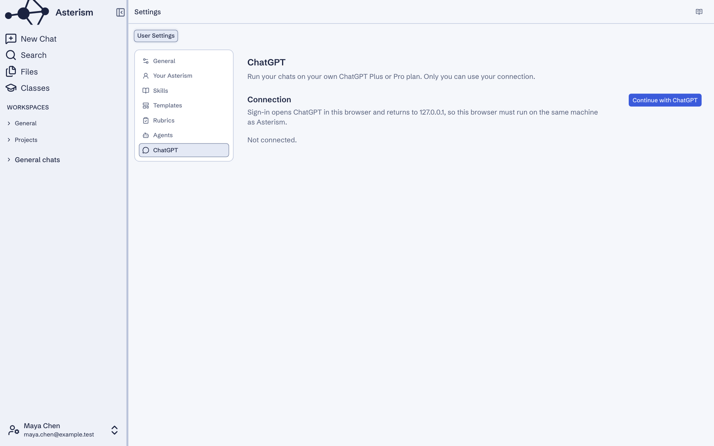

# Connecting a ChatGPT plan

If you pay for ChatGPT Plus or Pro, you can connect your plan to Asterism and run
your chats on its models. Only you can use your connection.

> **Who can do this:** everyone, when your administrator allows ChatGPT plan
> connections, and only on the computer that runs Asterism. If there's no
> **ChatGPT** in Settings, your administrator hasn't allowed them.

## Before you start

- A ChatGPT Plus or Pro plan.
- **Your browser must be on the same computer as Asterism.** Signing in to ChatGPT
  sends you back to that computer's own address, so this only works when
  Asterism is installed on the computer you're using. On a school or shared
  Asterism, it won't work; use the models your administrator provides.

## Connect

1. Select your name at the bottom of the sidebar, then **Settings**, then
   **ChatGPT**.

   

2. Select **Continue with ChatGPT**.
3. Sign in to ChatGPT and allow Asterism to use your plan.

You come back to this page, which now says **Your ChatGPT plan is connected.**

Your plan's models now appear in your own model lists: in chats and when you
choose a sub-agent's model. Nobody else sees them. To get any new models your plan
has added, select **Refresh models**.

## Disconnect

Select **Disconnect** on the same page, then confirm. Chats and sub-agents that
used your plan's models keep them, but they show as unavailable until you choose
another model.

## If something goes wrong

- **"Your administrator has turned off ChatGPT plan connections."** Ask your
  administrator.
- **"ChatGPT sign-in was cancelled."** or **"That sign-in expired or was already
  used."** Select **Continue with ChatGPT** and try again.
- **"You signed in, but ChatGPT did not allow plan usage."** Select
  **Continue with ChatGPT** and allow plan usage when ChatGPT asks.
- **"Usage limit reached."** Your ChatGPT plan's own limit is used up. Wait for it
  to reset, or use another model.

## Related

- [Choosing and comparing models](../02-chatting/choosing-and-comparing-models.md)
- [Agents](agents.md)
