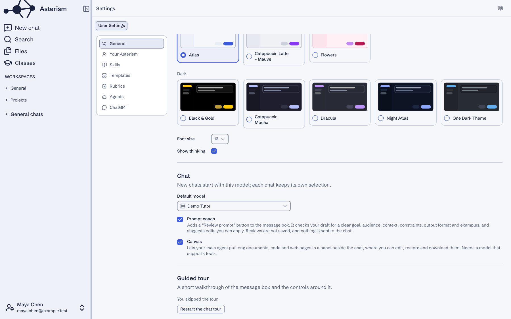

# General settings

**Settings** › **General** is where you choose how Asterism looks and how new
chats start. This page goes through each setting.

> **Who can do this:** everyone.

## Open your settings

1. Select your name at the bottom of the sidebar.
2. Select **Settings**.

**General** opens first. The list on the left has the other parts of your
settings: **Your Asterism**, **Skills**, **Templates**, **Rubrics**, **Agents**
and **ChatGPT**.

Changes on this page are saved as soon as you make them.

## Account

**Group** shows the [group](../glossary.md) you're in, such as **Student**. Your
group decides which models and tools you may use. Only an administrator can
change it.

The **Your data** and **Sign-in and account** parts are explained in
[Your data and your account](your-data-and-account.md).

## Appearance

- **Theme**: choose one of the **Light** or **Dark** themes. Each card shows a
  small preview.
- **Font size**: make the text bigger or smaller.
- **Show thinking**: some models write out their reasoning before they answer.
  Untick this to hide it.

## Chat

- **Default model**: the model new chats start with. Each chat keeps its own
  choice, so changing this doesn't change your old chats.
- **Prompt coach**: adds **Review prompt** to the **+** menu, so Asterism can
  suggest how to make a draft clearer. See
  [the prompt coach](../02-chatting/skills-templates-and-the-prompt-coach.md#ask-the-prompt-coach-to-review-a-draft).
- **Canvas**: lets Asterism put long documents, code and web pages in a panel
  beside the chat. See [Working in the canvas](../02-chatting/canvas.md). If the
  box can't be ticked, your administrator has turned the canvas off.

## Guided tour

Select **Restart the chat tour** to take the short tour of the message box again.
See [the chat tour](../01-getting-started/getting-help.md#the-chat-tour).

## Related

- [About you and your usage](about-you-and-usage.md)
- [Your data and your account](your-data-and-account.md)
